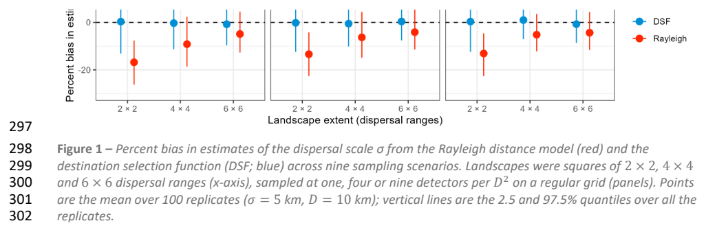

# 只看最终匹配距离，会把候选集的疏密错当成偏好吗？

<!-- 全库方法复筛开始 -->
> **方法储备 · 面向决策的履约建模**。保留“Destination Selection Function: a competing hazards model for redistribution data”这一研究问题或机制；是否用于当前业务另行验证。
> 原有阅读范围与证据等级不变；储备不等于效果已验证。
> [[研究前沿/论文库复筛与阅读路线|全库阅读路线]] · [[研究前沿/面向决策的履约建模/存量论文分层索引|本方向完整分层]]
<!-- 全库方法复筛结束 -->

**能改哪一环？** 改商家召回距离的诊断模型，判断远单少是因为司机回避，还是因为可选司机本来就少。论文图 1 在已知候选密度的模拟里复原距离尺度，适合借用其按候选集归一化的分母。

**第一步怎么验证？** 从能重建完整召回集的同一批请求出发，对照只拟合成交距离与按当时可达司机集合估计选择概率。在留出时段按供给密度比较实际选中距离分布与预测分布。若差异集中于候选记录缺失批次，先修日志；仅凭已成交样本不调整召回半径。（本地验证未运行。）

图 1 的九种覆盖范围与候选密度组合中，仅对已选距离拟合的 Rayleigh 模型均低估距离尺度；按当次可观察目的地集合归一化的估计恢复了设定值。

## 论文与阅读范围

Destination Selection Function: a competing hazards model for redistribution data。Chris Sutherland、Seungyeon Lee、Albert Bonet Bigata、Deon Roos、Xavier Lambin、Angela Trowsdale、William Amos。首次公开 2026-11-12，所读版本 v1（2026-11-12）。精读目的地选择模型、假设、模拟 1–2、图 1–4 与表 1，仅提取条件选择机制。 [一手来源](https://doi.org/10.32942/x23d7b) · [paper.pdf](./assets/source/paper.pdf)

## 怎样计算

对一次已记录的选择，已知其起点、终点和所有可观察备选项。对 $j$ 构造强度 $\lambda_{ij}=\theta_j\exp(-d_{ij}^2/(2\sigma_i^2))$，在该次备选集合内归一化为 $\lambda_{ij}/\sum_{k\in A_i}\lambda_{ik}$。可按决策时可见信息建模尺度或目的地权重，若观察努力不均衡，需显式修正。共同的强度截距在归一化中抵消。

## 与哪些方法比较

模拟 1 固定真实尺度为 5 km，每种范围/密度设置重复 100 次。仅拟合成交距离的负偏更受观察区域范围影响。模拟 2 的表 1 在样本 50/500、目的地效应真值 0.50 时，模型估计均值为 0.53/0.50，95% 重复分位数 0.28–0.85 / 0.42–0.60。后者评估参数恢复。

图 1，九种备选集合几何下的相对偏差。 [原文第 11 页](./assets/source/paper.pdf#page=11)

## 适用条件与迁移

迁移到展示与接受日志，需保存决策时可见且有资格的完整集合。该目标条件于已有一次被观察的选择，估计的是选谁；总接受率、放弃与换策略后的因果变化另需建模。原文的情景效应也限制向其他市场外推。作者仓库 R/dsf.R、R/dsf_frame.R、R/simulate_dsf.R 已核实。 [作者代码](https://github.com/chrissuthy/dsf)

[[研究前沿/动态等待与匹配决策/02-可复用方法卡/DestinationSet-用当时可选的对象作条件选择的分母|用当时可选的对象作条件选择的分母]] · [[研究前沿/动态等待与匹配决策/03-实验假设与结果/DestinationSet-检验只用成交距离是否混入候选覆盖差异|检验只用成交距离是否混入候选覆盖差异（未运行）]]
