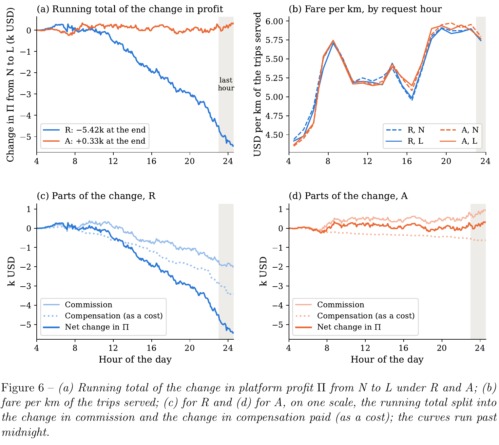

# When Disclosure Is Compulsory: Evaluating Ride-Hailing Rebalancing Policies with Self-Interested LLM Driver Agents

[官方论文](https://arxiv.org/abs/2610.41132) · [本地PDF](./assets/source/paper.pdf) · [HTML快照](./assets/source/paper.html)

版本记录：[Submitted on 30 Oct 2026 ( v1 ), last revised 4 Nov 2026 (this version, v2)]；本次核验与精读：2026-11-06。本篇为滚动窗口内首次入库；检索日不等于首次发表日。

阅读范围：§3.1.2 重平衡优化、§3.2 代理与披露，§4 城市设置与主/混合结果、§5 局限；附录完整 prompt 和价格参数保存在原文，未逐条复现。未逐行复证全部数学证明，未声称逐页翻译。[[研究前沿/动态等待与匹配决策/01-论文原文与精读/DisclosureAgents/阅读覆盖|原文章节与公式索引]]；HTML为原始快照，外部样式和图片可能需要联网，PDF可离线阅读。

代码：本次核验的论文原文与元数据未提供可确认的作者实现入口；代码状态未知，不能据此断言不存在。未运行代码。 [[研究前沿/动态等待与匹配决策/01-论文原文与精读/DisclosureAgents/代码核验|核验记录]]

## 研究问题与可复用价值

若参与者理解平台规则并为自身收益行动，同一调度策略是否仍有效？论文把规则披露作为实验因子，用读取规则的 LLM 代理测试重平衡策略的行为反馈。它提供策略压力测试范式，不能代替真实司机行为模型，也不把论文对法规的背景描述作为法律结论。

## 方法与对照设计

平台策略两类：R 按刚损失的请求量、最小旅行时间发送重平衡；A 用需求预测与在途供给做多期规划，最大化预期佣金减补偿，只执行当前期。

$$\max_{x,y,s}\sum_{k,o,d}(\theta\overline{\mathrm{fare}}_{od}y_{odk}-\bar b_{od}x_{odk})$$

约束包括需求上限、可用司机及带旅行延迟的供给流守恒。A 是滚动优化，不是本文新发明的优化器。

代理每次获得同样的时间、自身状态、市场历史、供需及动作选项；N/L 两组仅改变规则段落。代理可拒单、拒绝重平衡、等待或自发移动，目标为自身净收益。没有训练其模仿人类，除 prompt 外没有记忆。另设完全服从基线；用不同 LLM 的小模型、全代理及混合群体检查稳健性。

## 实验与重要限定

**模拟，§4/Table 9**：曼哈顿 29 区、500 司机，2016-03-23 的 52,461 请求，前几日训练需求预测。Table 8 是 5 次服从基线均值；关键 Table 9 是 repeat 0 的成对结果，不能把它说成 5 次显著均值提升。

|规则披露带来的变化 L−N|R|A|
|---|---:|---:|
|接受重平衡比例|约 +52 个百分点|约 +54 个百分点|
|平台日利润|−5.42 千美元|+0.33 千美元|
|司机日均净收入|−2.8 美元|+4.7 美元|
|服务率|约 −0.2 个百分点|约 +0.3 个百分点|

R 原来部分计划由拒绝补偿后自发移动的司机免费完成；披露后付费接受增多，但晚高峰后响应过去损失的调度未带来等量佣金。A 将补偿与未来收益联动，支出变化较小。R 披露后的结果仍好于完全服从基线，不能概括为策略完全失效。

**混合群体，Table 10**：100/250 代理加其余服从者，R 的代理收益接近挤占其他司机收入；A 更多来自新增服务。但这些均在相同模拟机制中，无人类实证校准。

## 归因与迁移

采用相同信息和种子、仅切换规则段落，能分析这个代理模拟器内的信息反馈；无法识别真实人类接受率或利润因果效果。乘客接受所有价格、一个代表性测试日、LLM/prompt 敏感性及市场机制简化都限制外推。论文使用的 LLM 产品名称与配置按作者记录，本次未另行验证其供应商能力。

迁移推断：把“参与者知道策略后的响应”加入等待/补偿/匹配设计评估，比较反应式与预期收益式策略；将 LLM 当作发现失效案例的压力测试器，并用真实数据或受控实验验证发现，不能直接把其输出当履约标签。

## 原文关键图表

原文 Figure 6，PDF 第 23 页；原始裁图，机制和证据解释见上文。裁图坐标与源文件校验值见 assets/source/figure-provenance.json。

## 方法卡

- [[研究前沿/动态等待与匹配决策/02-可复用方法卡/DisclosureAgents-disclosure-stress-test|规则披露 × 自利参与者的调度策略压力测试]]

## 待验证想法

[[研究前沿/动态等待与匹配决策/03-实验假设与结果/2026-11-06-规则理解后的策略稳健性|规则理解后的策略稳健性（未运行）]]

## 2026-11-09 版本复核

全代理/混合车队主表 7–10 数值与 v2 一致，新增 §5.4 图 8–10，交叉比较长等待、分区自主移动收益与市场增量；100 增至 500 个代理时，A 每次自主移动对应的增量服务单从 1.28–1.40 降至 0.82–0.85，来自同一仿真体系。 [[研究前沿/动态等待与匹配决策/01-论文原文与精读/DisclosureAgents/版本更新-2026-11-09|v3 对照及新版原文]]
