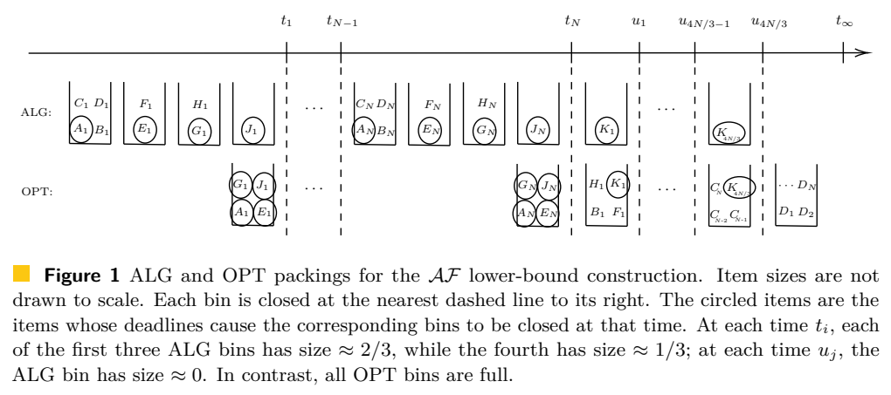

# Online Bin Packing with Dispatch Deadlines

作者 Pei-Lin Chiang、Wing-Kai Hon、Kazuo Iwama、Li-Tzu Yang。首次发布 2026-11-05，此次核验的版本为 v1（2026-11-05），阅读于 2026-11-10。11 月 9 日 cs.DS 公告，ISAAC 2026 正式议程已列出同题报告。核对 16 页 v1 的 §2 设定、§3 反例、§4 定理 4 与规范化、§5 下界；未逐项复证附录。

[作者原文](https://arxiv.org/abs/2611.08792v1) · [离线 PDF](./assets/source/paper.pdf)

## 订单何时绑定车辆

设第 $i$ 件货在 $a_i$ 到达，需求 $s_i\in(0,1]$，最迟在 $d_i$ 发运。到达时三项才揭晓，货件立即且不可撤销地绑定一个仍开放的箱。一箱 $B$ 的可行性等价于 $\sum_{i\in B}s_i\le1$ 且 $\max_{i\in B}a_i\le\min_{i\in B}d_i$。箱数无限，各箱等容量、每发一箱付同样成本。同刻先处理到达，再关闭本刻到期的箱。离线解知道完整序列；衡量的是 $\sup_I C_{\rm alg}(I)/C_{\rm opt}(I)$。

## 先到先装哪一个箱

§2 的 First-Fit 按开箱时间从早到晚找到第一个容量足够的开放箱；无可用箱才开新箱。加入一件紧急货后，该箱的最晚发运时间改为其成员最小截止期，因此很小的货也可能导致半空箱提前离场。选箱次序本身不使用截止期，调度器仍须追踪每个箱的发运时刻。在单位容量及无提前等待成本时，可以等到箱中第一项到期才发运。

§3 的对手把多种接近 1/3 的货分多波到达。短窗小件迫使 Any-Fit 一次关掉数个未满箱，随后到达的货不能回填。图 1 中在线方案用 $16N/3$ 箱，所示离线方案最多用 $7N/3+1$ 箱，比值趋近 $16/7$。这构成 Any-Fit 的下界。§4 先根据离线关箱时刻对 First-Fit 箱取快照，构造规范化输入，保留 First-Fit 箱数且不增加离线最优箱数，再分析规范化实例，得到相同上界。算法 1 用已知离线解作证明，在线调度器只执行 §2 规则。

## 可校验的界和迁移条件

| 条件 | 原文结果 |
|---|---|
| 只保留一个开放箱的 Next-Fit，或挑最空可用箱的 Worst-Fit | 定理 1、3 各给出紧比 3 |
| 任一遇到可装箱就不开新箱的 Any-Fit | 定理 2 给出竞争比介于 $16/7$ 和 3 |
| First-Fit | 定理 4 给出紧比 $16/7\approx2.28571$ |
| 任意确定性在线策略 | 定理 5 给出下界 $11/5=2.2$，最优确定性比仍有间隙 |

证据为竞争分析及显式构造，论文未报告货运平台实测。可作为到单即预分配、已绑定资源仍允许后续装载时的基线。若可在截止期前保留未绑定订单，应使用另一种决策模型，见 [[研究前沿/动态等待与匹配决策/01-论文原文与精读/TimelyThrifty/精读|允许待定订单的截止期合批]]。乘客等待惩罚、有限车辆、异构容量、路线绕行都改变目标或可行域，需重新评估。

## 原文证据

图 1，作者的 Any-Fit 下界实例，虚线表示发运，圈出导致发运的时限紧迫货件，PDF 第 6 页。

## 代码与关联

核查 arXiv 摘要页、PDF/HTML 正文与公开题名检索，尚未核到作者发布的实现仓库。算法入口见文中伪代码。

- [[研究前沿/动态等待与匹配决策/02-可复用方法卡/DispatchDeadlineFF-commit-first-fit|到达绑定、最早期限发运的 First-Fit 基线]]
- [[研究前沿/动态等待与匹配决策/03-实验假设与结果/DispatchDeadlineFF-deadline-mix|立即绑定下，短窗货件会增加多少半空发运]]
