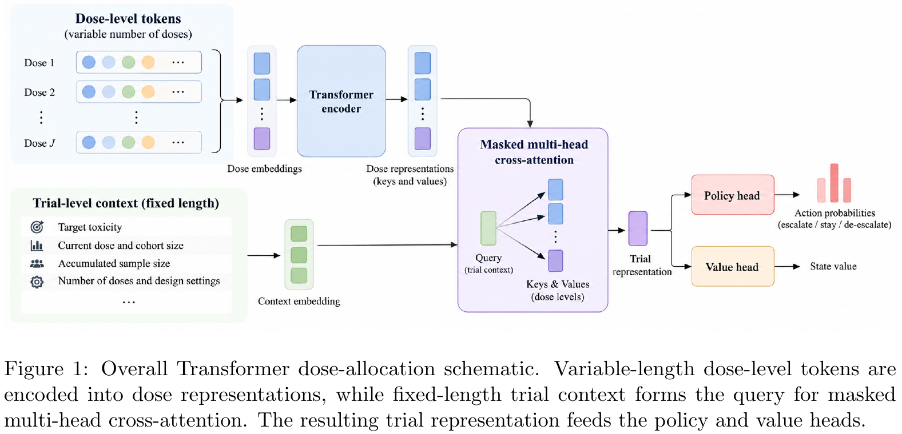

# Transformer-Based Reinforcement Learning for Phase I Dose Allocation

[官方论文](https://arxiv.org/abs/2611.00395) · [本地PDF](./assets/source/paper.pdf) · [HTML快照](./assets/source/paper.html)

版本记录：[Submitted on 30 Oct 2026]；本次核验与精读：2026-11-06。本篇为滚动窗口内首次入库；检索日不等于首次发表日。

阅读范围：§2 全部方法与训练协议，§3 主结果/惩罚/种子/选择误差，§4.3 限制。未逐行复证全部数学证明，未声称逐页翻译。[[研究前沿/动态等待与匹配决策/01-论文原文与精读/DoseAllocation/阅读覆盖|原文章节与公式索引]]；HTML为原始快照，外部样式和图片可能需要联网，PDF可离线阅读。

代码：本次核验的论文原文与元数据未提供可确认的作者实现入口；代码状态未知，不能据此断言不存在。未运行代码。 [[研究前沿/动态等待与匹配决策/01-论文原文与精读/DoseAllocation/代码核验|核验记录]]

## 问题与创新单元

序贯分配的候选动作数可以变化，如何共享策略网络，同时把在线探索与最终统计选择分开？本文在模拟剂量分配中将每个有序剂量编码成 token，再用试验状态作为 query 汇聚。可迁移的是表示与评估分解，不是某个临床用药建议。

每个剂量 token 为 $z_{j,t}=(\bar d_j,n_{j,t},x_{j,t},\mathbb I[j=j_t])$，依次表示归一化位置、已观察人数、DLT 数及当前剂量。query 包含目标风险、最大/当前样本量、当前位置、剂量数和 cohort 大小。共享 Transformer 后

$$h_t=\mathrm{MHA}(q_t,H_t,H_t;M_t),$$

padding mask 支持可变长度，4 头、64 维表示进入 PPO 策略和价值头。策略选择降一级、保持、升一级；最高档屏蔽升级，最低档降级表示安全提前停止。只在 cohort 结果返回后决策，尚未建模延迟反馈。

## 分配与终局选择要分开评价

达到预算后，用已尝试剂量的加权 isotonic regression：

$$\widetilde p=\arg\min_{q_1\le\cdots\le q_J}\sum_{j\in\mathcal O}n_j(q_j-\widehat p_j)^2.$$

仅允许 $\widetilde p_j\le\phi+0.05$，选择距目标最近的已尝试剂量；块内 tie-break 随拟合值在目标上/下改变。这个预设终局选择器不是策略网络输出。原文约 0.10 的 PCS 变化主要来自 tie-break 修订，不能归给 attention。

训练 reward 为终局正确/错误的 $+1/-1$ 减去 $\lambda_{DLT}$ 乘实际 DLT 数。优化标量 reward 与正确选择率、风险暴露、误停等指标不同。

## 实验、负面证据与局限

**同分布模拟，Tables 1–2**：$J=4,6,8,10$、5,000 独立测试情景、5 个 RL 种子。在共享终局选择器下，惩罚为 0.05 的 RL PCS 0.561–0.568，低于 BOIN/i3+3/mTPI-2/CRM 的 0.588–0.596；平均 DLT 6.51–6.97，低于 8.15–8.42。去惩罚 PCS 升到 0.595–0.605，但平均 DLT 升到 9.06–9.77。主要是目标权衡，不是全指标胜出。

**消融/诊断**：固定选择器后的奖励惩罚对照支持分配行为变化；没有足够证据将收益独立归因于 cross-attention 优于其他汇聚器。剂量数增大时精度仍下降；变长可执行不等于已证明未见长度泛化。正文 §3.6 明确还未报告“曾尝试真目标的概率”和“尝试后条件正确率”，所以误差归因尚不完整。

**优化敏感性，Table 3/§3.4**：种子变化明显；batch/entropy 调节无统一胜者。传统方法只报告单次匹配模拟、RL 多种子，比较不完全对称。没有真实临床验证，没有独立超风险保护规则，没有 pending outcomes。

迁移推断：候选等待时长、预算档位或分配强度可做有序 tokens，当前全局资源状态作 query；在线探索和最终方案选择分别报告结果。是否可改变动作步长、终止规则与风险约束需重新设计。

## 原文关键图表

原文 Figure 1，PDF 第 4 页；原始裁图，机制和证据解释见上文。裁图坐标与源文件校验值见 assets/source/figure-provenance.json。

## 方法卡

- [[研究前沿/动态等待与匹配决策/02-可复用方法卡/DoseAllocation-variable-action-query|状态 query 汇聚变长有序动作，并分离分配与终局选择]]
