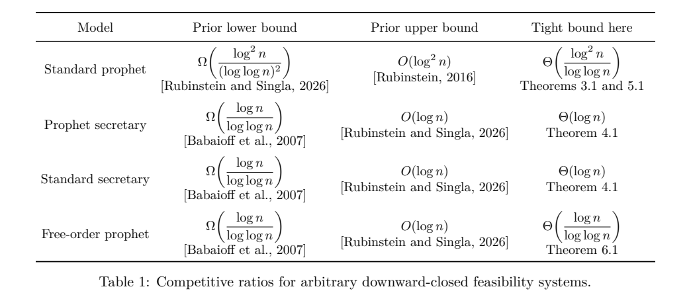

# Tight Bounds for Downward-Closed Prophet and Secretary Problems

<!-- 全库方法复筛开始 -->
> **方法储备 · 业务决策与理论储备**。保留“向下封闭可行域的先知界”这一研究问题或机制；是否用于当前业务另行验证。
> 原有阅读范围与证据等级不变；储备不等于效果已验证。
> 已恢复此前因业务距离被移出的原笔记；旧取舍原因仅作历史记录。
> [[研究前沿/论文库复筛与阅读路线|全库阅读路线]] · [[研究前沿/业务决策与理论储备/存量论文分层索引|本方向完整分层]]
<!-- 全库方法复筛结束 -->

对于任意向下封闭约束，能自选查看顺序与仅被动接收随机顺序，在最坏情形有渐近差距。知道各项价值分布也无法消除随机顺序下的全部损失。

Hanrui Zhang。首次提交 2026-11-12，本次核对首版 v1。以上日期为 UTC；本批未独立核实正式发表日期。核读 §1–2 的模型和表 1、§4 分层下界、§5 残余集合递推及 §6 激活指数分布排序。未重演编码构造中各项概率估计。

[arXiv 版本页](https://arxiv.org/abs/2611.16880v1) · [本地 PDF](./assets/source/paper.pdf) · [本地 HTML](./assets/source/paper.html)

## 三个顺序设定共享什么

每件物品有非负价值。加入一件后必须仍属给定集合族，任何可行集的任一子集也可行。接纳不可撤回，目标是已接纳价值之和。先知模型知道相互独立的价值分布，离线先知更能看到每项实现。随机序列秘书模型甚至可以不知道先验。

## 顺序如何改变可选余地

保留物品 i 后，可行族收缩为含 i 的集合去掉 i；跳过则删除 i。离线可在观察整组实现后取两支的最大值，在线只能用当前价值和剩余项的期望续值。§4 用嵌套前缀约束造成不可逆的早期承诺。§6 先研究伯努利激活的指数价值，若按指数均值从大到小看，最优在线策略最多损失 2 倍。一般分布先抽辅助尺度排顺序，再在原分布上作在线决定。

## 怎样读表 1

相对原离线基准的损失倍数，任意向下封闭族的最坏结果是对抗序先知 Θ(log²n/log log n)、随机序先知秘书与无先验秘书 Θ(log n)、可择序先知 Θ(log n/log log n)。其中随机序下界及可择序上界是本稿新证，另一方向界引用前人；可择序保证允许预先排序并使用已知分布，不能转作自然到单的 SLA。

表 1，不同到达顺序下损失倍数，原 PDF 第 4 页。

## 实现与验证入口

未核到公开实现，可按 §2 的纳入/剔除集合和 §6 的降尺度顺序实现小实例动态规划。

- [[研究前沿/动态等待与匹配决策/02-可复用方法卡/DownwardProphet-order|用先验尺度决定优先观察哪些高价值机会]]
- [[研究前沿/动态等待与匹配决策/03-实验假设与结果/DownwardProphet-order|随机到达与可挑顺序在同一个约束族中差多少]]
