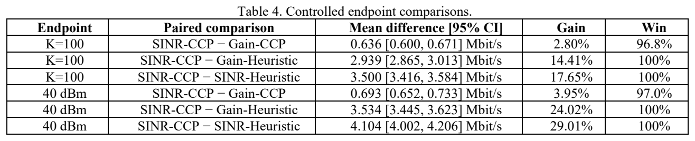

# 换配对规则带来的收益，怎样与后续资源分配的收益分开？

<!-- 全库方法复筛开始 -->
> **方法储备 · 业务决策与理论储备**。保留“物理可行性约束下的匹配与凸凹迭代”这一研究问题或机制；是否用于当前业务另行验证。
> 原有阅读范围与证据等级不变；储备不等于效果已验证。
> 已恢复此前因业务距离被移出的原笔记；旧取舍原因仅作历史记录。
> [[研究前沿/论文库复筛与阅读路线|全库阅读路线]] · [[研究前沿/业务决策与理论储备/存量论文分层索引|本方向完整分层]]
<!-- 全库方法复筛结束 -->

为两种配对规则固定同一个后续优化器，并在每个模拟实例上做配对比较。

## 文献与版本

Feasibility-Screened SINR Matching and Actual-Power CCP for Sum-Rate Maximization in Downlink PD-NOMA Networks。Murad Halabouni 等。Research Square 预印本 v1 于 11-13 发布。 检索及精读于 2026-11-15。精读算法 1–2、表 2–5、图 2–9，核对指标单位及随机实例的比较方式。 [一手来源](https://doi.org/10.21203/rs.3.rs-11354501/v1) · [关联原始资料](https://assets-eu.researchsquare.com/files/rs-11354501/v1/8f2616db1f5ba5a5688311d7.rar)

本地资料　[paper-v1.pdf](./assets/source/paper-v1.pdf) · [simulation-results.rar](./assets/source/simulation-results.rar)

## 方法与关键计算

算法 1 先按最低服务需求检查每一对用户能否共用一个子信道，再按含干扰的信号质量或单独增益构造偏好。若暂定配对共同超出功率预算，禁用效率最低的组合并重试；对已可行方案尝试增加、替换、搬移或交换。算法 2 固定配对，只优化功率，每步检查真实目标和约束，必要时阻尼或拒绝更新。

## 效果证据与对照

表 4 在每个设置共用 500 个随机信道实例。100 名候选时，固定后续优化器，仅更换配对阶段，吞吐量提升 2.80%（均差 0.636 Mbit/s，95% 区间 0.600–0.671）。配对与分配器同时替换，对较弱基线的提升为 14.41%。

同一设置固定新配对规则，只把启发式功率改成 CCP，改善 17.65%。三项比较分母不同，不能相加。图 4 中功率紧张时单用户方案更强；图 9 中 100 名候选时新配对全流程耗时中位数为 2.006 秒，增益配对加同一优化器为 1.788 秒。

表 4，固定一侧和整套替换的端点比较。 [原文第 10 页](./assets/source/paper-v1.pdf#page=10)

## 能迁移到什么问题

迁移到订单与服务资源组合时，可先建可行边、识别共享资源冲突，再比较有无局部修复。无线吞吐的结果适用于给定信道模型和约束；线上等待、取消与公平目标均需另验。

算法 1、2 给出配对与功率求解流程。出版方补充包中的 sim_results/user_sweep_paired_comparisons.csv 可复核 100 用户时的配对均差及区间，同包还含 power_sweep_paired_comparisons.csv、运行清单和自检报告；包内未见求解源码。

[[研究前沿/动态等待与匹配决策/02-可复用方法卡/FeasiblePairCCP-先检可行性，再固定下游分配器比较配对规则|先检可行性，再固定下游分配器比较配对规则]] · [[研究前沿/动态等待与匹配决策/03-实验假设与结果/FeasiblePairCCP-固定分配器比较配对与修复的边际价值|固定分配器比较配对与修复的边际价值（未运行）]]
