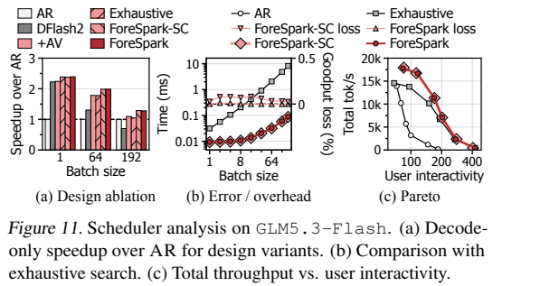

# ForeSpark: Joint Draft and Verification Budget Scheduling for Parallel Speculative Decoding

<!-- 全库方法复筛开始 -->
> **方法储备 · 模型自进化**。保留“草稿验证与自适应推理计算”这一研究问题或机制；是否用于当前业务另行验证。
> 原有阅读范围与证据等级不变；储备不等于效果已验证。
> 已恢复此前因业务距离被移出的原笔记；旧取舍原因仅作历史记录。
> [[研究前沿/论文库复筛与阅读路线|全库阅读路线]] · [[研究前沿/模型自进化/存量论文分层索引|本方向完整分层]]
<!-- 全库方法复筛结束 -->

在一批并发请求间分配两个顺序预算时，先按各请求的候选长度预测被接受的收益，再联合选择草拟量和验证量。ShareGPT 端到端测试中，以 90% 请求同时满足两个延迟条件为准，相对各自最强基线可支持 1.13–1.20 倍请求率。

arXiv v1 预印本。作者 Jaeyong Song、Daniel Wang、Pratyush Patel、Jonny Kong、Preyas Shah、Shobhit Kanaujia。首次提交 2026-11-10，核验于 2026-11-12。11 月 11 日公告。核读 §3–7、式 (2)–(4)、图 8–12，以及附录 A–C 配置口径。扩展草拟器结果仅覆盖 §6.7 摘要，未复现 vLLM 服务。

[一手发布页](https://arxiv.org/abs/2611.13442v1) · [离线 PDF](./assets/source/paper.pdf) · [离线 HTML](./assets/source/paper.html)

## 为什么只调第二阶段会浪费预算

并行草拟器一次产生整段候选，必须在看到这些候选的接受概率前决定段长。只在验证阶段截短候选的 DSpark，已经为整段花了算力。不同长度的草稿前缀在非因果注意力下也可能不同，上一轮实际接受长度还会受到验证截断。

## 先预测每种长度的有效产出，再按批次延迟报价

刚结束一次验证后，取下一请求的锚点表示与 token 嵌入，低秩网络输出每个候选草拟长度 $d$、位置 $j$ 单独的条件接受概率。前缀存活概率 $S_{i,d,j}=\prod_{t\le j}\sigma(z^{(d)}_{i,t})$。若只验证前 $b$ 个，期望接受量为其前 $b$ 项之和。预估器用各长度的草拟和验证所得软接受标签训练，再独立标定，不能仅复制上一轮的已接受数量。

对每种长度先求全验的预计产出 $R_i(d)$，再取上凹包 $F_i(d)$，按边际 $g_{i,d}=F_i(d)-F_i(d-1)$ 全批降序。每个请求内边际递减，选出的条目自然对应前缀。联合选各请求草拟长度 $\mathbf D$ 和总验证量 $B$，约束 $B\le\sum_i d_i$。原文式 (4) 用预计接受总量除以一步草拟与验证时间，后者由对应硬件预先测量，按 CUDA 图的大小档位检查可行方案。真正生成草稿后，再依据更精确的后验置信度分配 $B$。这种规则允许先多草拟少量候选以保留选择权。

## 有没有对照能分辨调度收益

图 11 在 GLM5.3-Flash 使用同一 DFlash2 主体，先从全量验证转为按需验证，吞吐最高增至 1.56 倍，再加入预估与联合调度后最高再增至 1.17 倍。在 192 个请求时，调度用 88 微秒，穷举用 8.2 毫秒；图 11 的同输入对照报告平均 goodput 损失至多 0.01%，比较的是该候选空间。联合调度与草拟前估计共同移除，不能把 1.17 倍全额分给上凹包。

ShareGPT 的开环测试要求首 token 等待和后续 token 延迟同时达标。固定 90% 达标率时，相对各模型最强基线，Qwen3-14B、GLM5.3-Flash、GLM5.3 的容量倍数依次为 1.20、1.13、1.17（图 9）。单请求时部分配置弱于 DSpark；全局排序可能使个别请求本轮拿不到草拟资源。将此机制迁移到两阶段候选生成时，需核验后验拒绝概率、批处理开销曲线和每个请求的服务约束。

图 11　调度消融、穷举误差与计算开销。PDF 第 9 页。

## 实现与关联

§5 指明实现基于 vLLM 0.30.0。作者引用的 vllm-project/speculators 是通用底座；在本版论文及同题公开检索中未核实 ForeSpark 自身代码入口。

- [[研究前沿/动态等待与匹配决策/02-可复用方法卡/ForeSpark-joint-budget|按接受概率与实测批延迟联选两个阶段的预算]]
- [[研究前沿/动态等待与匹配决策/03-实验假设与结果/ForeSpark-budget-curve|第一阶段也限额，能否提高每秒有效确认数]]

预留资源与后续执行能否独立比较，取决于前一阶段是否已承诺。 [[研究前沿/面向决策的履约建模/01-论文原文与精读/BatteryDFL/精读|另一方向的对照]]\n\n## 2026-11-16 版本核验\n\nForeSpark v2 补充了高负载下每个请求实际使用的预算。[[研究前沿/动态等待与匹配决策/01-论文原文与精读/ForeSpark/版本更新-2026-11-16|版本对照和本地 v2 原文]]\n