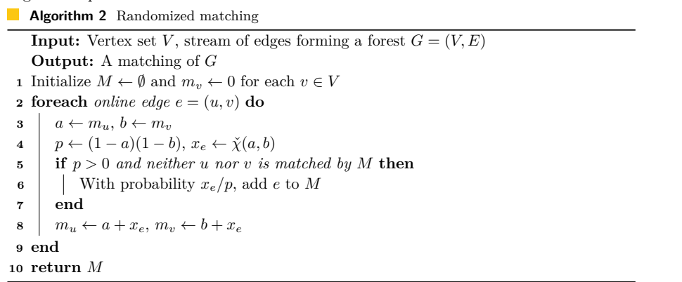

# Tight Competitive Bounds for Online Matching on Forests

<!-- 全库方法复筛开始 -->
> **方法储备 · 业务决策与理论储备**。保留“森林约束下的匹配竞争界”这一研究问题或机制；是否用于当前业务另行验证。
> 原有阅读范围与证据等级不变；储备不等于效果已验证。
> 已恢复此前因业务距离被移出的原笔记；旧取舍原因仅作历史记录。
> [[研究前沿/论文库复筛与阅读路线|全库阅读路线]] · [[研究前沿/业务决策与理论储备/存量论文分层索引|本方向完整分层]]
<!-- 全库方法复筛结束 -->

无环兼容图的边按任意顺序到达时，通过两端已匹配概率决定新边的接纳概率，可保住离线最大匹配规模的 4/7。这在森林上是紧界。

arXiv v1 预印本。作者 Bartłomiej Bosek、Grzegorz Gutowski、Paweł Putra、Anna Zych-Pawlewicz。首次提交 2026-11-09，核验于 2026-11-12。11 月 10 日公告。核读 §3–6、算法 1–2、式 (2)(4)(6)、硬例构造和三项主定理；未逐段复算分段函数的全部不等式。

[一手发布页](https://arxiv.org/abs/2611.12210v1) · [离线 PDF](./assets/source/paper.pdf) · [离线 HTML](./assets/source/paper.html)

## 不知道下一条边，怎样保留可用端点

每条无权边到达时必须承诺或拒绝，之后不能撤回。边序列始终构成森林，两个端点来自不同连通分量，输入顺序不依赖算法的随机数。基准是同一前缀上知道全部边的最大匹配。令 $m_v$ 是所有已到达关联边的分数之和。分数算法以顶点覆盖的对偶权重 $y_v=\psi(m_v)$ 衡量剩余容量，式 (4) 的覆盖函数在 $1/7,3/7,6/7$ 处改变斜率。每条边的分数选择为使两端覆盖和达到 1 的最小新增负载：

$$\chi(a,b)=\min\{x\in[0,1-\max(a,b)]:\psi(a+x)+\psi(b+x)\ge1\}.$$

算法 1 可同时维持至少离线最优的 $4/7$ 的分数匹配和至多最优的 $7/4$ 的分数顶点覆盖。

## 把这个分数变为真实选边概率

两个端点来自不同随机历史，在固定输入下同时空闲概率为 $p=(1-a)(1-b)$。原分数可能比该概率大，故算法 2 取 $x_e=\min(\chi(a,b),p)$。若两端都空闲且 $p>0$，以 $x_e/p$ 接纳；无论是否实际接纳都将两端的确定性负载分别增加 $x_e$。这样边的边际接纳率为 $x_e$，顶点负载始终等于已匹配概率。分量每次合并时通过分析中的余量分摊最优匹配规模；随机算法仍达到 $4/7$，此前可证保证为 $5/9$。

§6 构造一族最大度为 4、逐次添加叶子的树，让任何分数或随机在线算法在某个阶段无法超过 $4/7$。这项证据给出最坏顺序界，未提供真实派单平均效果。若运行中加入了形成环的边，端点分量的选择就可能相关。

算法 2　分量间随机接边的条件概率与负载更新。PDF 第 10 页。

## 实现与关联

核对官方 v1 与原文引用，未核实作者实现；可执行入口为 PDF 第 10 页算法 2。

- [[研究前沿/动态等待与匹配决策/02-可复用方法卡/ForestMatching-load-round|在森林边流上按端点空闲概率修正接纳率]]
- [[研究前沿/动态等待与匹配决策/03-实验假设与结果/ForestMatching-cycles|候选图首次出现环后，按端点独立性舍入的误差有多大]]
