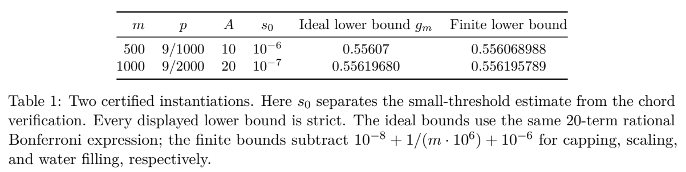

# Online Edge-Weighted Matching Beyond 0.55

作者 Alireza Farhadi、Mohammad Hajiaghayi。首次发布 2026-11-04，此次核验的版本为 v1（2026-11-04），阅读于 2026-11-10。11 月 5 日 cs.GT 公告，滚动窗口补录。读 §1–5 的单位与算法、§6–7 的赢率选择和认证、附录 D 的紧性、附录 E 验证范围；未本地编译 Lean。

[作者原文](https://arxiv.org/abs/2611.06896v1) · [离线 PDF](./assets/source/paper.pdf)

## 先到的边可被替换，怎样处理竞争

离线侧资源预先已知，线上请求逐一到达并揭示它与各资源的非负权重。每次最多选一个资源，一个资源可被分配多次，最终只计算该资源收到的最重边。目标是最终保留权重总和；比较对象为知道所有边的离线最大权匹配。允许免费放弃已占的轻边，适合暂存候选、最终确认等阶段；已不可逆执行的订单不具备这一性质。

## 两种历史状态有不同作用

1. **确定性记账。** 每个资源按已看到的权重把数轴切成区间，为不同阈值保存“选择历史与该阈值此前仍未覆盖”的联合量。一条新边权 $w$ 在低于 $w$ 的阈值上可改进目标，在更高阈值上虽不贡献权重，候选选择过程依然要前进。忽略后者会算错后续的覆盖机会。§4 算法 1 用每个候选的对偶缺口 $d_i(x)=\Gamma w_i-A_i(x)$ 做逐步水位分配，得到含虚拟丢弃选项的抽样概率。记账时对候选抽中次数取二项分布平均。
2. **真实随机选择。** 按上述分布有放回抽 $m$ 个候选，允许同一资源重复出现。每一次入选暴露推进该资源的随机年龄状态；重置时使用年龄相关分数、否则给基准分。对 $r_i$ 次入选的资源计算 $Q_i=1-\prod_{k=1}^{r_i}(1-X_{ik})$。预先校准的锦标赛使用这些期望赢率选唯一赢家，不能简单将 $Q_i$ 归一化。实际赢家和真实抽中次数不会写回第一步的确定性记账。
3. **计算保证。** §5 的状态相关原始–对偶分析同时约束有效、无效的阈值更新。§6–7 在初始一段年龄中使用相同赢率，再对其余年龄使用不同分数。赢率映射与锦标赛必须满足所有重复抽样次数和连续阈值下的可行性约束。图与输入顺序须独立于算法内部随机性。

## 原文证据

| 证据 | 数值及含义 |
|---|---|
| Thm. 1、§7 表 1 | $m=1000$ 的有限计算版本下界超过 0.556195789，作者主定理保守写作 $\mathbb E[\mathrm{ALG}]\ge0.556195\,\mathrm{OPT}$。此前论文保证为 0.5368。$m=500$ 的另一组证书下界超过 0.556068988。 |
| 紧性结果 | 三角形的单位权重输入族使指定理想算法趋近对应保证。论文没有证明所有在线算法都受这个上界。 |
| 形式证明与实现 | 论文 §7、附录 E 和仓库文档分列数值验证与 Lean 定理。后者依赖两个明确列出的文献假设（校准种子到选择器的构造、独立类别采样）；期望多项式运行时间、理想算法紧性等没有包含在该 Lean 主定理内。 |

上述均为最坏期望保证或计算机辅助证明；没有订单上的提升测量。实际分配要存阈值状态，定理采用较大的预处理和候选规模，对在线时延没有实证。若现实中撤回要付费或会影响司机可用性，价值函数和可行域均随之改变。

## 原文证据

表 1，两个不同候选数的理想化与有限实现下界；末列已扣除实现所需近似损失，PDF 第 21 页。

## 代码与关联

作者公开了数值证明与 Lean 源码。可查 paper/verifiers、research/lean/tournament1000/Main1000.lean、VERIFICATION.md；未在本地运行。仓库说明另列证明依赖的文献公理。[作者仓库](https://github.com/farhadi94/online-edge-weighted-matching)

- [[研究前沿/动态等待与匹配决策/02-可复用方法卡/FreeDisposalOCS-state-ocs|按权重阈值记账的多候选相关选择]]
- [[研究前沿/动态等待与匹配决策/03-实验假设与结果/FreeDisposalOCS-disposal-frontier|候选暂存与替换成本如何改变在线匹配收益]]
