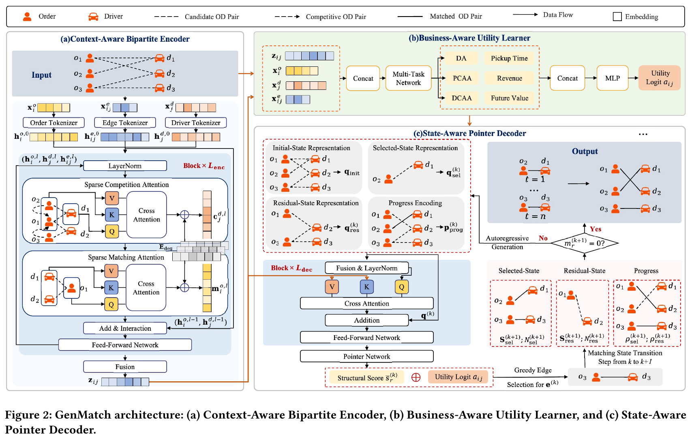
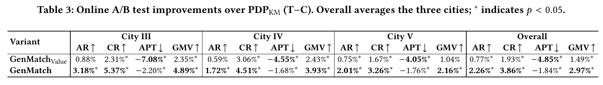
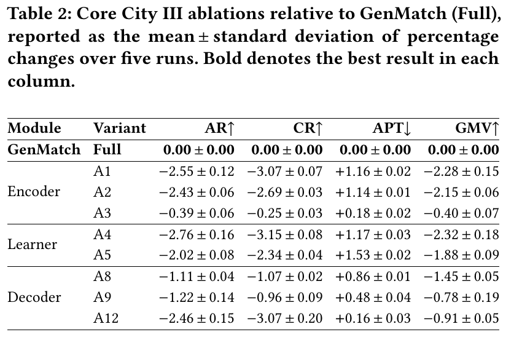

# GenMatch: An End-to-End Generative Matching Framework for Micro-View Order-Dispatching in Ride-Hailing

[官方论文](https://arxiv.org/abs/2608.19751) · [本地 PDF](./assets/source/paper.pdf) · [HTML 快照](./assets/source/paper.html)

首次提交：2026-08-20；本次精读：2026-11-05；核验版本：v1。会议正式发表日期未核验。本文是旧队列补精读，不是今日新发表。

阅读范围：核心方法、关键公式、主实验/理论条件及与迁移直接相关的附录。未逐行复证全部证明，也不称逐页翻译；具体覆盖见 [[研究前沿/动态等待与匹配决策/01-论文原文与精读/GenMatch/阅读覆盖|阅读覆盖]]。HTML 为原始快照，外部样式/图片可能需要联网；PDF 是完整离线原文。

代码状态：原文未提供可核验的公开官方仓库入口；未把文中本地脚本名、提交哈希或同名项目当成已取得代码。本次未运行作者代码。

## 1. 问题、基线与整体方法（§1–3）

传统流程分别预测订单—司机的接单/取消概率，手工计算价值，再由匹配求解器构造分配。预测更准未必使整批分配更好。GenMatch把一次派单批次作为输入，直接生成一组互不冲突的候选边。它是指针式自回归匹配，不是扩散生成，也没有语言模型token化需求。

输入是上游规则筛选后的稀疏二部图，订单、司机和候选边都有特征；输出为一对一分配集合。上游召回和业务可行性筛选仍保留。训练目标来自历史最终完单边，未广播的候选没有履约监督，不能据此宣称已消除选择偏差。

图表为原始PDF裁图，页码见图片说明及附件溯源记录；数字与标记以原图为准。

## 2. 三个模块与计算链（§4）

**竞争与匹配编码。** 在每个司机/订单端聚合共享端点的候选，得到竞争上下文；再带着该上下文对对端做匹配注意力。注意力只沿候选边计算。度数embedding补充softmax平均容易丢失的候选数量。边状态融合两端匹配向量的和、逐元素积、绝对差，形成最终候选记忆。

**业务学习。** DA、PCAA、DCAA多任务预测为候选记忆提供履约阶段监督；预测值再与接驾时长、收入、未来价值等业务字段送入MLP，产生步骤无关的业务logit $a_r$。下游取消仅在对应流程发生后定义，复现需落实标签依赖，不能把未观测直接当负例。

**状态指针。** 保留初始、已选、剩余三组候选的表示和与数量，生成均值，并用已选比例/剩余比例补充进度。查询经交叉注意力产生每步结构分 $\bar s_r^{(k)}$，再与业务分相加：

$$
p_r^{(k)}=\frac{\exp(\bar s_r^{(k)}+a_r)}{\sum_{r'\in\mathcal R^{(k)}}\exp(\bar s_{r'}^{(k)}+a_{r'})}.\qquad\text{(14)}
$$

贪心选边后，把同订单/同司机的边全部硬mask，并增量更新集合和与计数。**硬约束来自mask，业务偏好来自logit；二者不能混淆。** 推理持续至无可选边；没有显式可学习hold/stop动作，所以它不能直接替代动态等待控制。

## 3. 训练与工程（§4.4、6、附录B）

每次把历史完单边随机排列，teacher forcing学逐步NLL，防止拟合任意集合顺序；所有可选候选都在分母。总损失

$$
\mathcal L=\mathcal L_{\mathrm{gen}}+10\mathcal L_{\mathrm{mtl}}.\qquad\text{(19，代入所选权重)}
$$

多任务损失只用广播且反馈可观察候选。联合训练使辅助监督影响表征和生成，但历史成功示范仍可能保留旧策略偏好。

配置：编码/解码各2层，维度128，4头，最多500订单、500司机、10000边。部署保留分布式特征准备，城市编排器恢复统一候选顺序与285个特征的全局字典；生成结果作为预分配进入仲裁与锁定，失败回退原pair-level引擎。不能把这些工程机制的整体成功归为单独可量化模块收益。

## 4. 效果与消融（§5、Table 1–4）

离线City I–III，14天训练、7天模拟回放，5次运行；线上City III–V，14天、1小时交替时间片。因此**合计5城，线上3城**。线上对PDP-KM的三城平均相对变化：AR +2.26%、CR +3.86%、GMV +2.97%、APT −1.84%；表3标注显著性 $p<0.05$。这是系统收益，不能分别算给三个模块。

图表为原始PDF裁图，页码见图片说明及附件溯源记录；数字与标记以原图为准。

City III消融Table 2以完整GenMatch为0：去竞争但留匹配上下文A2，CR −2.69%；去度数A3 −0.25%；去辅助监督A4 −3.15%；去业务logit A5 −2.34%；去剩余状态A8 −1.07%；去进度A9 −0.96%；首次logit固定后用KM的A12 −3.07%。这是共同训练系统内消融，不代表独立接入可取得同等增益。

图表为原始PDF裁图，页码见图片说明及附件溯源记录；数字与标记以原图为准。

GenMatchValue只替换生产预测环节，也有收益，但完整系统进一步改善AR/CR/GMV；支持跨阶段联合决策的动机。接驾时长等指标存在权衡，不能认为每个基线所有指标都被严格支配。

## 5. 可迁移模块与边界

批次竞争表征可先移入pair打分；阶段监督可研究“结果预测→业务分→匹配”的联合训练；状态指针是较大替换，需要候选集合、状态更新、延迟和兜底一起接入。原文公开数据/代码未取得，线上切换的干扰、携带效应与具体统计估计还需复现核实。本文未证明因果反事实履约概率，也没有发现某项线上增益可独立归给一个子模块。

## 方法卡与后续实验

- [[研究前沿/动态等待与匹配决策/02-可复用方法卡/GenMatch-bipartite-context|先竞争后匹配的稀疏二部图编码]]
- [[研究前沿/动态等待与匹配决策/02-可复用方法卡/GenMatch-business-utility|阶段履约监督与可学习业务logit]]
- [[研究前沿/动态等待与匹配决策/02-可复用方法卡/GenMatch-state-pointer|集合状态与硬mask的可行匹配指针]]
- [[研究前沿/动态等待与匹配决策/03-实验假设与结果/2026-11-05-竞争状态表示|竞争上下文与剩余状态是否分别改善匹配（未运行）]]
