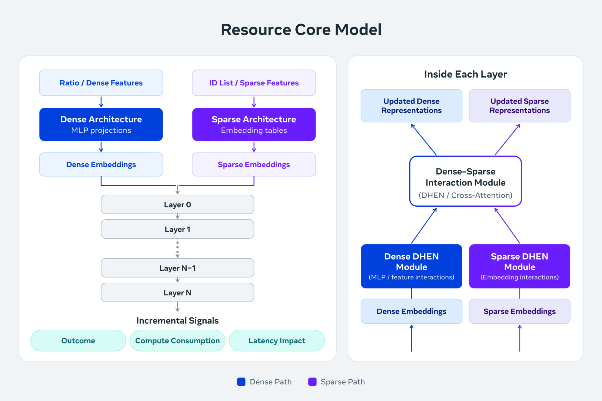

# Intelligent Delivery: Making Every Unit of Compute Serve Better Ads

<!-- 全库方法复筛开始 -->
> **方法储备 · Scaling up 与效率**。保留广告请求级算力分配的工程接口；原分层将 Delivery 误写成配送，现纠正并归入效率储备。
> 核验范围：官方工程文章与本地原文定向复核。本地实验未运行。
> [[研究前沿/论文库复筛与阅读路线|全库阅读路线]] · [[研究前沿/Scaling up 与效率/存量论文分层索引|本方向完整分层]]
<!-- 全库方法复筛结束 -->

Meta 在候选召回前评估每个请求多用算力可获得的收益和延迟代价，再由各层调度器分配资源。团队报告相对旧生产模型，离线识别高影响请求的表现约提升 20%，没有公布该指标的定义、分母和对照设计细节。

Meta Engineering 技术文章。作者 Zhaojun Zhang、Qinwei Zhu、Gang Li、Jianwei Xiao、Yanan Wang、Hongmei Li、Deepak Vijaywargi、Ke Pan、Li Yu。官方首次发布 2026-11-11，核验于 2026-11-12。通读官方正文、模型结构图、逐层分配案例和文末尚待解决的问题。稿件没有实验附表或正式伪代码。

[一手发布页](https://engineering.fb.com/2026/11/11/ml-applications/intelligent-delivery-serve-better-ads/) · [离线 HTML](./assets/source/paper.html)

## 分配器在决策前可以知道什么

作者的旧做法按产品界面、请求上下文及素材属性分组，再人为给每组规定算力。新增特征导致规则组合膨胀，同组内使用统一资源设置。新的 Resource Core Model 在候选召回前运行一次，融合稠密与稀疏请求特征，并为下游各阶段共享。作者披露 60 亿稀疏参数、2000 万稠密参数；各专用模型在共享模型上微调，分别预测不同资源设置下的结果、计算消耗和时延。

图源为官方文章第二幅文内插图。只观察到已经选择的算力强度时，如何构造不同设置的增益训练标签、随机化比例和数据划分，作者没有披露。

## 一个请求经过三层资源选择

区域层以分钟为周期调整流量，使不同地区新增一单位容量的效用趋近。硬件层对工作负载和芯片组合做实测，再将有限硬件分给效率更高的阶段。主机内并发请求共享尾延迟限额，根据上一步预测的收益、算力和延迟选择资源设置；负载越高，率先收紧高成本低收益请求。文章没有给出延迟约束的数值，也没有给出内部求解器代码。

## 哪个数字可以回答哪个问题

- “1. Request Understanding: A Shared ML Intelligence Layer for Compute”相应段落报告，主要产品面上的离线评测相对旧生产模型，在识别最能受益的广告请求上改进约 20%。具体度量、分母、测试集构成、基线版本、误差和拆组件对照未给出，无法换算为多服务了多少请求或多节省多少算力。
- 从 2017 年到 2026 上半年，作者报告整套 Intelligent Delivery 在主要产品面的广告排序表现额外改进约 10%，已叠加在同期其他模型与系统进展之上。长期多层机制共同发生，此处没有可定位到请求模型或某个调度层的独立收益。
- 后文还讨论工程师审核的优化建议与 GPU 资源不可细分等约束，本条不把其中的工程参与比例计作调度效果。

对在线分配的迁移假设是：当深挖候选的成本可调、共享队列拥塞可见时，可先估计各请求分档的收益、算力和延迟，再作受约束分配。受理者耐心、出车概率或订单匹配质量均须另行建模。

## 实现与关联

公开材料提供结构图与流程，未公开模型权重、训练数据或生产调度代码。

- [[研究前沿/动态等待与匹配决策/02-可复用方法卡/IntelligentDelivery-resource-value|用分档增量收益和延迟代价选择请求的资源量]]
- [[研究前沿/动态等待与匹配决策/03-实验假设与结果/IntelligentDelivery-fixed-budget|相同容量和尾延迟下，按请求分档是否胜过静态分组]]
