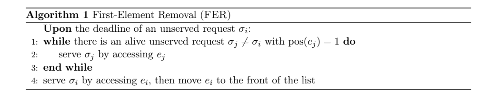

# List Update with Time Windows and Delays without Batch-Serving

<!-- 全库方法复筛开始 -->
> **方法储备 · 业务决策与理论储备**。保留“带延迟的在线列表更新”这一研究问题或机制；是否用于当前业务另行验证。
> 原有阅读范围与证据等级不变；储备不等于效果已验证。
> 已恢复此前因业务距离被移出的原笔记；旧取舍原因仅作历史记录。
> [[研究前沿/论文库复筛与阅读路线|全库阅读路线]] · [[研究前沿/业务决策与理论储备/存量论文分层索引|本方向完整分层]]
<!-- 全库方法复筛结束 -->

同一类请求即使必须逐笔访问，也能用当前列表位置来决定先服务谁。硬截止下先清表首请求再服务到期项；软等待下用同类请求累计延迟触发访问与移首。

Icey Siyi Ai, Jingwei Li, Clifford Stein。首次提交 2026-11-12，本次核对首版 v1。以上日期为 UTC；本批未独立核实正式发表日期。核读 §2、§3.1–3.2、§4 的随机界适用条件、§5.1–5.2 和算法 1、3。附录对局部规则的完整下界证明未复算。

[arXiv 版本页](https://arxiv.org/abs/2611.17083v1) · [本地 PDF](./assets/source/paper.pdf) · [本地 HTML](./assets/source/paper.html)

## 服务顺序会改变后续成本

查询列表第 x 位支付 x，完成后该项可以免费前移，其他相邻交换各花 1。同一时刻允许多次瞬时操作但每笔须单独付费，后续请求会看到已调整的顺序。离线最优也须支付每笔访问与付费交换成本。

## 硬时窗与软等待

FER 到截止触发，先清当前表首所有活跃请求，每笔成本为 1，再服务到期请求并把其项目移首。重叠量 k 限制同一时刻包含该点的输入窗口数。软等待模型设置各请求的非降延迟函数，对当前位置 x 的某项，当同项所有未完成请求延迟之和达 2x/3 时，先花 x 访问、移首，再逐笔各花 1 清余项。

## 结果与边界

硬时窗的确定界随 k 从 2 向 3 靠近。随机 WBIT 在 k=2、无自适应对手时有 7/4 界；更一般结论另需同一元素的窗口不重叠。软模型 5 倍界要求到达延迟从零开始、连续非降且发散，已知等待函数时论文另处理左连续跳变。占用实际时长及连续资源容量均未建模。

算法 1 的处理次序，原 PDF 第 6 页。

## 实现与验证入口

未核到作者仓库。正文算法 1、2、3 与 §5.2 提供执行规则。

- [[研究前沿/动态等待与匹配决策/02-可复用方法卡/ListUpdateWindows-head|到期前先清掉当前表首的请求]]
- [[研究前沿/动态等待与匹配决策/02-可复用方法卡/ListUpdateWindows-delay|用当前位置给同类累计等待定服务阈值]]
- [[研究前沿/动态等待与匹配决策/03-实验假设与结果/ListUpdateWindows-separate|逐笔收费后，表首清理比只看截止多赚多少]]
