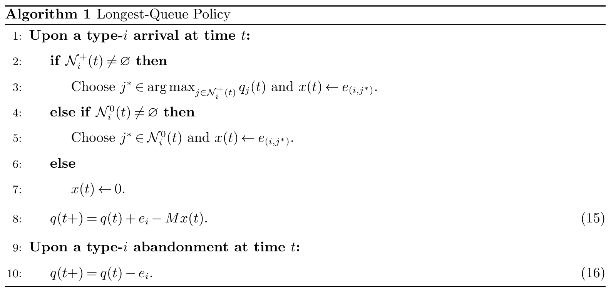
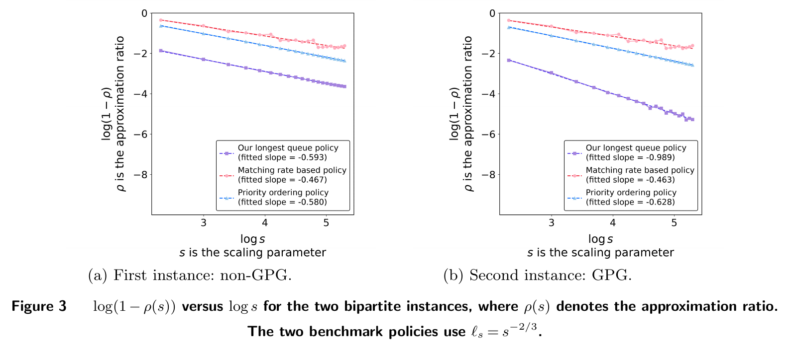

# Longest-Queue Policies in Dynamic Matching with Abandonments

[官方论文](https://arxiv.org/abs/2611.01431) · [本地 PDF](./assets/source/paper.pdf) · [HTML 快照](./assets/source/paper.html)

首次提交：2026-11-01；本次精读：2026-11-05；核验版本：v1。会议正式发表日期未核验。本文是旧队列补精读，不是今日新发表。

阅读范围：核心方法、关键公式、主实验/理论条件及与迁移直接相关的附录。未逐行复证全部证明，也不称逐页翻译；具体覆盖见 [[研究前沿/动态等待与匹配决策/01-论文原文与精读/LongestQueue/阅读覆盖|阅读覆盖]]。HTML 为原始快照，外部样式/图片可能需要联网；PDF 是完整离线原文。

代码状态：原文未提供可核验的公开官方仓库入口；未把文中本地脚本名、提交哈希或同名项目当成已取得代码。本次未运行作者代码。

## 1. 问题与整体思路

连续到达的多类主体可以配对，等待会发生成本并可能放弃。只看即时奖励容易耗掉稀缺资源；固定批处理又会制造额外等待。本文先用流体 LP 判断哪些匹配值得做、哪些类型稀缺，再在到达时优先匹配最长的关键队列。

## 2. 模型与基准（§2–3）

有限类型、独立 Poisson 到达率 $\lambda_i$、独立指数耐心率 $\theta_i>0$、两两匹配，可非二部图。奖励非负；目标扣除持有成本、放弃罚金及期末剩余库存的后续放弃成本。耐心到期前不可观测。期末成本是理论基准的一部分，不可在复现时删除。

令 $M$ 为类型—匹配关联矩阵、$\bar c_i=c_i+\theta_i\gamma_i$，流体 LP 是

$$
F^*(\lambda)=\max_{x,q\ge0}\{r^\top x-\bar c^\top q: Mx+\Theta q=\lambda\}.
$$

消去队列后，奖励变为 $\widetilde r=r+M^\top\Theta^{-1}\bar c$，对偶约束 $M^\top U\ge\widetilde r$。正对偶值的类型是关键类型；对偶约束紧的边是 good matches。

## 3. 算法与机制（§4、Algorithm 1）

离线求一次对偶解，固定关键类型和 good 边。类型 $i$ 到达时：在非空的 good 邻居中，优先选关键类型里队列最长者；若无关键邻居，选任一非关键 good 邻居；再没有则入队。离开事件仅更新队长。到达时每次最多形成一个匹配，未提出学习型等待时长预测器。

图表为原始PDF裁图，页码见图片说明及附件溯源记录；数字与标记以原图为准。

**直观理解：** 对偶筛边避免为低价值配对耗掉稀缺资源；最长关键队列规则减少有价值的等待库存。筛边与队列规则共同构成保证，不能只取最长队列并继承定理。

## 4. 理论证据、数值比较及限制（§4–6）

高流量设置 $\lambda^s=s\lambda^b$。GPG 要求最优对偶解唯一且在到达率的小邻域内保持最优；不要求唯一非退化的原始解。定理1在所有 $s\ge1,T\ge1$ 上给出与 $s,T$ 无关的时间平均 regret 上界，数量级为 $O((n/\varepsilon)\log(n/\varepsilon))$。流体值为正时比率达到 $1-C/s$。无 GPG 时 Proposition 1 仍给出 $1-C/\sqrt{s}$，所以不能说“无GPG就无保证”。常数依赖耐心率、奖励及类型结构，有限规模下可能不紧。

证明主线是把 regret 约束到关键队列长度，再用负漂移控制队列；完整概率界证明未逐行复证。指数耐心、固定类型和已知参数是实质条件，时变市场/非指数放弃不直接继承保证。

三个数值实例，$s=10,20,\ldots,200$，每档100次、时域100；对比 matching-rate-based 与 priority-ordering 两种周期复查策略，复查间隔分别 $s^{-2/3}$、0.1、0.3。测试中 LQ均有较高流体近似比率；有/无GPG实例的拟合斜率约−1/−0.5。没有真实线上或现代学习型调度基线，不能宣传为优于所有批匹配。

图表为原始PDF裁图，页码见图片说明及附件溯源记录；数字与标记以原图为准。

## 5. 迁移价值

可作为匹配触发、候选筛选与资源竞争的可解释基线，或学习策略的结构先验。需估计并验证类型划分、到达率、耐心分布和对偶稳定性。与 StaticPriority 的二分之一保证比较时，必须区分这里的有限时域流体上界与后者的长期全知基准，不能直接排名。

## 方法卡与后续实验

- [[研究前沿/动态等待与匹配决策/02-可复用方法卡/LongestQueue-dual-critical-queue|流体对偶筛边与最长关键队列匹配]]
- [[研究前沿/动态等待与匹配决策/03-实验假设与结果/2026-11-05-匹配理论基线|对偶队列与静态优先级的匹配基线比较（未运行）]]

## 关联阅读

[[研究前沿/动态等待与匹配决策/01-论文原文与精读/StaticPriority/精读|StaticPriority：比较模型假设、评价基准与保证口径]]。两篇保证对应不同基准，不直接比较常数大小。
