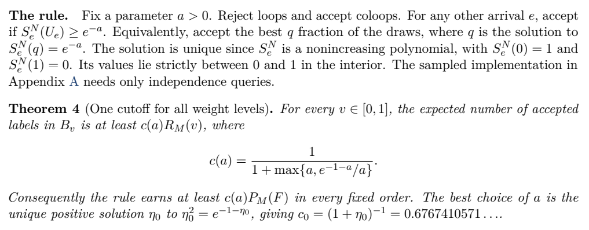

# Prophet Secretary for Matroids and XOS Valuations: A Separation at 1-1/e and a 0.6767 Guarantee for I.I.D. Weights

<!-- 全库方法复筛开始 -->
> **方法储备 · 业务决策与理论储备**。保留“拟阵约束的先知不等式”这一研究问题或机制；是否用于当前业务另行验证。
> 原有阅读范围与证据等级不变；储备不等于效果已验证。
> 已恢复此前因业务距离被移出的原笔记；旧取舍原因仅作历史记录。
> [[研究前沿/论文库复筛与阅读路线|全库阅读路线]] · [[研究前沿/业务决策与理论储备/存量论文分层索引|本方向完整分层]]
<!-- 全库方法复筛结束 -->

当资源约束形成拟阵、价值来自同一个已知分布时，可按当前元素被其他元素替代的概率决定是否接纳。即使到达顺序预先固定，也能获得离线最优期望价值的至少 0.6767；这是 v2 新增的结果。

作者 Hossein Esfandiari、MohammadTaghi Hajiaghayi。首次提交 2026-11-04，实质修订 2026-11-06。v1 已取得并逐版比较；未见正式发表日期。[前版原文](./assets/source/prior-v1.pdf)本期核读逐版核对 v1、v2 摘要和正文目录。精读 v2 定理 1–4、§3、§5.2、§8.2、§9 及附录 A；Lean 证明包只核验入口，未编译。

[arXiv 版本页](https://arxiv.org/abs/2611.06891v2) · [本地 PDF](./assets/source/paper.pdf) · [本地 HTML](./assets/source/paper.html)

## 问题、机制与证据

不可撤销地选加权元素，已选集合始终满足拟阵独立性。每次接纳后收缩已选元素，拒绝后删除当前元素，形成剩余拟阵。在独立同分布情形，剩余元素的权重未知，但知道共有的分布和可行性查询接口；固定顺序须与取值和算法随机性独立。

**v2 新增的一条截止规则。** 将已到达权重转为上尾分位数 $u$，在分布原子的区间内随机打破平局。令 $S_e^N(u)$ 为在剩余其他元素中以概率 $u$ 逐个独立采样后，当前 $e$ 仍能增加秩的概率。环元素拒绝、余环元接纳；其余在 $S_e^N(u)\ge e^{-a}$ 时接纳。定理 4 同时控制所有价值分位层，再积分得到收益界。取 $a^2=e^{-1-a}$ 的正根后，$1/(1+a)\simeq0.676741$。附录 A 说明如何用独立性查询估计阈值。§3.1 的上限针对特定单步分析框架，全体算法的最优比值仍未由此确定。

**另外两种结构。** 独立但不同分布、到达顺序均匀随机时，算法 2 估计参考分布及接受价格；触发条件成立时转入虚拟基交换，以采样维持剩余拟阵可行性。定理 1 的保证为 $1-1/e+10^{-6}$。多买家的 XOS 组合估值下，§9 给 i.i.d. 买家反例，$1-1/e$ 无法统一改善。v1 已有这两项，本期实质新版为 i.i.d. 拟阵权重在固定次序的 0.6767 保证。全文给理论证明，不含运营实证。

v2 §3 的单截止规则和定理 4，原文 PDF 第 8 页。

## 实现与后续验证

正文指向作者仓库，核对到 MatroidProphetSecretary_XOS_Proofs.zip 与 iid-matroid-prophet-lean.zip 两个证明包，未发现生产调度实现，未编译。[固定仓库版本](https://github.com/hajiaghayi/Matroid-Prophet-Secretary-XOS/tree/ffaa3702ed58865a03ec29e7da41cdee137542ce)

- [[研究前沿/动态等待与匹配决策/02-可复用方法卡/MatroidCutoff-cutoff|按剩余集合可替代性设接纳分位阈值]]
- [[研究前沿/动态等待与匹配决策/02-可复用方法卡/MatroidCutoff-reference|不同分布的资源如何用参考价格和虚拟基接纳]]
- [[研究前沿/动态等待与匹配决策/03-实验假设与结果/MatroidCutoff-iid|共同分布被打破时，替代性阈值会不会失去优势]]
