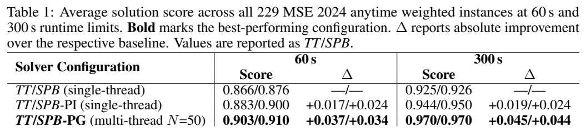

# 用可微优化给组合求解器热启动，增益有多少来自额外并行？

<!-- 全库方法复筛开始 -->
> **方法储备 · 业务决策与理论储备**。保留“GPU 可微指引与离散 MaxSAT 求解结合”这一研究问题或机制；是否用于当前业务另行验证。
> 原有阅读范围与证据等级不变；储备不等于效果已验证。
> 已恢复此前因业务距离被移出的原笔记；旧取舍原因仅作历史记录。
> [[研究前沿/论文库复筛与阅读路线|全库阅读路线]] · [[研究前沿/业务决策与理论储备/存量论文分层索引|本方向完整分层]]
<!-- 全库方法复筛结束 -->

单线程、并行多种子和同求解器的初值对照，能够区分启发式初值和额外算力的影响。

## 文献与版本

Advancing Weighted Partial MaxSAT Solving via Differentiable GPU Guidance。Mingju Liu、Curie Kim、Steve Dai、Cunxi Yu。arXiv v1 首投 11-11。 检索及精读于 2026-11-15。精读 §2–4、全基准表 1、入选子集表 2 和开销表 3。 [一手来源](https://arxiv.org/abs/2611.15091v1)

本地资料　[paper-v1.pdf](./assets/source/paper-v1.pdf) · [paper.html](./assets/source/paper.html)

## 方法与关键计算

给每个布尔变量两个待优化的 logit，按实例求梯度，无需历史训练数据。硬约束违反一次的代价大于所有软奖励之和，原文取 $\lambda\ge1+\sum_t w_t$。一条路线把完整赋值用于 CPU 分支方向初始化，保留原问题；另一条路线用扰动后的高置信部分赋值构造额外软子句，并行尝试。最后评价原问题的解。

## 效果证据与对照

229 个 MSE 2024 实例、CPU 求解 300 秒下，SPB 单线程基线平均得分 0.926，使用 GPU 初值的单线程为 0.950，50 路部分引导为 0.970。GPU 前处理另计，中位 9.17 秒、平均 49.74 秒、最大 1,045.8 秒。

表 1 给全体实例的单线程对照。表 2 的无 GPU 多种子和有 GPU 多种子比较只覆盖作者选出的 20 个提升明显实例，不能据此确定全体 229 个实例的等算力增益。

原文表 1，完整基准的结果。 [原文第 7 页](./assets/source/paper-v1.pdf#page=7)

## 能迁移到什么问题

适合已有离散约束编码的匹配或排班模型。需保留超时前可行解，端到端期限须包括构造、传输和优化。若每个新候选图都需从头编码，缓存收益会改变。

本次核实论文原文中的损失、转换规则及运行配置，未核实作者公开实现入口。

[[研究前沿/动态等待与匹配决策/02-可复用方法卡/MaxSATWarmStart-比较组合优化热启动与等预算多种子|比较组合优化热启动与等预算多种子]] · [[研究前沿/动态等待与匹配决策/03-实验假设与结果/MaxSATWarmStart-短期限内可微初值是否优于相同总预算的多种子|短期限内可微初值是否优于相同总预算的多种子（未运行）]]
