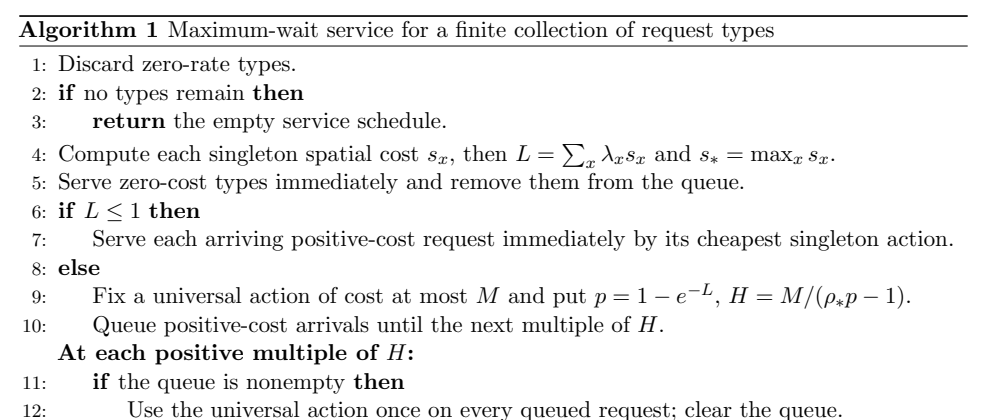

# Online Network Design with Maximum Delay and Stochastic Arrivals

<!-- 全库方法复筛开始 -->
> **方法储备 · 业务决策与理论储备**。保留“最大等待时间目标的网络调度”这一研究问题或机制；是否用于当前业务另行验证。
> 原有阅读范围与证据等级不变；储备不等于效果已验证。
> 已恢复此前因业务距离被移出的原笔记；旧取舍原因仅作历史记录。
> [[研究前沿/论文库复筛与阅读路线|全库阅读路线]] · [[研究前沿/业务决策与理论储备/存量论文分层索引|本方向完整分层]]
<!-- 全库方法复筛结束 -->

如果每批只计最长等待，一次立即服务还是定时清空可由单独服务的成本率决定。在共享服务成本有统一上界时，相对任意分批的离线最优，长期期望成本比恰能保证 e/(e−1)。

作者 Tianhang Lu。首次提交 2026-11-10，本次核验同一 v1，未见独立的修订或正式发表日期。本期核读§3–4、算法 1–2、定理 6.2、8.1 和 §6.5 的单地点下界；概率论的中间引理未独立复证。

[arXiv 版本页](https://arxiv.org/abs/2611.13865v1) · [本地 PDF](./assets/source/paper.pdf) · [本地 HTML](./assets/source/paper.html)

## 问题、机制与证据

同一批服务的时间为 $t$，最早请求到达于 $a$，等待只计 $t-a$。每个类型 $x$ 的最低单独空间成本为 $s_x$，包含该类型的批次至少支付 $s_x$。另外有一个可花至多 $M$ 就能服务任意多待处理请求的无状态动作。离线基准知道全部到达、可任选分批。给每个请求画从到达到其后 $s_x$ 的时间段，任何批次成本足以覆盖所含时间段的并集。独立泊松率下，长期覆盖率为 $1-\exp(-L)$，其中 $L=\sum_x\lambda_xs_x$。

**共享服务策略。** $L\le1$ 就逐单即时服务；$L>1$ 时令 $\rho=e/(e-1)$，采用固定周期 $H=M/[\rho(1-e^{-L})-1]$，只在非空时清空。定理 6.2 给出长期上界；单地点负载为 1 时即使随机策略也不能突破该常数。负载刚越过 1 时周期可能非常长，短时段和单请求服务级别均无同样保证。

**有逐单连接费的设施。** 一次连接很多远方请求会累积费用，统一上界 $M$ 的前提可能失效。作者先即时服务前 $m$ 个到达，用其间隔构造各类型的指数半径，按候选设施集互斥条件贪心选点；其后固定分配，并在 $c_f\Lambda_f\le1$ 时即开，否则按逐渐增大的间隔清空。定理 8.1 给出 3 倍上界；若要求固定有界等待，可换成固定周期，以推论 8.7 的 $3(1+\varepsilon)$ 为代价。正文未报告现场实验。

算法 1 的负载分档与清空周期，原文 PDF 第 16 页。

## 实现与后续验证

arXiv 正文未给实现仓库；§6.3 的算法 1 与 §8.3、§8.7 的算法 2 给出可核对步骤。

- [[研究前沿/动态等待与匹配决策/02-可复用方法卡/MaximumDelayBatch-union|一批只计最久等待时如何决定是否合批]]
- [[研究前沿/动态等待与匹配决策/02-可复用方法卡/MaximumDelayBatch-gaps|逐单连接收费时用到达间隔定服务点]]
- [[研究前沿/动态等待与匹配决策/03-实验假设与结果/MaximumDelayBatch-objective|将逐单等待换成每批最长等待后，策略排序会不会翻转]]
