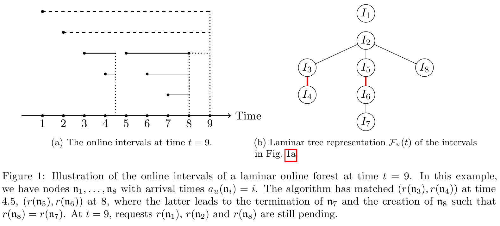

# Noncrossing is All You Need: Beyond Identical Delay Functions in Online Matching with Delays on General Metrics

[官方论文](https://arxiv.org/abs/2611.05769) · [本地PDF](./assets/source/paper.pdf) · [HTML快照](./assets/source/paper.html)

版本记录：[Submitted on 4 Nov 2026]；本次核验与精读：2026-11-06。本篇为滚动窗口内首次入库；检索日不等于首次发表日。

阅读范围：§1技术综述、§2定义、§3伪归约、§4完整算法与§6边界；§5证明仅保留定位。未逐行复证全部数学证明，未声称逐页翻译。[[研究前沿/动态等待与匹配决策/01-论文原文与精读/NoncrossingDelays/阅读覆盖|原文章节与公式索引]]；HTML为原始快照，外部样式和图片可能需要联网，PDF可离线阅读。

代码：本次核验的论文原文与元数据未提供可确认的作者实现入口；代码状态未知，不能据此断言不存在。未运行代码。 [[研究前沿/动态等待与匹配决策/01-论文原文与精读/NoncrossingDelays/代码核验|核验记录]]

## 问题与创新

最小化配对距离和等待损失，允许每请求不同且事先未知的延迟曲线，只观察当前增长率。非交叉条件十分具体：先到的r1与后到r2在后者到达后满足 $f'_{r1}(t)\le f'_{r2}(t)$ 且 $f_{r1}(t)\ge f_{r2}(t)$。不是任意异质耐心/取消风险。

## 单点触发与树上扩展（§3–4）

单点只增长最新待配请求的计数器；较早请求维护其后续子请求的历史。简单“最新计数达到老请求一半”过慢，简单累加全部子计数又可能过快。作者以连续子序列分区的最小值构造势函数：单元素块取子计数，多元素块取父请求在块期间增加的延迟，最新子独立成块。

$$Y_n(t)=\min_{\mathcal P\text{ canonical}}\sum_{B\in\mathcal P}v_n(B),\qquad Y_n(t)\ge z_n(t)/2\Rightarrow\text{匹配关键父子}.$$

它保留历史而避免重复给最优解计费。一般度量嵌入2-HST；请求累计延迟达到树层距离时晋升，创建虚拟副本。奇偶待配数量决定激活最新或次新计数；必要时终止/重建区间维持laminar结构。虚拟匹配仅在两端仍处当前层时转成实际匹配。

## 证据、基线和限制

理论：单点确定性常数竞争；一般n点度量随机 $O(\log n\log\Delta+\log^2\Delta)$，Δ为度量纵横比。§3 Lemma3.1和3.4把全局成本联系到单点虚拟/合并实例；§5负责完整计费证明，本次未逐引理复证。相对已有统一线性/凹延迟算法扩大函数范围，未给真实轨迹收益或运行时实验。

任意延迟函数无有界竞争比的反例说明约束不可随意取消。取消退出、带权收益、二部供需、截断最大等待并非本文保证。可研究历史势函数触发机制，但离开非交叉条件后必须重新验证。

## 原文关键图表

原文 Figure 1，PDF 第 14 页；原始裁图，机制和证据解释见上文。裁图坐标与源文件校验值见 assets/source/figure-provenance.json。

## 方法卡

- [[研究前沿/动态等待与匹配决策/02-可复用方法卡/NoncrossingDelays-partition-trigger|历史分区势函数驱动异质等待触发]]
