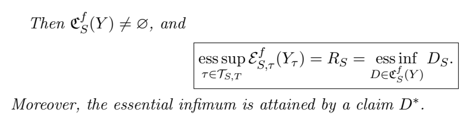

# Nonlinear optimal stopping and domineering claims

作者 Siham Bouhadou、Oussama Lamhadoul、Youssef Ouknine。首次发布 2026-11-05，此次核验的版本为 v1（2026-11-05），阅读于 2026-11-09。arXiv 概率论预印本。重点核读 §3 的非线性 Snell 包络、§4 的命题 4.4、4.7–4.9 和相应证明结构，未逐行复证既有反射 BSDE 定理。

[作者原文](https://arxiv.org/abs/2611.07743) · [离线 PDF](./assets/source/paper.pdf)

## 已经等到当前时点，还能为最优值给出什么上界

设 $Y_t$ 是立即行动收益，以带布朗与泊松噪声的倒向随机微分方程（BSDE）定义从 $\tau$ 回到 $S$ 的非线性评价 $\mathcal E^f_{S,\tau}$。这允许未来收益按一个时间一致的非线性规则折算。决策者从当前时点 $S$ 选何时停止，目标 $R_S$ 是所有可选时刻评价的本质上确界。作者研究能否给最优策略价值配一个上界，并说明何时达到它。

## 剩余区间上的证书

在 $[S,T]$ 上选过程 $D$，要求它对同一个评价 $\mathcal E^f$ 为强鞅，且对区间内每个停止时刻都有 $D_\tau\ge Y_\tau$。比较定理加鞅性质使任一停止规则的价值至多 $D_S$。§4 命题 4.7 进一步证明，对左极限存在、右上半连续、平方可积的可选收益和满足比较条件的 Lipschitz 驱动，最佳上界可达到。
$$
R_S=\operatorname*{ess\,sup}_{\tau\in\mathcal T_{S,T}}\mathcal E^f_{S,\tau}(Y_\tau)
=\operatorname*{ess\,inf}_{D\in\mathfrak C^f_S(Y)}D_S .
$$
作者从相应的反射 BSDE 解构造局部占优鞅，将最小上界与非线性 Snell 包络对应；这是存在性和准确性证书。训练一个回归网络后只在若干样本上高于即时收益，并未满足“所有停止时刻”的要求。

## 哪些结论能用于解释等待规则

| 结论 | 条件和原文定位 | 用途/边界 |
|---|---|---|
| 给定占优过程可找最优停止 | 命题 4.4 与备注 4.6。收益在 $\mathcal E^f$ 期望下右上半连续，且全局接触时刻集合非空 | 接触时刻集合的本质下确界给从 0 出发的最优停止时间；若要保证其自身也等于接触点，文中另用严格比较。 |
| 在任意 $S$ 重建局部证书 | 命题 4.7，PDF 第 12–14 页 | 对每个起点可重建并取到最小上界，不保证同一全局过程在所有起点都紧。 |
| 全局证书在中途何时紧 | 命题 4.8 | 存在全局占优鞅在 $S$ 等于包络，当且仅当反射过程满足 $A_S=B_{S-}=0$；第二个端点是左极限。 |
| 最优化时的接触必要性 | 命题 4.9 | 全局证书在 0 达到最优值、存在最优停止且满足严格比较时，最优停止时收益与证书相等。 |

理论结果，无数值表、实测数据或运行时基准。对动态匹配的研究联系是评估“已等待一段时间”的单次停止问题：若给定风险敏感评价、可验证的候选鞅和终止收益，可把可行策略价值与上界一起报告。论文没有提供从日志学习该评价或构建可验证证书的算法，多单共同分配也需额外建模。因当前缺少具体的非线性评价及可行证书，本篇不另建本地实验。

## 原文证据

命题 4.7 跨页陈述的等式及取到下确界的结论；假设见 PDF 第 12 页下部，PDF 第 13 页。

## 代码与关联

本次检查论文全文、arXiv 记录和按题名检索结果，作者算法仓库入口未知。

- [[研究前沿/动态等待与匹配决策/02-可复用方法卡/NonlinearStoppingDual-local-certificate|从当前时点构造停止价值的非线性上界]]
