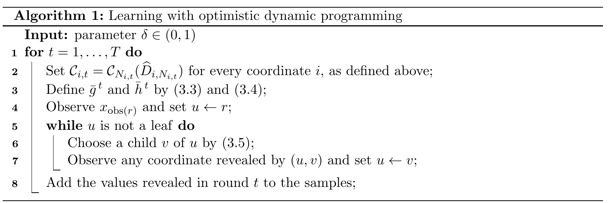

# Beyond Monotonicity: Stochastic Online Optimization under Semi-Bandit Feedback

[官方论文](https://arxiv.org/abs/2611.02739) · [本地PDF](./assets/source/paper.pdf) · [HTML快照](./assets/source/paper.html)

版本记录：[Submitted on 2 Nov 2026]；本次核验与精读：2026-11-06。本篇为滚动窗口内首次入库；检索日不等于首次发表日。

阅读范围：§2–3模型/算法/定理、§4.3–4.4应用与AppendixA.2计算复杂度；长证明未逐行复证。未逐行复证全部数学证明，未声称逐页翻译。[[研究前沿/动态等待与匹配决策/01-论文原文与精读/OptimisticSOO/阅读覆盖|原文章节与公式索引]]；HTML为原始快照，外部样式和图片可能需要联网，PDF可离线阅读。

代码：本次核验的论文原文与元数据未提供可确认的作者实现入口；代码状态未知，不能据此断言不存在。未运行代码。 [[研究前沿/动态等待与匹配决策/01-论文原文与精读/OptimisticSOO/代码核验|核验记录]]

## 为什么普通乐观分布不够

等待/停止、截止期调度中，随机结果变大可能同时增收益和消耗更多时间，因此最优值未必随一阶随机占优单调。本文不找一个处处更好的单一分布，而在每个Bellman期望里对分布置信集取上确界。

## 计算（§2–3）

有限决策树/DAG表达逐步揭示独立随机坐标；跨轮同分布、只看到策略执行路径上的坐标（semi-bandit）。每坐标以经验分布和所有区间质量误差建立置信集 $\mathcal C_{i,t}$，向后递推
$$\bar g_u=\max_{v\in A_u}\bar h_{uv},\quad \bar h_{uv}=\sup_{Q\in\mathcal C_{i,t}}E_Q[\bar g_v(X_i,x_{obs})].$$
不同边的最优Q可以不同。每轮冻结置信集、按乐观值选择动作、收集实际揭示坐标。所需结构是任意置信集下继续价值的超水平集能写成至多s_i个区间；不是只检查叶收益单调。

## 证据与计算限制

Theorem3.2在 $S=\sum_i\min(s_i,k_i)<\infty$ 下给 $\widetilde O(\sqrt{ST})$ 遗憾；Theorem3.6最坏情形下界匹配到对数。§4.3损失厌恶停止s_i=2；§4.4截止调度将即时收益与单调剩余收益分开控制。理论成果，无实验。

AppendixA.2每边乐观更新可转区间质量LP/最小费用流；多项式复杂度依赖决策图大小和区间上确界oracle，单边可到O(t³logt)。决策树本身可能指数大，不能称普遍低延迟解法。跨坐标相关、非平稳、未观察结果的选择依赖会改变假设。

可迁移的是“对下一步结果分布的置信集做乐观价值计算”，以及即时收益和未来机会成本分开分析；具体求解器仍需领域状态压缩。

## 原文关键图表

原文 Algorithm 1，PDF 第 11 页；原始裁图，机制和证据解释见上文。裁图坐标与源文件校验值见 assets/source/figure-provenance.json。

## 方法卡

- [[研究前沿/动态等待与匹配决策/02-可复用方法卡/OptimisticSOO-optimistic-bellman|区间分布置信集上的乐观Bellman更新]]
