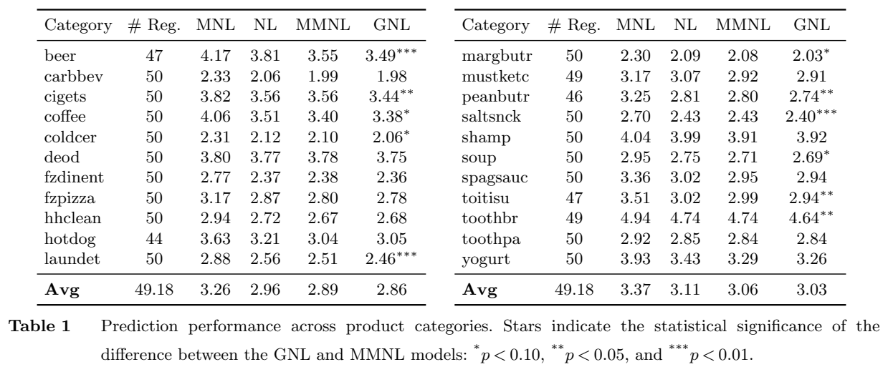

# 同一个候选可属于多个替代组时，如何建模选择并求最佳展示集合？

<!-- 全库方法复筛开始 -->
> **方法储备 · 业务决策与理论储备**。保留“Tree Decomposition of Product and Nest Graphs for Assortment Optimization under the Generalized Nested Logit Model”这一研究问题或机制；是否用于当前业务另行验证。
> 原有阅读范围与证据等级不变；储备不等于效果已验证。
> [[研究前沿/论文库复筛与阅读路线|全库阅读路线]] · [[研究前沿/业务决策与理论储备/存量论文分层索引|本方向完整分层]]
<!-- 全库方法复筛结束 -->

允许候选进入多个替代组，可以从给定展示集的选择概率进一步计算整组收益。可解性取决于替代关系图的结构。

## 文献与版本

Tree Decomposition of Product and Nest Graphs for Assortment Optimization under the Generalized Nested Logit Model。Yuheng Wang、Paat Rusmevichientong、Huseyin Topaloglu。arXiv v1 首投于 2026-11-11。 检索及精读于 2026-11-16。精读产品图与分组图、树分解的精确和近似算法、§6 估计对照与附录 EC.2。 [一手来源](https://arxiv.org/abs/2611.15817v1)

本地资料　[paper-v1.pdf](./assets/source/paper-v1.pdf) · [paper-v1.html](./assets/source/paper-v1.html)

## 方法与关键计算

先按集合内每组吸引力决定组概率，再在组内选择候选，对候选所属的各组求和。产品图按同组候选连边，分组图按共享候选连边。将图分解成相互连接的小袋，只在分隔处传递子问题状态，再从叶到根合并；产品图树宽有界时可精确多项式求解，分组图树宽有界时得到完全多项式时间近似方案。

## 效果证据与对照

表 1 的 22 类零售商品中，广义嵌套 Logit 在 19 类的平均样本外预测误差小于混合 Logit。模拟附表 EC.2 中，15,000 笔交易的广义嵌套模型平均期望收益 6.762，混合 Logit 为 6.735。

真实交易样本对照 MNL、互斥组的 NL 和混合 Logit，测试指标是预测误差。收益对照来自已知真值的模拟；真实数据未验证替换策略后的收益。

表 1。零售类别在相同留出数据上的预测误差。 [原文第 30 页](./assets/source/paper-v1.pdf#page=30)

## 能迁移到什么问题

迁移到多入口候选展示，要记录可选集合、未选择选项和候选所属组。若连接图稠密，求解的树宽前提会失效；用户选择参数也需独立估计。

正文说明使用 MATLAB fmincon 拟合，附录给动态规划状态转移；未核实作者公开求解仓库。

[[研究前沿/动态等待与匹配决策/02-可复用方法卡/OverlappingChoiceSets-允许重叠替代组并按交界状态求展示集合|允许重叠替代组并按交界状态求展示集合]] · [[研究前沿/动态等待与匹配决策/03-实验假设与结果/OverlappingChoiceSets-比较互斥分组与重叠分组对选择及集合收益的影响|比较互斥分组与重叠分组对选择及集合收益的影响（未运行）]]
