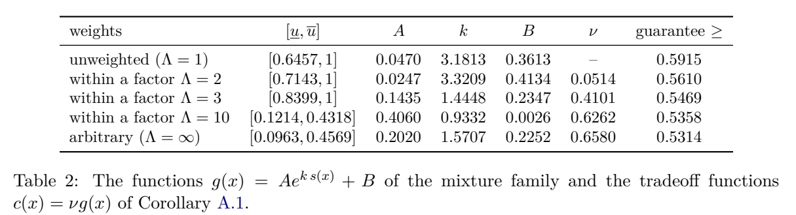

# Online Matching with Arbitrary Stochastic Rewards

作者 Rajan Udwani。首次发布 2026-11-02，此次核验的版本为 v1（2026-11-02），阅读于 2026-11-09。arXiv 算法预印本。阅读 §1–3、§4.2–4.3、§5 的加权扩展、§6 与附录 A 的参数证书，未逐项复证附录的数值区间及长引理。

[作者原文](https://arxiv.org/abs/2611.03598) · [离线 PDF](./assets/source/paper.pdf)

## 单次邀请，如何保留未来机会

每个到达只能邀请一个当前可用资源。成功获得资源价值并消耗一个单位，失败释放资源且本次到达结束。边的成功率随到达揭示，未来的到达可按对手选择的次序出现。一直选即时预期收益最高者的最坏情形竞争比为 0.5。某些资源适配许多后续到达，本次稍微降低其优先级可能换来未来匹配机会。

## 匹配策略与证明思路

1. 在一个资源生命周期开始时，为每个资源独立取 $u_i\sim U[0,1]$。到达 $t$ 时，观测可用集合 $A_t$、边成功率 $p_{it}$ 和资源权重 $r_i$，如有候选就按固定次序破平局，探测得分最高的一条边。
2. §2 式 (2) 在种子区间 $[l,h]$ 给相同折扣，按原始 $r_i p_{it}$ 比较这部分资源；区间外用压缩后的种子施加指数折扣。折扣保留正下界，避免把明显更容易成功的资源完全压低。
$$
s(u)=\min(u,l)+\max(0,u-h),\quad g(u)=A\exp(ks(u))+B,\qquad
i_t\in\arg\max_{i\in A_t}r_i p_{it}(1-g(u_i)).
$$
3. §2 Lemma 2 对同一到达引入一个均匀阈值，模拟该到达所有候选边的潜在结果。每次只尝试一条边，所以策略观察到的联合历史与独立边模型同分布。这个构造可在相同未来随机性上比较有无某资源的路径，结合 §3 的对偶证书界定随机折扣的长期代价。只要允许同一到达观察第二次尝试，该等价就需要重新验证。

## 原论文的对照与边界

| 对照或证据 | 原文位置 | 结论 |
|---|---|---|
| 比较对象 | §2 的 adaptive offline OPT | 已知全部到达、边及概率，可改变探测顺序并随过去反馈适应，决策前看不到未探测边的成功结果。比值比较双方的期望总价值。 |
| 均权与任意资源权 | Thm. 3、4，附录 A Cor. A.1、表 2 | 取相应的不同参数可得 0.5915、0.5314 的竞争比下界。中间权重比上界为 2、3、10 时依次为 0.5610、0.5469、0.5358。 |
| 值得注意的假设 | §2、§6 | 权重属于资源，边上的随机量是已知成功概率。成功后永久消耗该单位。资源按服务时长返回、边特异成功报酬、等待时间和客方重试均超出本模型。 |

这是理论下界，参数比较的证据是解析不等式和附录的数值检验。论文未在订单数据上测得提高。对于估计概率，可把扰动打分作为单次派发的回放基线；先分别测成功概率校准与跨单资源竞争，才有可能解释实测差异。

## 原文证据

附录 A 表 2。第二列到第六列给出扰动函数与证明用参数，最后一列是保证下界，PDF 第 30 页。

## 代码与关联

本次检查论文全文、arXiv 记录和按题名检索结果，作者算法仓库入口未知。

- [[研究前沿/动态等待与匹配决策/02-可复用方法卡/PerturbedGreedy-persistent-seed|资源固定种子的扰动贪心]]
- [[研究前沿/动态等待与匹配决策/03-实验假设与结果/PerturbedGreedy-seed-replay|候选资源重合时，固定扰动能否提高整段匹配价值]]
