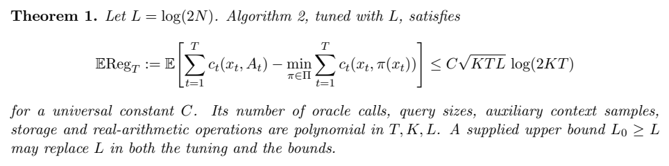

# 只有所选动作反馈时，大策略类的探索代价能降到多少？

<!-- 全库方法复筛开始 -->
> **方法储备 · 业务决策与理论储备**。保留“上下文 bandit 的 oracle 计算效率”这一研究问题或机制；是否用于当前业务另行验证。
> 原有阅读范围与证据等级不变；储备不等于效果已验证。
> 已恢复此前因业务距离被移出的原笔记；旧取舍原因仅作历史记录。
> [[研究前沿/论文库复筛与阅读路线|全库阅读路线]] · [[研究前沿/业务决策与理论储备/存量论文分层索引|本方向完整分层]]
<!-- 全库方法复筛结束 -->

定理 1 在独立同分布上下文、预先固定损失与精确离线优化 oracle 下给出近平方根的期望遗憾界。原文提供形式化证明，未报告在线延迟实验。

## 论文与阅读范围

Near-Optimal Regret for Oracle-Efficient Adversarial Contextual Bandits。Kiarash Banihashem、MohammadTaghi Hajiaghayi。首次公开 2026-11-12，所读版本 v1（2026-11-12）。精读定理 1、算法 1–2、随机扰动和优化 oracle 实现。 [一手来源](https://arxiv.org/abs/2611.17109v1) · [paper.pdf](./assets/source/paper.pdf) · [paper.html](./assets/source/paper.html)

## 怎样计算

给定 $K$ 个动作、$N$ 个候选策略和 $T$ 轮决策，保留历史由实际动作概率修正后的损失。每轮另从同一上下文分布独立抽样，用 Poisson 数目的虚拟样本与 Laplace 扰动近似未来的不确定性，借成本敏感离线优化 oracle 比较各动作价值。可执行版本以随机投影次梯度和持久化随机记录近似理想分布，并控制重要性损失估计的分母。

## 与哪些方法比较

与最佳固定策略相比，算法 2 的期望遗憾上界为 $O(\sqrt{KT\log(2N)}\log(2KT))$。每轮 oracle 查询量、查询规模及辅助样本等为 $T,K,\log(2N)$ 的多项式。相同先验工作条件下的重要 oracle 高效基线依赖 $T^{2/3}$。两项理论比较不含端到端时延、固定流量下收益或每轮实际常数。

定理 1 及 oracle 计算条件。 [原文第 2 页](./assets/source/paper.pdf#page=2)

## 适用条件与迁移

依赖可从相同分布取得新上下文、可调用精确成本敏感优化器、损失不按当前抽样动作自适应。若派单改变下一轮可观察的市场状态，独立设定需要重新验证。作者仓库含 poisson_playout_lean.zip，是证明材料。 [作者仓库](https://github.com/kbanihashem/bandit-oracle-lean)

[[研究前沿/动态等待与匹配决策/02-可复用方法卡/PoissonBanditOracle-用离线成本敏感优化器实现有探索保证的动作选择|用离线成本敏感优化器实现有探索保证的动作选择]] · [[研究前沿/动态等待与匹配决策/03-实验假设与结果/PoissonBanditOracle-在已知全动作损失的小策略类核对遗憾与耗时|在已知全动作损失的小策略类核对遗憾与耗时（未运行）]]
