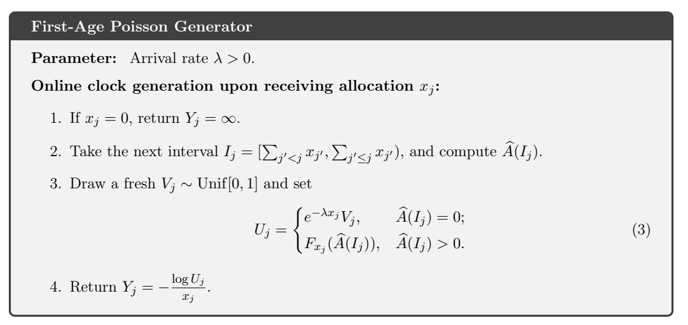

# Online Correlated Exponential Clocks

<!-- 全库方法复筛开始 -->
> **方法储备 · 业务决策与理论储备**。保留“相关时钟实现在线随机舍入”这一研究问题或机制；是否用于当前业务另行验证。
> 原有阅读范围与证据等级不变；储备不等于效果已验证。
> 已恢复此前因业务距离被移出的原笔记；旧取舍原因仅作历史记录。
> [[研究前沿/论文库复筛与阅读路线|全库阅读路线]] · [[研究前沿/业务决策与理论储备/存量论文分层索引|本方向完整分层]]
<!-- 全库方法复筛结束 -->

把分数分配变成真实选择时，同一资源可在不同轮次使用负相关的指数时钟，保持每轮选择概率，同时改变连续多轮被漏掉或过载的概率。原文分别用不同分数分配器给出三种目标的理论界。

arXiv v1 预印本。作者 Zhiyi Huang、Kalen Patton、Peilin Yang、Jiahao Zhao。首次提交 2026-11-08，核验于 2026-11-12。11 月 10 日公告。核读 §1–5 的框架、生成器和广告选边规则，核对 §6–7 的问题、分配器及定理和附录 B.2 数值。附录 C–D 的区间证书未逐式复算。

[一手发布页](https://arxiv.org/abs/2611.11133v1) · [离线 PDF](./assets/source/paper.pdf) · [离线 HTML](./assets/source/paper.html)

## 分数分配与真正选中一个资源之间缺了什么

每轮 $j$ 先给各资源 $i$ 分数 $x_{ij}$，总和归一为 1；有弃权时可用虚拟资源补足。资源之间的生成器独立，分数决策须独立于舍入采样。每个产生边际分布为 $\mathrm{Exp}(x_{ij})$ 的时钟 $Y_{ij}$，取最小时钟者。指数竞赛保证 $\Pr(i\text{ 被选}\mid x_{\cdot j})=x_{ij}$。同一资源跨轮时钟再要求负关联；对次模收益或超模成本，这一性质可将竞争者改成独立新时钟来界定收益或成本。

## 怎样使同一资源的时钟跨请求相关

§3.2 给每个资源一条独立的平稳 Poisson 时间轴。将依次收到的分数当作相邻区间的长度 $x$，取区间内首个到达点距前一到达点的间隔 $A$；区间无点时记为 0。以 $A$ 的累计分布变换为均匀变量 $U$，在零点的概率质量内额外均匀随机化，再置 $Y=-\log U/x$。长空档后的第一个点可使本区间时钟更短。$x=0$ 时返回无穷时钟。三个应用均取强度 4.5，分数决策与何时使用独立时钟随应用而异。

## 这些界分别衡量什么

- **Display Ads。** 一个广告主可收多次展示，只计最高出价。按出价水平跟踪尚未获得更高价值的概率与 Poisson 年龄分布，用潜力产生下一次分数报价；再由相关时钟选定一个广告主。§5 定理给至少 0.556，附录 B.2 算得常数约 0.556297869；库内另一路离散 OCS 结果约 0.556195。二者针对相同免费替换目标。
- **AdWords。** 广告主收入为所分配出价总和与预算之小者。小于半预算的出价用独立时钟，大额用相关时钟，水位分配与势函数也相应改变。§6 对 LP 上界给至少 0.530 的期望收入。
- **平方负荷。** 在不相关机器到达任务模型最小化负荷平方和，§7 为完整算法给出至多离线最优的 4.69 倍。三个数字均为原领域理论证明，无法从数字之差单独归因于时钟。

与 [[研究前沿/动态等待与匹配决策/01-论文原文与精读/FreeDisposalOCS/精读|离散的免费替换选边]] 对读时，可固定分数分配测试舍入层，再分别检验完整算法的界。若新分数直接取决于上一轮随机结果，原文分析前提会改变。

§3.2　First-Age Poisson 时钟生成器。PDF 第 9 页。

## 实现与关联

作者仓库按任务给出证明的数值核验代码，包括 display-ads/verify.py、adwords/verify.py 与 load-balancing/verify_kernel.py。未执行这些证书核验。[验证仓库](https://github.com/Jiahao566/Online-Correlated-Exponential-Clocks)

- [[研究前沿/动态等待与匹配决策/02-可复用方法卡/PoissonClocks-first-age|保持逐轮分配概率的跨轮相关指数时钟]]
- [[研究前沿/动态等待与匹配决策/03-实验假设与结果/PoissonClocks-rounding-only|只替换舍入的随机性，能否降低连续遗漏]]
