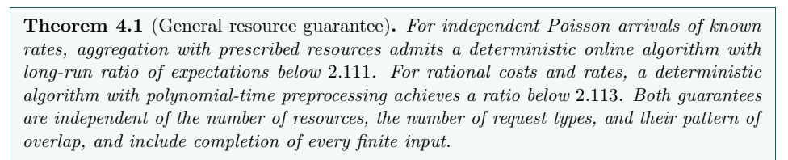

# Stochastic Aggregation with Prescribed Resources and Additive Delay

<!-- 全库方法复筛开始 -->
> **方法储备 · 业务决策与理论储备**。保留“随机资源聚合与在线分配”这一研究问题或机制；是否用于当前业务另行验证。
> 原有阅读范围与证据等级不变；储备不等于效果已验证。
> 已恢复此前因业务距离被移出的原笔记；旧取舍原因仅作历史记录。
> [[研究前沿/论文库复筛与阅读路线|全库阅读路线]] · [[研究前沿/业务决策与理论储备/存量论文分层索引|本方向完整分层]]
<!-- 全库方法复筛结束 -->

多种请求能共用同一资源时，可以预先为各类型排好彼此对齐的服务周期。在独立泊松到达模型下，逐单等待与采购的长期期望总成本小于全知离线最优的 2.113 倍。

作者 Tianhang Lu、Runtian Ren、Shengcai Liu。首次提交 2026-11-10，本次核验同一 v1，未见独立的修订或正式发表日期。本期核读定理 3.1、4.1、6.3、7.9、7.11 与 §4 的策略构造；附录的有理数证书未独立复算。

[arXiv 版本页](https://arxiv.org/abs/2611.13757v1) · [本地 PDF](./assets/source/paper.pdf) · [本地 HTML](./assets/source/paper.html)

## 问题、机制与证据

每个类型的请求必须获得一套指定资源。一批内同一资源只购买一次，下次开批仍需再买；每个请求各自支付从到达到服务的线性等待成本。离线基准可看见本次实现的全部到达、自由选择批次。比值是长期期望成本之比，包含末批清空成本。

**只有一种资源时，批量可直接算。** 将到达率归一到 1，购买成本归一为 $q=\lambda w$。每累积 $n$ 个到达就清空，单位时间成本为 $q/n+(n-1)/2$。先对整数 $n$ 取最小，再加随批次编号增长的兜底截止，有限输入的最后一批也能服务。定理 3.1 还通过离线动态规划分析全知者可利用的短间隔，最不利负载在 $q=1$，最优在线与离线成本比约 1.409。多个资源的一般上界和这个一维精确结果适用范围不同。

**资源重叠时，时间表要联编。** 资源和请求各自分摊购买、等待预算，解资源×尺度线性规划，并用对偶给每个类型一个时间尺度。取同一个相位将尺度向上舍入到嵌套的二倍周期，零周期的类型立刻服务。时钟相遇时，只为到期且非空的队列购买资源并集。请求等待的长期成本率是 $\lambda_i p_i/2$；稀疏队列为空时可以跳过采购。定理 7.9 给出小于 2.111 的确定性界，有理输入用有限网格预处理时定理 7.11 给出小于 2.113 的界。论文提供理论证明和数值证书，没有平台日志实测。

定理 4.1 的一般资源保证，原文 PDF 第 8 页。

## 实现与后续验证

版本页及正文未列作者实现。多资源重建入口在 §7.2 的 LP 与 §7.4–7.5 的周期选择，单资源在定理 6.3。

- [[研究前沿/动态等待与匹配决策/02-可复用方法卡/PrescribedBatch-clock|共享资源的多个队列怎样对齐服务时间]]
- [[研究前沿/动态等待与匹配决策/02-可复用方法卡/PrescribedBatch-count|单资源批量如何随到达率和固定成本改变]]
- [[研究前沿/动态等待与匹配决策/03-实验假设与结果/PrescribedBatch-phase|同步不同队列的时钟，能节省多少重复采购]]
