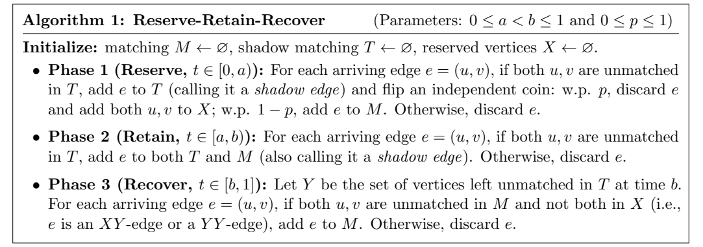

# Improved Bounds for Online Matching with Random Edge Arrivals

<!-- 全库方法复筛开始 -->
> **方法储备 · 业务决策与理论储备**。保留“随机边选择与在线匹配保证”这一研究问题或机制；是否用于当前业务另行验证。
> 原有阅读范围与证据等级不变；储备不等于效果已验证。
> 已恢复此前因业务距离被移出的原笔记；旧取舍原因仅作历史记录。
> [[研究前沿/论文库复筛与阅读路线|全库阅读路线]] · [[研究前沿/业务决策与理论储备/存量论文分层索引|本方向完整分层]]
<!-- 全库方法复筛结束 -->

随机到达的边必须立刻决定去留，早期拒绝部分可用边，能保留端点给后续更有价值的组合。三阶段算法在一般无权图上至少取得离线最优规模的 0.5445，在无三角图上至少 0.5535。

arXiv v1 预印本。作者 Yilong Feng、Haolong Li、Zonghan Yang。首次提交 2026-11-10，核验于 2026-11-12。11 月 11 日分类公告。核读 §1–3、§4 局部比较的条件、§5 小图递推及附录 B 参数与验证。未重新运行有理数或 Lean 证明。

[一手发布页](https://arxiv.org/abs/2611.13571v1) · [离线 PDF](./assets/source/paper.pdf) · [离线 HTML](./assets/source/paper.html)

## 第一阶段要舍弃的是什么

输入为未知有限简单图，每条边出现一次，时间独立均匀分布在 $[0,1]$。不知道图或边数，收到边时能看到当前时间和端点。每条边一旦拒绝即消失，两端仍可留给将来的边。目标是最大化最终匹配条数，按 $\inf_G\mathbb E[|M|]/\mathrm{OPT}(G)$ 评价。

算法 1 同时维护实际匹配 $M$、记录曾经可以贪心选择的影子匹配 $T$ 和被保留的端点集 $X$。在 $[0,a)$ 中，若两端在 $T$ 均空闲，先把边记入 $T$，以概率 $p$ 舍弃并把两端都标为保留，否则真接纳。在 $[a,b)$ 中，对影子匹配可接纳的边都同时加入 $T$ 和 $M$。最后用实际空闲状态恢复匹配，但不接纳两端都来自 $X$ 的边。这样为早期放弃的每条边留出寻找不同搭档的机会。

## 怎样评价保留的代价

一般图的参数为 $a\approx0.176913,b=3/8,p=5/11$。分析通过一个端点对直至时刻 $t$ 仍存活的概率，把先放弃一条边带来的未来收益与其机会成本比较，再对图类取下界。附录 B 在无三角图采用 $a=3/32,b=4/11,p=11/25$，排除局部交叉边后得到第二个保证。这两组值是最坏图上的期望下界。

另一条证据问：即使事先知道图的同构类型，随机打乱顶点标签和边序还能做多好？将已揭示子图 $H$ 与仍空闲的标签集合 $U$ 作为状态。令 $C(H)$ 是和观察兼容的标号数，式 (13) 给下一边概率 $C(H+e)/[(m-|E(H)|)C(H)]$。式 (14) 精确比较接纳的 $1+V(H+e,U\setminus e)$ 和拒绝的 $V(H+e,U)$。两个固定难例将任意在线算法可得的最优竞争比分别限制在 0.6964（一般图）与 0.7043（二部图）之下。上界与算法下界之间仍有间距。真实机会若成对出现或顺序受高峰、价格影响，随机顺序前提需先检验。

算法 1　三阶段的影子匹配与不可逆接纳。PDF 第 3 页。

## 实现与关联

作者工程提供求上界的 opt.py、cpp/solver.cpp 和 lean/Main.lean。该工程验证固定图递推，不是三阶段线上调度器。[作者仓库](https://github.com/fstqwq/Random-Order-Matching-Upper-Bounds)

- [[研究前沿/动态等待与匹配决策/02-可复用方法卡/RandomEdgeReserve-phases|用影子匹配决定早期保留、晚期恢复的端点]]
- [[研究前沿/动态等待与匹配决策/02-可复用方法卡/RandomEdgeReserve-exact-bound|在固定小图上计算随机顺序在线策略的精确上界]]
- [[研究前沿/动态等待与匹配决策/03-实验假设与结果/RandomEdgeReserve-orders|端点保留的收益对到达顺序有多敏感]]
