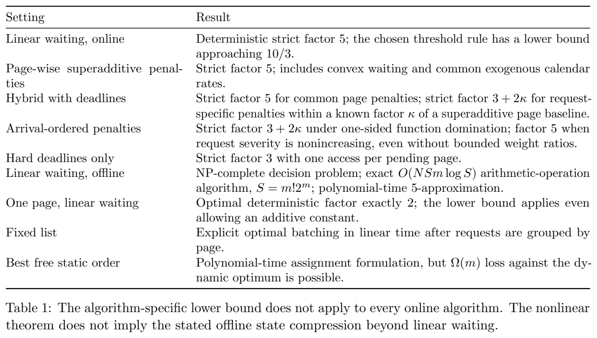

# 请求能按组批处理时，等待到何时值得触发一次服务？

<!-- 全库方法复筛开始 -->
> **方法储备 · 业务决策与理论储备**。保留“最大延迟目标的在线列表决策”这一研究问题或机制；是否用于当前业务另行验证。
> 原有阅读范围与证据等级不变；储备不等于效果已验证。
> 已恢复此前因业务距离被移出的原笔记；旧取舍原因仅作历史记录。
> [[研究前沿/论文库复筛与阅读路线|全库阅读路线]] · [[研究前沿/业务决策与理论储备/存量论文分层索引|本方向完整分层]]
<!-- 全库方法复筛结束 -->

把最老请求的等待与本次服务代价放在同一尺度上，可用一个随优先次序变化的阈值决定是否继续等。

## 文献与版本

List Update with Per-Page Maximum Delay。Tianhang Lu、Runtian Ren、Shengcai Liu。arXiv v1 首投于 2026-11-10。 检索及精读于 2026-11-16。精读在线规则、定理、表 1 和最大等待的反例边界。 [一手来源](https://arxiv.org/abs/2611.13750v1)

本地资料　[paper-v1.pdf](./assets/source/paper-v1.pdf) · [paper-v1.html](./assets/source/paper-v1.html)

## 方法与关键计算

每组对应列表中的一页。访问该页清掉全部积压，支付当前排名和组内最大等待代价，随后可移动位置。在线规则在最老请求的线性等待达到当前排名的 2/3 时服务，并把该页移至首位；排名改变后跟踪尚未服务的组。

## 效果证据与对照

理论上，线性等待下每条有限输入的总成本至多为动态离线最优的 5 倍，无加性项。表 1 的单页最优确定性因子为 2；仅有硬截止期时，可得 3 倍界。该阈值规则自身存在趋近 10/3 的下界。

离线参照既能等待又能调整顺序。把参照限制成固定顺序会混入排序损失，固定顺序与动态最优之比可随组数线性增长。论文没有业务吞吐或取消率实验。

表 1。各代价模型及比较对象对应的竞争界。 [原文第 3 页](./assets/source/paper-v1.pdf#page=3)

## 能迁移到什么问题

适用于一次操作能清空同组请求且等待代价按最大值计的场景。容量受限或累加每个乘客等待时需要重建目标。

原文给出阈值规则、离线动态规划及反例；未核实公开实现。

[[研究前沿/动态等待与匹配决策/02-可复用方法卡/RankDelay-以组内最老等待触发批量服务|以组内最老等待触发批量服务]] · [[研究前沿/动态等待与匹配决策/03-实验假设与结果/RankDelay-在组内最大等待成本下比较动态阈值与固定周期|在组内最大等待成本下比较动态阈值与固定周期（未运行）]]
