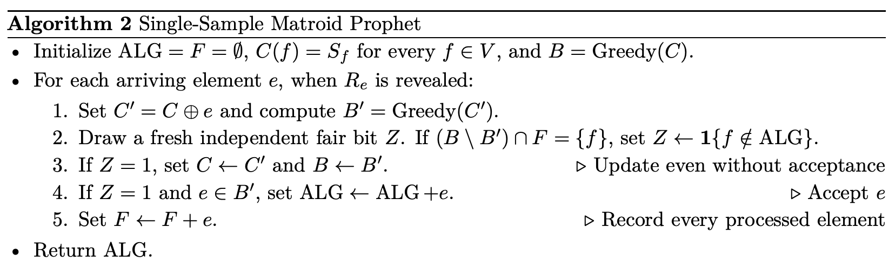

# 用贪心基的可逆更新在线分配受限资源

**As Easy as Rank One: Optimal Algorithms for Matroid Secretary and Single-Sample Matroid Prophet**  
Hamed Abdi、Kiarash Banihashem、MohammadTaghi Hajiaghayi、Zhiyi Huang、Danny Mittal、Sahil Singla。首次提交及当前版本 v1 均为 2026-11-06。合并扩展稿，作者预印本；截至核验日主记录仅列 v1。 [arXiv 版本记录](https://arxiv.org/abs/2611.08869v1)

[本地 PDF](./assets/source/paper.pdf) · [本地 HTML](./assets/source/paper.html) · [[研究前沿/动态等待与匹配决策/01-论文原文与精读/RankOneMatroid/阅读覆盖|阅读范围与原文定位]] · [[研究前沿/动态等待与匹配决策/01-论文原文与精读/RankOneMatroid/代码核验|代码核验]]

## 版本来源与研究问题

11 月 6 日 v1 将三篇 9 月预印本统一在同一组快照与分布不变量下。作者说明 Singla 的稿件提出简洁的组合秘书算法，Abdi 等的稿件给出单样本 prophet 算法，Huang 的稿件给出一般拟阵秘书尖锐界及其高效实现。核验日三条前序记录分别为 9 月 13 日首发、9 月 29 日 v2，9 月 16 日 v1，9 月 24 日 v1。这里只建一个合并稿入口。以下结论均据作者预印本，未逐行独立复证。[合并稿说明](https://arxiv.org/html/2611.08869v1#Sx1) · [Singla](https://arxiv.org/abs/2609.14555) · [Abdi 等](https://arxiv.org/abs/2609.19118) · [Huang](https://arxiv.org/abs/2609.30421)

拟阵给出一族具有交换性质的可行集合。固定相同价值的打破平局规则后，按价值从高到低扫描、可行才加入的 $\operatorname{Greedy}$ 得到规范最优基。加入一个元素或改变一个坐标的价值，贪心基至多发生一次交换。这解释了为何可以在更新参考解时保护先前已经不可撤销地做出的决定。[引理 2.1](https://arxiv.org/html/2611.08869v1#S2.Thmtheorem1)

| 模型 | 到达前信息与到达顺序 | 作者保证 |
|---|---|---|
| 秘书 | 已知元素总数 $n$。价值可任意固定，仅比较已到元素并查询其子集的独立性；到达顺序均匀随机。 | 简洁算法 1 对每个规范最优元素给出至少 $1/4$；算法 3、4 提高到独立的 $1/e$。算法仍可能接纳最优集外元素。 |
| 单样本 prophet | 拟阵已知，可对全部元素的子集查询。每元素的非负价值独立但分布未知，有一份独立同分布外部样本。固定到达顺序可任意，但与价值、历史样本及算法随机数无关。 | 算法 2 的期望价值恰为离线最优期望的一半，使用 $O(n^2)$ 次独立性查询。 |

## 可立即落实的两种基交换

**秘书算法 1。** 抛 $n$ 个公平比特，以 1 的个数 $K$ 决定无条件拒绝并存储的前 $K$ 个实际到达。按这串比特将已存项目和剩余真实到达交错处理。在参考集合 $C$ 中翻转当前元素的成员身份得到 $C'$；仅当贪心基在已处理集合 $F$ 上的成员完全相同才更新，并在当前元素属于新基时接纳。被初始拒绝的样本在内部处理时只能被移出参考集合。新基和旧基在已处理部分一致，故 $ALG\subseteq\operatorname{Greedy}(C)\cap F$。作者证明目标元素处理前的 $C$ 是与处理顺序独立的均匀子集，由此得逐最优元素至少 $1/4$、$O(n^2)$ 次查询。[算法 1](https://arxiv.org/html/2611.08869v1#alg1) · [快照双射和定理 2.2](https://arxiv.org/html/2611.08869v1#S2.Thmtheorem2)

**Prophet 算法 2。** 用样本向量 $S$ 初始化 $C$ 和贪心基 $B$。元素 $e$ 到达时提出用真实价值 $R_e$ 替换 $S_e$，重算 $B'$。若将挤出一个已处理的 $f$，先前接纳过它就阻止替换，先前拒绝过它就强制替换；其他情况抛公平硬币。替换成功且 $e\in B'$ 才接纳 $e$；替换成功但不接纳时也要更新配置。作者给出的分布结论是：从一个**新抽取的独立产品分布向量** $Y$ 计算规范最优基，每个基元素独立以 $1/2$ 保留，得到的元素与价值对和算法输出同分布。这里没有按当前一条到达路径所实现的离线最优集条件化。[算法 2](https://arxiv.org/html/2611.08869v1#alg2) · [定理 3.1](https://arxiv.org/html/2611.08869v1#S3.Thmtheorem1)

$$
\mathbb{E}\!\left[\sum_{e\in ALG}R_e\right]
=\tfrac12\mathbb{E}\!\left[\max_{I\in\mathcal I}\sum_{e\in I}R_e\right].
$$

## 怎样从四分之一推进到 $1/e$

把随机排列嵌入连续时间，取 $p=1/e$。对于已见集合 $O$ 和时刻 $t>p$，另做离线辅助抽样：每元素抽 $[0,t]$ 上的独立时间，只让辅助时间早于 $p$ 的元素成为候选。令 $\sigma_e$ 为更高价值的已出现元素首次张成 $e$ 的时刻，截断到 $[p,t]$；若一直不张成则取 $t$。候选条件于这些时间以 $\ln(\sigma_e/p)$ 独立保留，形成分布 $\mathcal D_{O,t}$。最终规范最优基元素不会被更高价值元素张成，因此单元素接纳率为 $p\ln(1/p)=1/e$。这里“早”指辅助时间。实际秘书算法在真实时间 $t\le p$ 时不接纳。[定义 5.1](https://arxiv.org/html/2611.08869v1#S5.Thmtheorem1)

要在线实现同一分布，还需证明每个已接纳集合可供下个动作分配的概率质量充足，并在观测历史间保持一致。算法 3 用两种辅助保留分布的概率之比决定当前处于贪心基的元素是否接纳；直接精确计算该比值可能昂贵。算法 4 用前向和反向坐标更新维持正确的条件分布。定理 6.1 的期望多项式复杂度采用可精确实数算术、连续均匀数及 $\ln,\exp$ 单位成本模型，未给实际浮点时延或比特复杂度界。删去条件概率校正、越过 $1/e$ 后直接贪心不具备原证明。[定理 4.4](https://arxiv.org/html/2611.08869v1#S4.Thmtheorem4) · [算法 3](https://arxiv.org/html/2611.08869v1#alg3) · [定理 6.1](https://arxiv.org/html/2611.08869v1#S6.Thmtheorem1)

## 匹配约束与独立核验证据

同一池至多选 $k$ 个候选是均匀拟阵，按互不交叠的组设上限可形成分割拟阵。一条边同时占用一名司机和一张订单时，左右两个分割拟阵的交一般不再是拟阵。作者对 $k$ 个拟阵的交另报秘书算法 $8k^2(k+1)$ 竞争比、$O(kn^2)$ 次查询；两端各限一次时取 $k=2$ 得 96，仅是这条通用定理给出的比值。它不涵盖随等待放弃、可撤销匹配或依赖报价的到达顺序。[定理 7.3](https://arxiv.org/html/2611.08869v1#S7.Thmtheorem3)

附录 C 的浮点线性规划覆盖至多七元素的所有正秩拟阵，以及八元素中的 1655/1723 个（八元素不可表示拟阵的 43/44 个）。所算的是序数算法的**期望价值竞争目标**，不直接检验最优基成员独立接纳的强结论；68 个未解八元素实例未计成功。作者公开计算代码并披露在多个理论环节使用 AI，对数学论证负责。未从所核一手记录确认同行评审或独立证明认证；本次没有运行求解、验证在线时间或评估真实匹配收益。[附录 C](https://arxiv.org/html/2611.08869v1#A3) · [作者声明](https://arxiv.org/html/2611.08869v1#Sx1)

## 原文算法与证据

算法 2 第 2–4 步把基准配置更新和实际接纳分开。被更新挤出的已处理元素决定是否覆盖随机位，已接受元素始终保留在新贪心基中。

## 方法与实验

[[研究前沿/动态等待与匹配决策/02-可复用方法卡/RankOneMatroid-preserve-members|用已处理成员不变性维护在线贪心基]] · [[研究前沿/动态等待与匹配决策/02-可复用方法卡/RankOneMatroid-sample-real-swap|用历史与实际价值交换保护先前接纳者]] · [[研究前沿/动态等待与匹配决策/02-可复用方法卡/RankOneMatroid-survivor-law|先构造保留集合的分布，再设计在线接纳概率]]

[[研究前沿/动态等待与匹配决策/03-实验假设与结果/2026-11-10-对单侧配额分别检验随机序筛选与单样本价值交换|对单侧配额分别检验随机序筛选与单样本价值交换（未运行）]]
