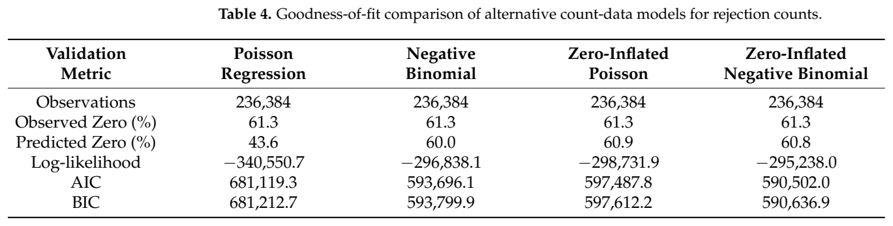

# 一笔最终匹配成功的订单，在成功前累积了多少次拒绝？

<!-- 全库方法复筛开始 -->
> **方法储备 · 面向决策的履约建模**。保留“Sequential Request Rejection Patterns in Ride-Hailing Systems: A Zero-Inflated Request-Level Analysis”这一研究问题或机制；是否用于当前业务另行验证。
> 原有阅读范围与证据等级不变；储备不等于效果已验证。
> [[研究前沿/论文库复筛与阅读路线|全库阅读路线]] · [[研究前沿/面向决策的履约建模/存量论文分层索引|本方向完整分层]]
<!-- 全库方法复筛结束 -->

**能改哪一环？** 改重派策略的诊断口径，把同一请求从首次派出到应答或退出期间的拒绝串起来。原文表 4 比较多个计数模型，只覆盖最终匹配成功者。

**第一步怎么验证？** 固定城市时段与观察窗，按请求重建每轮拒绝、退出与仍未匹配状态。先在成功样本对照负二项与零膨胀负二项的零拒绝占比和尾部拟合，再在完整跟踪的进入请求中复查并单报退出。若高拒绝尾部随未匹配请求纳入而明显改变，不用成功样本阈值触发重派。（本地验证未运行。）

把每笔请求的拒绝次数和最终匹配耗时放在同一观察单位上，同时把未匹配请求的缺失写进估计对象。

## 文献与版本

Sequential Request Rejection Patterns in Ride-Hailing Systems: A Zero-Inflated Request-Level Analysis。Nihat Karabulut、Mustafa Gursoy、Halit Ozen。历史补读，期刊于 09-10 公开；因直接给出调度日志的样本纳入范围和计数基线而收录。 检索及精读于 2026-11-15。精读样本定义、§3.1.3、方法、表 3–5、图 6、局限和数据可用性。 [一手来源](https://doi.org/10.3390/su18189292)

本地资料　[published.pdf](./assets/source/published.pdf)

## 方法与关键计算

按请求合并连续指派记录，统计最终应答前的失败指派数。普通 Poisson 的方差受均值约束；负二项容纳过度离散。零膨胀负二项再引入零状态权重 $\pi$，使 $P(Y=0)=\pi+(1-\pi)P_{\rm NB}(0)$。作者另用零膨胀有序 probit 处理匹配时间分档，推断时按最终应答司机聚类。

## 效果证据与对照

伊斯坦布尔一个月 236,384 笔最终匹配成功的请求中，61.3% 无先前拒绝，拒绝次数均值 0.90、方差 2.16。表 4 中 Poisson 预测零比例 43.6%，负二项 60.0%，零膨胀负二项 60.8%；后者 AIC 最低（590,502）。

零膨胀 Poisson 对零比例更接近（60.9%），但整体 AIC 为 597,487.8。单看某个桶的拟合容易漏掉尾部。论文未纳入取消和始终未匹配的请求，连这两类的总数也未取得；未报告更换策略的因果收益。

期刊表 4，同一成功匹配样本的四个计数模型。 [原文第 17 页](./assets/source/published.pdf#page=17)

## 能迁移到什么问题

可借用按请求还原连续失败暴露的口径。线上预测只能使用当时已知字段；原文的延误量和最终服务司机属性属于成功后信息。零状态是统计混合成分，不能据此判断某笔请求“天然不会被拒”。

期刊正文 §3.2 和表 4 给出模型与对照；数据由平台限制访问，本次未核实作者公开代码。

[[研究前沿/动态等待与匹配决策/02-可复用方法卡/RejectionExposure-按请求聚合重复拒绝并检验零膨胀|按请求聚合重复拒绝并检验零膨胀]] · [[研究前沿/动态等待与匹配决策/03-实验假设与结果/RejectionExposure-成功样本上的连续拒绝分布能否外推到全部进入请求|成功样本上的连续拒绝分布能否外推到全部进入请求（未运行）]]
