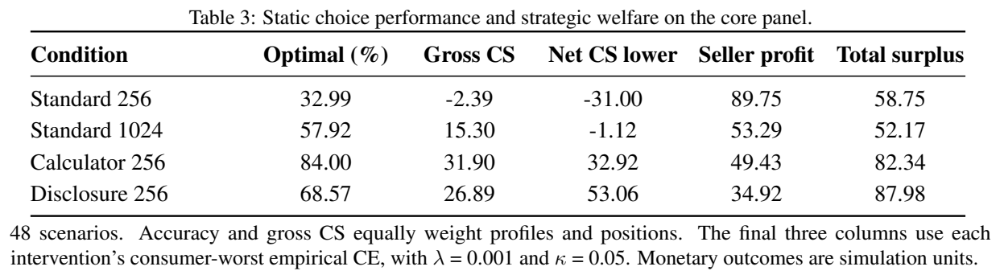

# 一套规则让眼前的选择更准确，对手调整策略后，用户收益是否仍会提高？

<!-- 全库方法复筛开始 -->
> **方法储备 · 业务决策与理论储备**。保留“预测精度改善与均衡福利改善的反例”这一研究问题或机制；是否用于当前业务另行验证。
> 原有阅读范围与证据等级不变；储备不等于效果已验证。
> 已恢复此前因业务距离被移出的原笔记；旧取舍原因仅作历史记录。
> [[研究前沿/论文库复筛与阅读路线|全库阅读路线]] · [[研究前沿/业务决策与理论储备/存量论文分层索引|本方向完整分层]]
<!-- 全库方法复筛结束 -->

固定菜单、冻结对手策略和重新求解均衡回答三个不同的问题。把它们并排，能看清收益结论依赖哪种响应假设。

## 文献与版本

Accuracy Is Not Welfare: Evaluating AI Buyers under Strategic Price Complexity in a Synthetic Duopoly。Jiaqu Ning（论文署名）。arXiv v1 首投于 2026-11-12。 检索及精读于 2026-11-16。精读机制、表 3–5、图 3 的重采样与附录复现范围。 [一手来源](https://arxiv.org/abs/2611.16471v1)

本地资料　[paper-v1.pdf](./assets/source/paper-v1.pdf)

## 方法与关键计算

在合成双卖家市场内，对买方的计算器辅助和价格披露分别收集动作。用相同场景和报价比较静态准确率，再据每种规则产生卖家收益矩阵，在满足偏离约束的经验相关均衡中求最低消费者净剩余。分两次检验，一次冻结训练得到的策略分布，在留出场景评分；一次重抽场景，重建矩阵并重新求均衡。

## 效果证据与对照

48 个合成场景里，计算器选中最优报价的比例为 84.00%，披露为 68.57%；消费者最不利的经验均衡下，披露的净剩余反而高 20.14 个模拟单位。固定训练策略后的 16 场景留出差为 +25.51（区间 10.69 至 42.08），每次重求均衡的敏感性范围为 −13.32 至 +33.77。

留出比较用 32 个场景估策略、16 个测结果，1,000 次配对重抽。表 5 还检查留出收益下的单方偏离；冻结的训练策略在留出样本上不一定仍是均衡。

表 3。相同 48 个场景上的静态选择与策略互动结果。 [原文第 19 页](./assets/source/paper-v1.pdf#page=19)

## 能迁移到什么问题

可用于匹配平台回放中区分短期固定响应和参与者适应后的结果。模拟合同、有限动作集以及模型代理都限制外推，重算范围也不是现实市场福利的置信区间。

附录说明了模拟输出、CPU 重绘与原始记录的关系；本次未核实独立可下载的作者代码入口。

[[研究前沿/动态等待与匹配决策/02-可复用方法卡/ResponseEquilibrium-冻结对手行为和重新求解行为各做一次评估|冻结对手行为和重新求解行为各做一次评估]] · [[研究前沿/动态等待与匹配决策/03-实验假设与结果/ResponseEquilibrium-检查匹配改动的收益是否依赖参与方不作调整|检查匹配改动的收益是否依赖参与方不作调整（未运行）]]
