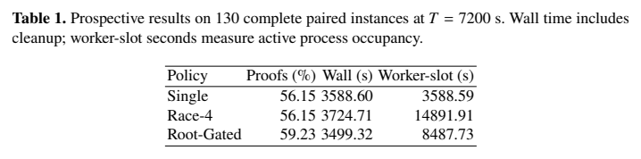

# 哪些匹配求解实例值得多开三个并行进程？

<!-- 全库方法复筛开始 -->
> **方法储备 · 业务决策与理论储备**。保留“求解器根节点门控的并行资源分配”这一研究问题或机制；是否用于当前业务另行验证。
> 原有阅读范围与证据等级不变；储备不等于效果已验证。
> 已恢复此前因业务距离被移出的原笔记；旧取舍原因仅作历史记录。
> [[研究前沿/论文库复筛与阅读路线|全库阅读路线]] · [[研究前沿/业务决策与理论储备/存量论文分层索引|本方向完整分层]]
<!-- 全库方法复筛结束 -->

130 个实例、两小时期限下，按根节点信号决定是否并行的方案证明最优 77 个，单进程和始终四进程各 73 个。对比始终四进程，平均进程占用秒数减少 43.0%。

## 论文与阅读范围

To Race or Not to Race? Exploiting Performance Variability in Mixed-Integer Programming via Root-Gated Resource Allocation。Mourchid Adegbindin、Brenda Dietrich、Jamol Pender。首次公开 2026-11-12，所读版本 v1（2026-11-12）。精读 §3–6、表 1、图 1 及附录算法 1。 [一手来源](https://arxiv.org/abs/2611.16543v1) · [paper.pdf](./assets/source/paper.pdf) · [paper.html](./assets/source/paper.html)

## 怎样计算

先启动一个 SCIP 实例。首个根 LP 解出后读取对偶退化指标，若 $d_{\rm root}\ge0.25$ 则再启动三个用不同种子的进程，否则保持原进程。信号缺失、无效或原任务已经完成时也保持单进程。各副本共用剩余的全局截止时间。一旦有合格终止证明，停止其余进程。

## 与哪些方法比较

阈值在前瞻性评估前固定。主对照使用相同实例和种子块。门控、单进程、始终四进程的平均进程占用分别为 8,487.73、3,588.59、14,891.91 秒。相对始终并行节省的 95% 自助区间为 34.51%–51.39%。多解出的 4 例在配对双侧 McNemar 检验中 p=0.125。

原文表 1。Wall 和 Worker-slot 采用不同的计量单位。 [原文第 11 页](./assets/source/paper.pdf#page=11)

## 适用条件与迁移

指标为活动进程占用，并非 CPU 利用率。相较单进程仍要多占资源。在线匹配须能在求解器根节点读到相同信号，且异步启动延迟、全局资源争抢、返回可行解与证明最优的区别都会影响结论。原文给出附录 B 伪代码，未核验公开可执行控制器。

[[研究前沿/动态等待与匹配决策/02-可复用方法卡/RootGatedRacing-从根节点观测决定是否分配并行副本|从根节点观测决定是否分配并行副本]] · [[研究前沿/动态等待与匹配决策/03-实验假设与结果/RootGatedRacing-在固定总算力下检验匹配求解器的按需并发|在固定总算力下检验匹配求解器的按需并发（未运行）]]
