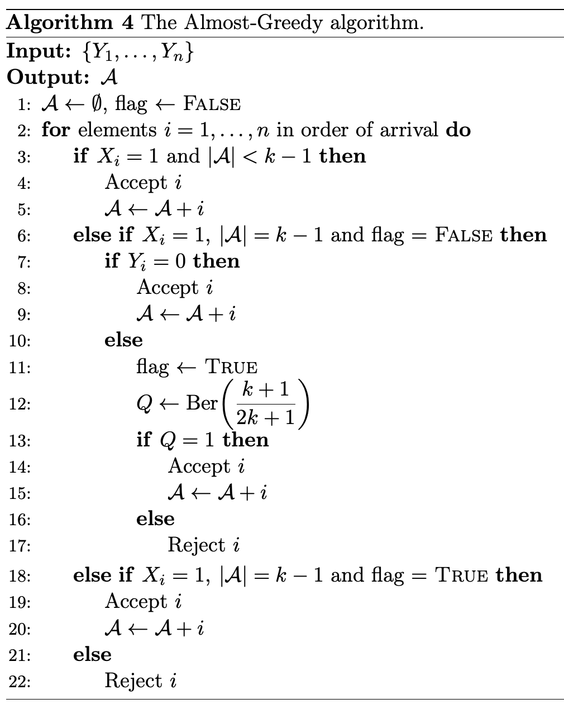

# 独立样本能为争抢同一容量的候选保留多大接纳概率

**Optimal Contention Resolution from Samples**  
Shaddin Dughmi、Vasilis Livanos、Pranav Nuti。首次提交及当前版本 v1 均为 2026-11-05。作者预印本；截至核验日版本记录仅列 v1。 [arXiv 版本记录](https://arxiv.org/abs/2611.08673v1)

[本地 PDF](./assets/source/paper.pdf) · [本地 HTML](./assets/source/paper.html) · [[研究前沿/动态等待与匹配决策/01-论文原文与精读/SampleContention/阅读覆盖|阅读范围与原文定位]] · [[研究前沿/动态等待与匹配决策/01-论文原文与精读/SampleContention/代码核验|代码核验]]

## 同一个名额，保护的是谁

每个候选 $i$ 在线只出现一次，揭示独立激活位 $X_i\sim\mathrm{Ber}(p_i)$，满足 $\sum_i p_i\le k$。可接纳任意至多 $k$ 个已激活的候选。概率向量对算法未知，各离线样本与真实激活及其他候选的抽样相互独立，来自各自的同一分布。算法须在到达时不可撤销地决定。随机序均匀打乱全部候选；对抗序允许任意预先固定的排列，并要求其独立于激活、样本与随机种子。作者使用的指标为

$$
C_i=\Pr(i\in A\mid X_i=1),\qquad c=\inf_{i:p_i>0}C_i .
$$

它回答“如果此人确实可用，能保住多少被接纳的概率”。平均接单数、带权收益和等待时长都需要单独评价。各定理常把激活概率总和取等于 $k$ 做证明，第 2 节注 2.1 及附录 C.5 用虚拟元素的单调性或直接计算处理未满的情形。[模型](https://arxiv.org/html/2611.08673v1#S2) · [未满容量的处理](https://arxiv.org/html/2611.08673v1#A3.SS5)

## 均匀随机到达时，调节最后一个名额

单名额算法 1 在在线激活且历史样本未激活时直接接纳；两次都激活时以 $1-1/e$ 概率接纳，成功就停止。进入接纳候选集合的边际概率为 $p_i(1-p_i/e)$，频繁激活元素相对少占名额。定理 3.1 给出最坏条件接纳率至少 $1-1/e$。一般容量的算法 4 直接取前 $k-1$ 个激活者。第 $k$ 人样本未激活则取，样本激活则以 $(k+1)/(2k+1)$ 概率取。若硬币拒绝，留给下一位激活者。虽然一次运行至多读取一个人的样本，事前无法预知是谁，算法需要为每个候选准备样本。作者给出的最优全信息随机序界为

$$
\gamma_k=1-e^{-k}\frac{k^k}{k!}.
$$

证明从给定其余活跃数时目标在其中的排名均匀出发，只修正第 $k$、$k+1$ 两个名次。纯贪心最坏界至少 $\min\{k/(k+1),\gamma_k\}$，无样本算法也存在相同的全局上界。故 $k=1,2,3,4$ 时一份样本有最坏界上的价值，而 $k\ge5$ 时纯贪心已经够。这里的最优指全部容许概率向量和规模上的最坏界。[算法 4](https://arxiv.org/html/2611.08673v1#alg4) · [定理 4.1](https://arxiv.org/html/2611.08673v1#S4.Thmtheorem1) · [推论 5.1 与命题 5.1](https://arxiv.org/html/2611.08673v1#S5.SS1)

## 顺序可固定得很不利时，样本数改变了可达界

| 容量与样本 | 作者取得的证据 | 对照与局限 |
|---|---|---|
| 单名额，一份样本 | 算法 3 构造阈值，给出 $C_i>0.48$ | 定理 3.2 排除最坏 $1/2$，即使算法知道固定顺序 |
| 单名额，两份样本 | 用算法 2 定位阈值元素，跳过它并取后方首个激活者；得到 $C_i\ge1/2$ | 在 $\sum p_i=1$ 时阈值为起点的概率为 $1/2$，为元素 $i$ 的概率为 $p_i/2$ |
| 固定 $k\ge2$，一份样本 | 算法 5 以样本前缀作候选入围测试，再从候选位置抽取名额，得 $1-O(k^{-1/2})$ | 任意固定有限的每元素样本数，都有某些实例严格低于已知概率向量的最优对抗序界 |

算法 2 的阈值是从两列历史激活中选出的元素身份，其在线出现就开启后续接纳；取值为 0 时从开头起即可接纳。它无需提前掌握全排列，但须观察所有到达，包括在线未激活的阈值元素。若平台只看见激活者，算法接口就发生了变化。算法 5 所比较的全信息对抗序界与上节的随机序 $\gamma_k$ 是不同基准。[算法 2、定理 3.3](https://arxiv.org/html/2611.08673v1#S3.Thmtheorem3) · [定理 4.2](https://arxiv.org/html/2611.08673v1#S4.Thmtheorem2) · [对抗序下界](https://arxiv.org/html/2611.08673v1#S5.Thmtheorem1)

## 可迁移的资源条件与证据等级

若一个时窗有 $k$ 个同质并且不会提前释放的服务名额，候选一旦出现即可判断是否激活，这套规则可作单个资源池实验的可解释对照。订单和司机双端冲突、抢单导致其余候选改变响应、等待引发放弃或改派，都会改动原模型。文中没有车队回放、业务指标或等待成本的最优性。作者披露问题和定理 3.1 的证明由作者提出，其他若干算法、证明有模型参与，作者对全文负责。此处核对版本、伪代码、定理前提与论证路径；最优性及下界仍按作者预印本主张记录，未独立逐行验证。[作者披露](https://arxiv.org/html/2611.08673v1#Sx1)

## 原文算法与证据

算法 4 第 6–19 行只在第 k 个活跃到达的样本也活跃时抛一次硬币；若拒绝，下一位活跃者直接拿到剩余名额。

## 方法与实验

[[研究前沿/动态等待与匹配决策/02-可复用方法卡/SampleContention-last-slot|只对随机到达的最后名额做单样本调节]] · [[研究前沿/动态等待与匹配决策/02-可复用方法卡/SampleContention-sentinel|用两份激活样本抽选开始接纳的阈值元素]]

[[研究前沿/动态等待与匹配决策/03-实验假设与结果/2026-11-10-在单容量池检验单样本末位调节与双样本阈值|在单容量池检验单样本末位调节与双样本阈值（未运行）]]
