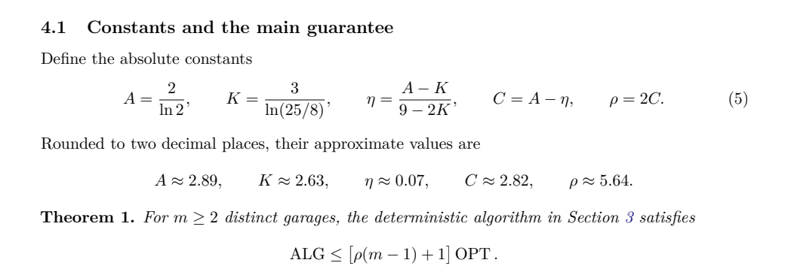

# Online Transportation via Shifted Geometric Scales

<!-- 全库方法复筛开始 -->
> **方法储备 · 业务决策与理论储备**。保留“按几何尺度分解的在线运输”这一研究问题或机制；是否用于当前业务另行验证。
> 原有阅读范围与证据等级不变；储备不等于效果已验证。
> 已恢复此前因业务距离被移出的原笔记；旧取舍原因仅作历史记录。
> [[研究前沿/论文库复筛与阅读路线|全库阅读路线]] · [[研究前沿/业务决策与理论储备/存量论文分层索引|本方向完整分层]]
<!-- 全库方法复筛结束 -->

给定 m 个固定资源点，每单到达须立即绑定且不能改派。先按资源点最小生成树设搜索尺度，再在虚拟分配中换位，可把总距离的最坏上界压至约 5.64(m−1)+1 倍离线最优。

John Jeang。首次提交 2026-11-12，本次核对首版 v1。以上日期为 UTC；本批未独立核实正式发表日期。核读 §2–3 虚拟与实际分配、§4.1、§4.3–4.5；§4.6–4.7 的几何常数按作者引理引用，未独立重证。

[arXiv 版本页](https://arxiv.org/abs/2611.17090v1) · [本地 PDF](./assets/source/paper.pdf) · [本地 HTML](./assets/source/paper.html)

## 容量集中在少数地点

所有资源点彼此的距离和整数容量已知。单个请求只消耗一个单元直到期末，可行输入总数不超过总容量。最近空位贪心没有为以后保留地理接近性。若把同一位置拆成许多独立服务器，传统界随总容量而非地点数增长。

## 如何选择尺度和落点

按原始距离先建最小生成树。把边长向下取整到同一套带相位的二倍刻度，遍历由树边决定的有限候选相位，最小化总取整失真 H 与最坏同尺度树重 F 的和。到单时从最近资源点发起虚拟深搜；遇空位即停，只有更小优先级可以驱逐已停的较大优先级虚拟请求，后者继续其旧行程。虚拟链最后新占用的空位才是这次真实指派。

## 为什么没有暗中改派

链内交换原有虚拟占用者，不改变真实占用计数；最终只有一个地点多占一格。度量三角不等式使真实距离可由整条虚拟路径上界。定理 1 的系数 ρ 由 §4.1 式 (5) 给定，约为 5.64。没有给出有限实例上的典型节省，更没有覆盖资源回流、可取消请求或等候后再匹配。

§4.1 的常数与定理 1，原 PDF 第 6 页。

## 实现与验证入口

未核到作者仓库。§3.1–3.2 是可直接核查的预处理与在线搜索顺序。

- [[研究前沿/动态等待与匹配决策/02-可复用方法卡/ShiftedTransport-phase|固定资源点的树搜索如何选择尺度相位并保持真实指派]]
- [[研究前沿/动态等待与匹配决策/03-实验假设与结果/ShiftedTransport-phase|同样的虚拟交换规则下，相位选择能否减少真实距离]]
