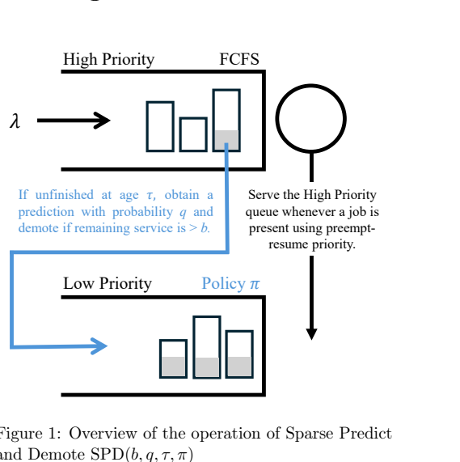

# Sparse Predict and Demote: Optimal Scheduling with Minimal Size Advice

<!-- 全库方法复筛开始 -->
> **方法储备 · 业务决策与理论储备**。保留“预测辅助的稀疏队列降级策略”这一研究问题或机制；是否用于当前业务另行验证。
> 原有阅读范围与证据等级不变；储备不等于效果已验证。
> 已恢复此前因业务距离被移出的原笔记；旧取舍原因仅作历史记录。
> [[研究前沿/论文库复筛与阅读路线|全库阅读路线]] · [[研究前沿/业务决策与理论储备/存量论文分层索引|本方向完整分层]]
<!-- 全库方法复筛结束 -->

单服务器队列不必为每个任务预测完整耗时。在论文限定的服务时长分布下，只对极少数未完成任务问一次“还会不会很长”，即可达到与已知真实大小的最短剩余时间优先同阶的重载平均响应时间。

作者 Chengyi Liu、Thodoris Lykouris、Junxuan Shen、Adam Wierman。首次提交 2026-11-06，本次核验同一 v1，未见独立的修订或正式发表日期。本期核读§3–6、图 1–2，重点核对尾部分布分界、抽样查询、预测占用及数值参数；附录重载展开未复算。

[arXiv 版本页](https://arxiv.org/abs/2611.10293v1) · [本地 PDF](./assets/source/paper.pdf) · [本地 HTML](./assets/source/paper.html)

## 问题、机制与证据

每个任务先进入高优先级 FCFS 队列，累计已获服务量达到 $\tau$ 还没结束时，以概率 $q$ 请求大小预测。若余下服务量超过屏障 $b$，永久调入低优先级队列。高优先级队列严格抢占低优先级队列。$\tau$ 按**已获得的服务量**计时；队尾排了很久但尚未获得服务，并不触发询问。

**为什么稀疏预测能起作用。** 先调低屏障，使符合降级条件的任务变多，再少量抽查，将分流比例与剩余容量 $1-\rho$ 配平。定理 4.3 与 4.6 分别给出到达即抽查、服务一段再抽查的保证。对论文定义的对数正态或更轻的尾部类，在负载趋于 1 时，查询比例趋零而平均响应与精确 SRPT 同阶。对某些中间尾部，任何双 FCFS 优先级的单比特分配都达不到该阶，定理 4.7 的扩展需为稀疏子集查询完整耗时并在后台使用 SRPT。§5 把查询自身占用服务器、固定乘性预测误差等条件加入分析。

**证据。** 图 2 用闭式均值数值计算，按负载分别调参数，预测是耗时且精确的。以免费获得真实大小的 SRPT 为分母，在 $0.85\le\rho\le0.99$ 的四个图示分布上，SPD(FCFS) 和 SPD(SRPT) 最差观测比值为 4.72 与 4.00。图示最高负载下预测比例均不高于 $1.42\times10^{-5}$；部分中度负载 FB 更好。结果指平均响应，对低优先级尾部及不可抢占、多服务台业务没有相同保证。

图 1 的双队列、查询与降级，原文 PDF 第 10 页。

## 实现与后续验证

核对版本页与全文，未见官方仓库；原理可按 §4 图 1 及式中四个参数定义重建。

- [[研究前沿/动态等待与匹配决策/02-可复用方法卡/SparsePredictDemote-sparse|按已获服务时长抽查，再把长任务降级]]
- [[研究前沿/动态等待与匹配决策/03-实验假设与结果/SparsePredictDemote-inference|把预测本身占用的处理时间算进去，稀疏查询何时得益]]
