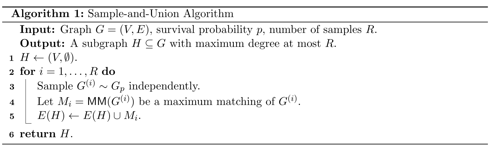

# Stochastic Matching with Polynomial Degree

[官方论文](https://arxiv.org/abs/2611.03367) · [本地PDF](./assets/source/paper.pdf) · [HTML快照](./assets/source/paper.html)

版本记录：[Submitted on 2 Nov 2026]；本次核验与精读：2026-11-06。本篇为滚动窗口内首次入库；检索日不等于首次发表日。

阅读范围：§1–2问题、主结果和技术概述、§3.3边际校准及证明；完整稀疏化证明和附录改进未逐行复证。未逐行复证全部数学证明，未声称逐页翻译。[[研究前沿/动态等待与匹配决策/01-论文原文与精读/SparseStochasticMatching/阅读覆盖|原文章节与公式索引]]；HTML为原始快照，外部样式和图片可能需要联网，PDF可离线阅读。

代码：本次核验的论文原文与元数据未提供可确认的作者实现入口；代码状态未知，不能据此断言不存在。未运行代码。 [[研究前沿/动态等待与匹配决策/01-论文原文与精读/SparseStochasticMatching/代码核验|核验记录]]

## 问题和结果

在已知图G中，每条边独立以相同概率p存活；真实状态查询昂贵。先选稀疏子图H，再查询H所有边并在存活边上找最大匹配。目标是 $E\mu(H\cap G_p)\ge(1-\varepsilon)E\mu(G_p)$，同时控制每节点查询数。

本文分析既有sample-and-union算法：反复模拟独立存活图、求其最大匹配，取这些匹配的并集为候选H。新的主要证据为度数界 $O(\log(1/\varepsilon)/(\varepsilon^4p))$；附录B给改法更强界 $O(\varepsilon^{-2}p^{-1}+\varepsilon^{-3})$，本次未展开该改法。

## 关键分析模块：保边际、控总协方差（§2–3）

单独保持各节点被匹配概率不保证两端同时空闲。作者构造另一匹配分布，保持每节点覆盖边际，且总绝对协方差为 $O(E|M|)$。以 $w_v=\theta_v+\xi_v$、独立 $\xi_v\sim U[-1,1]$ 做最大覆盖顶点权匹配；边际不足就增加θ，过大就降低。更新 $\theta_v\leftarrow\theta_v+s_v-m_v(\theta)$。

Lemma3.3给ρ精度下至多 $\lceil2n/\rho^2\rceil$ 次更新。正文证明收尾出现少一个平方的印刷表达，与前面势下降ρ²/2不一致；记录以上界声明及推导一致形式。精确边际通过匹配**分布**极限得到，不保证有限权值迭代就精确达到；期望边际oracle的实际估计成本未解决。

## 证据与边界

证据类型为理论，改进已有多项式/准多项式查询度数界，未给线上接单收益。分析的“去相关分布”不是sample-and-union实施时必须额外训练的网络。边独立、同p、无权最大匹配是主要条件，真实接受响应常因共享司机/时间相关；可以研究采样并集候选生成，但不能直接把理论扩展到相关拒单。

## 原文关键图表

原文 Algorithm 1，PDF 第 10 页；原始裁图，机制和证据解释见上文。裁图坐标与源文件校验值见 assets/source/figure-provenance.json。

## 方法卡

- [[研究前沿/动态等待与匹配决策/02-可复用方法卡/SparseStochasticMatching-sample-union|随机可行图匹配并集作为有限查询候选]]
