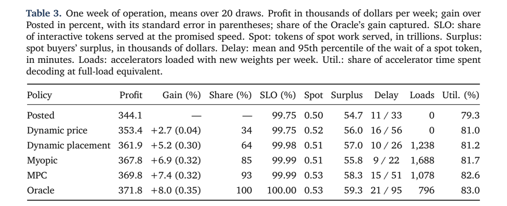

# Spot Markets for AI Inference: Dynamic Capacity Allocation and Pricing on a Shared Accelerator Fleet

<!-- 全库方法复筛开始 -->
> **方法储备 · 业务决策与理论储备**。保留“推理容量与竞价资源的动态分配”这一研究问题或机制；是否用于当前业务另行验证。
> 原有阅读范围与证据等级不变；储备不等于效果已验证。
> 已恢复此前因业务距离被移出的原笔记；旧取舍原因仅作历史记录。
> [[研究前沿/论文库复筛与阅读路线|全库阅读路线]] · [[研究前沿/业务决策与理论储备/存量论文分层索引|本方向完整分层]]
<!-- 全库方法复筛结束 -->

在固定容量、需求已知且采用线性需求曲线的单模型中，价格取决于截止前最便宜的服务时段，其中包括未来容量的影子价格与等待成本。共享算力仿真还允许慢速重配容量和快速调价。

Quanyan Zhu。首次提交 2026-11-08，本次核对首版 v1。以上日期为 UTC；本批未独立核实正式发表日期。核读 §4–5 两层容量及截止公式、§6 控制器、§7 表 2–3/灵敏度与附录 C。证明链按相应简化模型检查，未再训练或重跑数值实验。

[arXiv 版本页](https://arxiv.org/abs/2611.11215v1) · [本地 PDF](./assets/source/paper.pdf) · [本地 HTML](./assets/source/paper.html)

## 可等待工作如何使用容量

交互推理有最低速度要求，可延迟的 spot 工作有截止。批量不同使同一加速器在两层提供不同吞吐。模型加载慢且有切换成本；同一模型内在交互和 spot 间填补容量更快。控制器观察按截止分桶的积压、需求预测、可用算力与电力约束。

## 截止如何变成价格

固定单模型部署并假定需求已知时，窗口 W 内各时段的边际服务成本由电费、容量影子价格及逐时段持有成本组成。取它们的最小值得到 C，有正销量且解在相应内点时，最优报价是交互标价与 C 的均值。跨模型一般情形用线性近似收入与累计服务约束滚动求解，以预测 4 小时的第一步作为当前动作。

## 哪一种干预解释利润

同一个规划器派生固定半价且限流的 Posted、仅调价、仅换部署、短视、4 小时 MPC、提前看实际未来的 Oracle。表 3 的全周相对增利为 7.4%，占 Oracle 增量的 93%；五个无事件日 MPC 约 2.5%，单调价约 2.4%，模型发布冲击日系统提升 38.4%。数据含公开时段形状，冲击、价格反应和电网事件为模型设定，不能直接解释为真实市场效果。

表 3，共同仿真环境下六种控制策略，原 PDF 第 24 页。

## 实现与验证入口

附录 C 列 spot/code/spotsim.py、concept.py、run.py。此次检查 arXiv 源包只找到 TeX 与 figures，未核到可下载的这三个脚本。

- [[研究前沿/动态等待与匹配决策/02-可复用方法卡/SpotFleetMPC-window|用截止前最便宜的容量计算可推迟工作的成本]]
- [[研究前沿/动态等待与匹配决策/02-可复用方法卡/SpotFleetMPC-switch|一过性高峰应调价还是搬动容量]]
- [[研究前沿/动态等待与匹配决策/03-实验假设与结果/SpotFleetMPC-window|期限窗口是否真让同一批工作使用了更便宜容量]]
