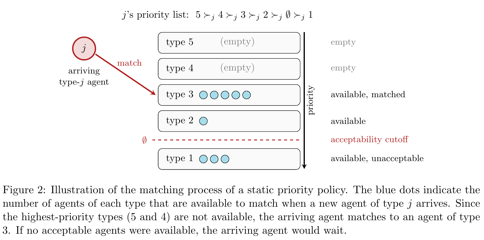

# Dynamic Matching with Abandonment: Optimal Guarantees via Static Priority Policies

[官方论文](https://arxiv.org/abs/2610.12991) · [本地 PDF](./assets/source/paper.pdf) · [HTML 快照](./assets/source/paper.html)

首次提交：2026-10-09；本次精读：2026-11-05；核验版本：v1。会议正式发表日期未核验。本文是旧队列补精读，不是今日新发表。

阅读范围：核心方法、关键公式、主实验/理论条件及与迁移直接相关的附录。未逐行复证全部证明，也不称逐页翻译；具体覆盖见 [[研究前沿/动态等待与匹配决策/01-论文原文与精读/StaticPriority/阅读覆盖|阅读覆盖]]。HTML 为原始快照，外部样式/图片可能需要联网；PDF 是完整离线原文。

代码状态：原文未提供可核验的公开官方仓库入口；未把文中本地脚本名、提交哈希或同名项目当成已取得代码。本次未运行作者代码。

## 1. 研究问题与结论

主体随机到达、会放弃，匹配奖励依赖类型与先后到达顺序。论文证明，适当计算的确定性静态优先级在长期平均奖励上至少达到全知最优的二分之一；这是该模型最坏情形可达到的最优竞争保证。它不是“收益提升50%”，也不意味着每个具体实例都最优。

## 2. 模型与基准（§2）

独立Poisson到达、独立指数耐心；未知未来离开时间；一般两两匹配，允许非二部图、$r_{ij}\ne r_{ji}$。策略只在新主体到达时匹配，列表预先固定，但会根据当前是否有可用主体执行。目标为长期奖励，不含另一篇LQ那样的持有与放弃成本。

全知基准看到全部实际到达/离开，用完整兼容图的最大权匹配计算。LP上界不仅限制每类供给，还限制一组类型中“至少有一个仍存在”的概率：

$$
\sum_{i\in S}x_{ij}\le\lambda_j\left(1-e^{-\sum_{i\in S}\lambda_i/\mu_i}\right).
$$

这里存在（present）不等于未被匹配的可用（available），不能直接把存在概率当策略可用概率。

## 3. 可用性下界与价值型优先级（§3–6）

核心随机过程工具 Lemma 3.3：在静态优先级策略的稳态下，定义

$$
\rho(S)=\sum_{i\in S}\lambda_i/\mu_i,\qquad\gamma_S=\frac{1-e^{-\rho(S)}}{\rho(S)},\qquad
\Pr\left(\sum_{i\in S}N_i^\pi>0\right)\ge\gamma_S\sum_{i\in S}\mathbb E[N_i^\pi].
$$

它在类型可用性相关时仍提供可分析的下界；不是一般随机库存的通用不等式。证明利用静态列表的 IIA 删除性质、Poisson过程与稳态比较。

原始路线用带可用性约束的LP，逐次删除零流量边，最多类型数平方加一次LP，得到可由嵌套紧约束读出列表的 suitable 解。对偶路线给每类一个机会成本 $v_i$，新到达 $j$ 按 $r_{ij}-v_i-v_j$ 排序，正分边接受、负分边拒绝。值必须解论文的平衡方程，不能任取启发式影子价后声称二分之一保证。

设 $u_{ij}=(r_{ij}-v_i-v_j)^+$，对每个排序前缀用相邻剩余分差 $Z_{Sj}$ 分解收益，价值满足

$$
\mu_i v_i=\sum_j\lambda_j\sum_{S\ni i}\gamma_S Z_{Sj}(v).
$$

左边是等待主体随放弃损失的价值率，右边是其为未来到达提供匹配盈余的保守价值率。原映射不一定收缩；论文证明阻尼后可收缩，并给多项式计算论证，不能用未经验证的无阻尼迭代代替。

图表为原始PDF裁图，页码见图片说明及附件溯源记录；数字与标记以原图为准。

## 4. 证据强度与局限

主要证据是定理与构造例，不是工业效果实验。价值同时下界策略收益、上界全知LP的一半，从而串起保证；附录有完整证明。本文没有报告真实平台AB，也没有未知参数在线学习保证。数学上多项式可解不等于已达到工业毫秒时延，指数多个约束通过分离/次模优化处理，工程代价需单独核验。

## 5. 迁移价值

适合作为复杂学习策略的强理论基线，以及机会成本定价、长期可用性建模的研究起点。若到达率、耐心率由模型估计或实时更新，原始固定参数保证会改变；应报告参数偏差敏感性。只需一份正文，与LongestQueue互相链接，分别保留基准、时域与成本定义。

## 方法卡与后续实验

- [[研究前沿/动态等待与匹配决策/02-可复用方法卡/StaticPriority-value-priority|按剩余匹配盈余排序的静态优先级]]
- [[研究前沿/动态等待与匹配决策/02-可复用方法卡/StaticPriority-availability-certificate|相关可用库存的概率下界与策略证书]]

## 关联阅读

[[研究前沿/动态等待与匹配决策/01-论文原文与精读/LongestQueue/精读|LongestQueue：比较模型假设、评价基准与保证口径]]。两篇保证对应不同基准，不直接比较常数大小。
