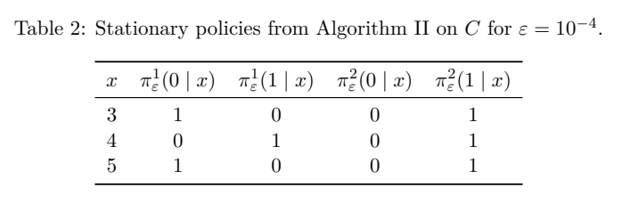

# Discrete-Time Zero-Sum Markov Games with Control, Stopping, and State-Dependent Discounting

<!-- 全库方法复筛开始 -->
> **方法储备 · 业务决策与理论储备**。保留“零和停止博弈的价值界”这一研究问题或机制；是否用于当前业务另行验证。
> 原有阅读范围与证据等级不变；储备不等于效果已验证。
> 已恢复此前因业务距离被移出的原笔记；旧取舍原因仅作历史记录。
> [[研究前沿/论文库复筛与阅读路线|全库阅读路线]] · [[研究前沿/业务决策与理论储备/存量论文分层索引|本方向完整分层]]
<!-- 全库方法复筛结束 -->

当请求方与服务方都能终止合约，等待价值还取决于谁先退出。一个零和排队算例中，客户在队长至多 2 或至少 7 时退出，只有队长 3–5 时双方都继续。

作者 Guanghui Feng、Xin Guo。首次提交 2026-11-07，本次核验同一 v1，未见独立的修订或正式发表日期。本期核读§2–6、定理 3.4、4.2、5.1–5.3、表 1–2，重点为同时停止的收益约定和迭代验证；存在性证明未逐行重推。

[arXiv 版本页](https://arxiv.org/abs/2611.10396v1) · [本地 PDF](./assets/source/paper.pdf) · [本地 HTML](./assets/source/paper.html)

## 问题、机制与证据

双方看到同一队列状态。任意一方都可先终止；双方同时终止按第一方的终止收益 $g_1$ 结算，第二方先终止时为 $g_2$。继续时双方选择控制动作，获得零和的当期转移支付、改变队列转移概率，然后以状态相关的因子折现。外生系统故障也可以结束博弈。

**求值与取策略。** 给定上一步价值，先解继续动作的局部零和矩阵博弈，得到 $I_\alpha u$。把继续价值置于双方的终止选项之间，更新为 $T_\alpha u=\max\{g_1,\min(g_2,I_\alpha u)\}$。即使 $g_1>g_2$，同时终止约定仍确定更新顺序。定理 3.4 在加权范数漂移、折现与连续性等条件下保证收敛；达到各方终止集合的首次时间给平稳均衡。终止支付不同的状态集有限且动作有限时，算法 I 用相邻两轮的差控制精度，算法 II 提取 $\varepsilon$ 均衡。

**算例与局限。** §6 客户选择是否加快提交，服务方选择是否增配容量。数字没有用运营数据拟合。表 1 在 49 次迭代后达到 $10^{-6}$ 价值精度；表 2 对 $10^{-4}$ 均衡给出明确动作，双方在队长 3、4、5 继续时服务方都增配，客户只在 4 增加提交。队长 6 由服务方停止，7 以上双方都停。真实用户和平台若关心不同的外部成本或无需同时行动，须重建博弈与收益。

表 2 的队长、双方平稳控制动作，原文 PDF 第 27 页。

## 实现与后续验证

版本页与全文未列实现仓库。§5 算法 I/II 及 §6 的转移概率、支付、折现参数可作为重建入口。

- [[研究前沿/动态等待与匹配决策/02-可复用方法卡/StoppingQueueGame-obstacles|用双边终止支付约束继续价值]]
- [[研究前沿/动态等待与匹配决策/03-实验假设与结果/StoppingQueueGame-tie|同时退出时的结算顺序能否翻转等待边界]]
