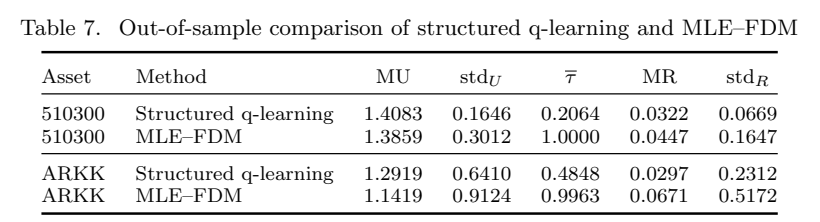

# Continuous-time q-Learning for Finite-Horizon Portfolio Choice with Optimal Stopping in Jump-Diffusion Markets

作者 Tingting Zhang、Can Yang。首次发布 2026-11-05，此次核验的版本为 v1（2026-11-05），阅读于 2026-11-09。arXiv 优化与控制预印本。阅读 §2–5 的建模、算法 1、§6 的数值设计与结果、附录有限差分对照，未复证附录所有随机分析细节。

[作者原文](https://arxiv.org/abs/2611.07362) · [离线 PDF](./assets/source/paper.pdf)

## 同时决定何时停和等待期间做什么

原问题在有限时域内选择连续控制 $a$ 和停止时间 $\tau$，最大化折现的停止收益 $\mathbb E[e^{-\rho\tau}g(\tau,X_\tau)]$。例子中 $X$ 是财富、$a$ 是风险资产比例，状态会连续波动也会突然跳变。对等待决策的联系在于一次立即行动有价值 $g$，继续行动可以改变未来状态及其价值。移植时必须重新指定资源到达、竞争与放弃过程。

## 如何从一条轨迹得到更新

- §2 式 (3)–(7) 给 HJB 变分不等式加障碍罚项 $K(g-V)^+=\max_{\beta\in\{0,1\}}K\beta(g-V)$。有限 $K$ 对应以强度终止，辅助状态 $R_{l+1}=R_l e^{-K\beta_l\Delta t}$ 追踪累计作用。定理 2.3 在论文给定的正则与有界黏性解条件下证明未加熵罚问题随 $K$ 增大单调逼近原值。
- §5 式 (33) 从同一个价值函数构造动作值，$\mathcal L^a_\phi$ 为局部扩散生成算子，$\mathcal J^a_\phi$ 为跳跃后的非局部价值差，$\phi$ 为未知动力学参数。
$$
q_{\theta,\phi}=\partial_t V_\theta+(\mathcal L^a_\phi+\mathcal J^a_\phi)V_\theta-\rho V_\theta+K\beta(g-V_\theta).
$$
- 算法 1 训练时按 $\pi(a,\beta\mid t,x)\propto\exp(q_{\theta,\phi}/\lambda)$ 探索，用整条轨迹上的鞅正交条件更新价值与生成算子参数，配合到期收益、吸收边界和熵一致性约束。部署原问题的策略时，在离散网格第一次 $V_\theta\leq g$ 时停止，否则在 $\beta=0$ 的动作中取最大 $q$。训练时的二元探索动作和最终触发时刻有不同的定义。

## 作者实验及可归因范围

| 对照 | 证据 | 读法 |
|---|---|---|
| 已知市场参数的有限差分求解 | §6.1.4 图 4，模拟状态上的停止分类 | 各测试时点平均一致率超过 98%，最低约 95%；参考是已知模型下的数值策略。 |
| 训练期最大似然估参＋有限差分（MLE–FDM） | §6.2 表 7，每只 ETF 使用同一组 5,000 条留出期日收益独立有放回重采样的一年路径 | 510300 的折现效用均值为 1.4083 对 1.3859，ARKK 为 1.2919 对 1.1419；相对约 +1.61% 与 +13.13%。 |
| 收益与退出行为 | 同表，分母及计量保持一致 | 两资产的平均财富收益分别为 0.0322 对 0.0447、0.0297 对 0.0671；平均终止时间分别为 0.2064 对 1.0000、0.4848 对 0.9963 年。优化效用与财富收益会给出不同排序。 |

训练/测试按日期切分。510300 训练至 2019 年底，ARKK 至 2021 年底，各自测试期至 2025 年底；独立重采样不会保留时序相关。模型将生成算子、罚项、鞅训练、熵温度及提取规则联合使用，表 7 不能分摊给某一项。没有派单数据、队列间干扰评估或线上收益。

## 原文证据

表 7，两种策略在同一组留出期收益重采样路径上的效用、终止时间和财富收益，PDF 第 25 页。

## 代码与关联

本次检查论文全文、arXiv 记录和按题名检索结果，作者算法仓库入口未知。

- [[研究前沿/动态等待与匹配决策/02-可复用方法卡/StructuredStoppingQ-generator-q|带停止罚项的生成算子 q 函数]]
- [[研究前沿/动态等待与匹配决策/03-实验假设与结果/StructuredStoppingQ-boundary-recovery|供需跳变时，结构化动作值能否恢复等待边界]]
