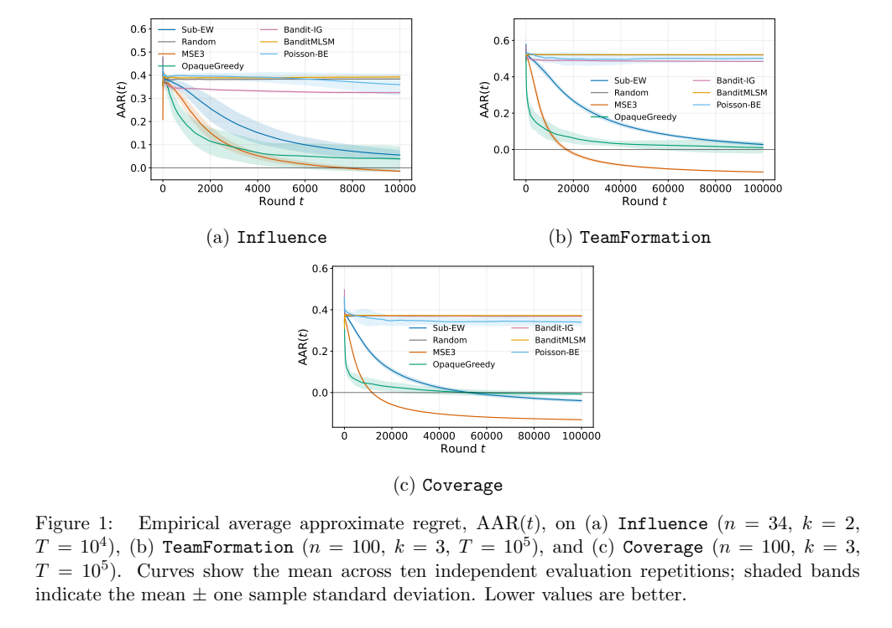

# Efficient Online Submodular Maximization with Bandit Feedback

<!-- 全库方法复筛开始 -->
> **方法储备 · 业务决策与理论储备**。保留“次模目标的 bandit 反馈选择”这一研究问题或机制；是否用于当前业务另行验证。
> 原有阅读范围与证据等级不变；储备不等于效果已验证。
> 已恢复此前因业务距离被移出的原笔记；旧取舍原因仅作历史记录。
> [[研究前沿/论文库复筛与阅读路线|全库阅读路线]] · [[研究前沿/业务决策与理论储备/存量论文分层索引|本方向完整分层]]
<!-- 全库方法复筛结束 -->

每次可选至多 k 个资源且只收到整组收益时，可以随机化组规模，从一次反馈估计元素权重更新。理论保证覆盖任意单调次模收益；作者的三组基准里，另一方法 MSE3 的最终平均近似遗憾都更低。

作者 Iasonas Nikolaou、Evimaria Terzi。首次提交 2026-11-09，本次核验同一 v1，未见独立的修订或正式发表日期。本期核读§3–6、算法 2、式 (1)–(7)、定理 3–5、图 1 及附录 E；核对仓库算法路径，未运行。

[arXiv 版本页](https://arxiv.org/abs/2611.11808v1) · [本地 PDF](./assets/source/paper.pdf) · [本地 HTML](./assets/source/paper.html)

## 问题、机制与证据

时刻 $t$ 从固定的 $n$ 个候选里挑不超过 $k$ 个。只观察执行集合 $S_t$ 的标量收益 $f_t(S_t)$；$f_t$ 归一化、单调、次模且在 $[0,1]$ 内。比较对象是事后在整个时段始终选择的最佳固定集合，比较时将其累计收益乘 $1-1/e$。这与无限制每轮改选的全知基准不同。

**一轮怎样更新。** 算法预先确定组规模分布 $q_m$、势函数系数 $a_m$。每轮抽次数 $M$，从同一元素分布 $p_t$ 有放回抽 $M$ 次，去重得到实际执行集合；保留去重前的出现次数 $N_i$。式 (5) 的估计量 $a_M f_t(S_t)N_i/(q_M p_{t,i})$ 对势梯度无偏。式 (6) 将奖励平移为 $f_t(S_t)-1$ 后送给指数权重更新，维持每项概率为正。组规模随机化与势系数配套，不能任意替换。

**理论与基准。** 在 $2\le k<n$ 等条件下，定理 3–5 给出 $O(k\sqrt{nT\log(n/k)})$ 的期望近似遗憾；单轮时间 $O(n+k\log n)$。图 1 将候选影响传播、组队、覆盖三个基准的最佳固定集合穷举作为比较，按 10 组独立运行画均值和一个样本标准差。Sub-EW 全部好于 Random、Bandit-IG、BanditMLSM 和 Poisson-BE；MSE3 全部更优，OpaqueGreedy 在影响传播、组队也更优。三种基准皆属更窄的 sum-max 类，正好落在 MSE3 的理论范围。

图 1 的三项任务近似遗憾对比，原文 PDF 第 12 页。

## 实现与后续验证

作者仓库已核实到 algorithms/sub_ew.py、main.py、固定 instances/ 和 tests/test_sub_ew.py，未运行。[仓库固定版本](https://github.com/jasonNikolaou/bandit-osm/tree/e01bce3f1e04c324833170ebd76c6ed132a9379a)

- [[研究前沿/动态等待与匹配决策/02-可复用方法卡/SubmodBandit-counts|靠组规模和重复次数从整组反馈更新元素概率]]
- [[研究前沿/动态等待与匹配决策/03-实验假设与结果/SubmodBandit-returns|候选搭配产生互补时，单调次模策略在哪里失效]]
