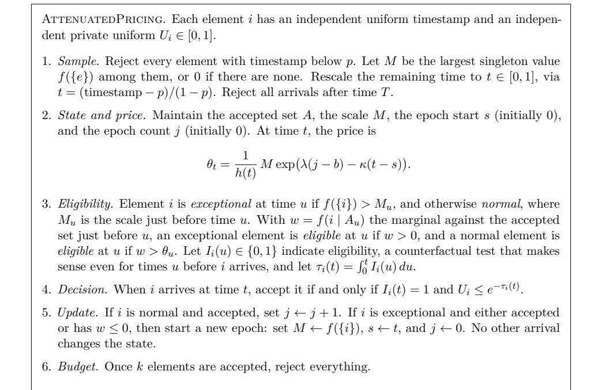

# The Submodular Secretary Problem: Tight $1-1/e$ for Monotone Objectives, and Strictly Between $1/e$ and $1/2$ in General

<!-- 全库方法复筛开始 -->
> **方法储备 · 业务决策与理论储备**。保留“次模秘书算法与到达顺序假设”这一研究问题或机制；是否用于当前业务另行验证。
> 原有阅读范围与证据等级不变；储备不等于效果已验证。
> 已恢复此前因业务距离被移出的原笔记；旧取舍原因仅作历史记录。
> [[研究前沿/论文库复筛与阅读路线|全库阅读路线]] · [[研究前沿/业务决策与理论储备/存量论文分层索引|本方向完整分层]]
<!-- 全库方法复筛结束 -->

随机顺序下，每次只能基于已出现的候选估计集合的边际收益。单调次模目标在大容量下的最优保证趋于 1−1/e；若增添候选可能损害总收益，保证明显较低。

Hamed Abdi, Kiarash Banihashem, MohammadTaghi Hajiaghayi, Danny Mittal。首次提交 2026-11-12，本次核对首版 v1。以上日期为 UTC；本批未独立核实正式发表日期。核读 §1 的结果分层、§2–4 的价格和资格、§5 两种策略的混合、§6–7 困难实例，并核附录 A/B 的小 k 口径。未重证明 63 页全部常数。

[arXiv 版本页](https://arxiv.org/abs/2611.17292v1) · [本地 PDF](./assets/source/paper.pdf) · [本地 HTML](./assets/source/paper.html)

## 不能拿未来的候选作对照

已知候选数 n 和预算 k，随机顺序抵达，抵达时必须接受或拒绝。可对已出现元素组成的集合查询非负次模价值。基准是事后所有大小至多 k 的集合中的最大值，单调与非单调分别说明。

## 边际价格怎么跟余量配合

AttenuatedPricing 从前一小段样本获取单项价值尺度，按已选计数上提价格、随经过时间下调价格；遇新纪录可能重设尺度。普通项的当前边际价值须超过价格，异常项须有正边际，再根据该项在过去状态中会满足资格的总时长 τ，以 exp(−τ) 概率接纳。在到达后查询已见状态即可回算 τ，不能预看未到者。

## 界的适用范围

单调目标的极限 1−1/e 可用至多 4n+1 次查询达到，覆盖型困难实例说明无限计算也不能超出。非单调情形 §5 混用双比较集合的价格法和样本剪枝的贪心变体才超过 1/e；0.497053 是另一侧的不可能性界。§3 直接参数约需千万量级 k 才有非空时域。附录 B 的独立有限预算策略对所有 k 保证 1/e，k≥98 可超 1/2。

§3 的动态定价、资格与随机接纳，原 PDF 第 8 页。

## 实现与验证入口

未核到作者仓库。§3 的 AttenuatedPricing、§5 与附录 B 是不同策略的原始入口。

- [[研究前沿/动态等待与匹配决策/02-可复用方法卡/SubmodSecretary-price|按过去能否达标的时长调整当前候选的接纳率]]
- [[研究前沿/动态等待与匹配决策/03-实验假设与结果/SubmodSecretary-overlap|相同预算下，高重复覆盖会让单项排序损失多少]]
