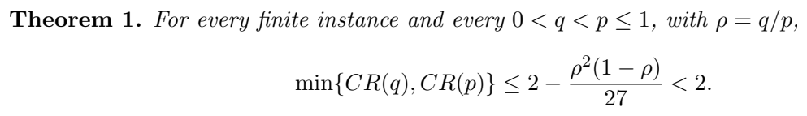

# 相同到达序列被不同程度抽稀后，哪种情况下原先的最坏输入依然难？

<!-- 全库方法复筛开始 -->
> **方法储备 · 业务决策与理论储备**。保留“输入子采样的在线计算折中”这一研究问题或机制；是否用于当前业务另行验证。
> 原有阅读范围与证据等级不变；储备不等于效果已验证。
> 已恢复此前因业务距离被移出的原笔记；旧取舍原因仅作历史记录。
> [[研究前沿/论文库复筛与阅读路线|全库阅读路线]] · [[研究前沿/业务决策与理论储备/存量论文分层索引|本方向完整分层]]
<!-- 全库方法复筛结束 -->

在线策略和预知未来的参照同时面对相同抽样，可区分供给变少的影响和决策方法本身的损失。

## 文献与版本

Beyond Worst-Case Online Algorithms via Input Subsampling。Siddhartha Banerjee、Tianle Jiang、Kamesh Munagala。arXiv v1 首投于 2026-11-11。作者标注已获 ITCS 2027 接收；会议发表日待核。 检索及精读于 2026-11-16。精读先知不等式模型、定理 1、两种观测设定与租赁阈值结果。 [一手来源](https://arxiv.org/abs/2611.15711v1) · [关联原始资料](https://github.com/relyt871/BWCA-Online-Lean)

本地资料　[paper-v1.pdf](./assets/source/paper-v1.pdf) · [paper-v1.html](./assets/source/paper-v1.html)

## 方法与关键计算

固定各时点的独立非负价值分布，按已知概率 r 独立保留候选，只能承诺一次。在线策略在到达时得知是否保留，比较当前价值和余下机会的期望价值；离线参照在同一实现的保留候选中取最大值。比较同一输入在 q 与 p 两个保留率上的竞争比。

## 效果证据与对照

理论上，任何单一保留率的最坏竞争比仍为 2。同一固定实例在两个不同正保留率上，至少一个竞争比严格小于 2（定理 1）。租赁问题另有不同边界，允许晚于盈亏平衡点购买时的比率阈值约 0.34，要求此前购买则约 0.31。

两种抽稀率共用基础实例，且在线与离线比较对象共用各自的实现。结论没有保证预先选定的某一档一定改善，也没有给出派单线上提升。

定理 1 给出同一实例的两个抽稀比例上至少一个严格改善的界。 [原文第 10 页](./assets/source/paper-v1.pdf#page=10)

## 能迁移到什么问题

候选流若因模型排序或业务选择而非独立抽样被裁剪，或者同一资源能反复承诺，定理需另证。

作者 Lean 仓库含 lean/SkiRental/Certificates.lean 及 lean/general_K/GeneralK.lean，对应租赁阈值的部分证明；未在本地编译。

[[研究前沿/动态等待与匹配决策/02-可复用方法卡/SubsampledStopping-在线与离线共同面对同一条抽稀候选流|在线与离线共同面对同一条抽稀候选流]] · [[研究前沿/动态等待与匹配决策/03-实验假设与结果/SubsampledStopping-验证供给抽稀是否改变停止策略的相对损失|验证供给抽稀是否改变停止策略的相对损失（未运行）]]
