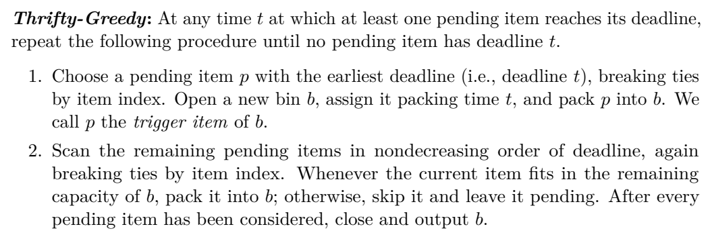
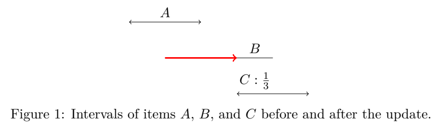

# Online Timely Bin Packing Revisited: A Simpler Algorithm with Optimality in Special Cases

订单到来后，平台可以一直等到最早截止才承诺吗？答案决定哪些合批策略真正可执行。先看允许待定与不可撤销绑定的区别，再读装箱数的理论界。等待分位数和分档容量下的表现留给本地对照。

[[研究前沿/动态等待与匹配决策/README#现在承诺还是继续等|比较同一问题的其他方法]] · [[研究前沿/动态等待与匹配决策/02-可复用方法卡/TimelyThrifty-trigger-edf-skip|截止时的贪心扫描]] · [[研究前沿/动态等待与匹配决策/03-实验假设与结果/TimelyThrifty-deadline-batch-fill|未运行：分档容量与硬截止的对照]]

作者 Pei-Lin Chiang、Wing-Kai Hon、Ying-Chia Huang、Li-Tzu Yang。首次发布 2026-11-06，此次核验的版本为 v1（2026-11-06），阅读于 2026-11-10。11 月 9 日 cs.DS 公告。核对 17 页 v1 的 §1–3 设定、执行规则与各类竞争比，§4 输入转换和附录 A 对照；未逐步复证转换不变量。

[作者原文](https://arxiv.org/abs/2611.09611v1) · [离线 PDF](./assets/source/paper.pdf)

## 哪些订单可以等，以及等到什么时候

每个订单有已知到达、截止期区间 $[a_i,d_i]$ 及体积 $s_i$。单件可先待定，任一新开的箱在同一时刻 $t$ 装入一组 $a_i\le t\le d_i$ 的订单，体积之和至多 1，然后立即封箱。总成本为箱数。硬期限内没有连续等待费。与 [[研究前沿/动态等待与匹配决策/01-论文原文与精读/DispatchDeadlineFF/精读|到达即绑定箱的模型]] 的区别发生在装箱前；两者离线可行批次都须有共同服务时点。

## Thrifty-Greedy 如何决定一次合批

§2 在有待定件到期的时刻才行动。选最早截止的待定件打开新箱作为触发件（同期限按固定索引）。再按其余件的截止期扫描，若装得下就加入，装不下的件留在池中，继续向后扫描。封箱后只要还有此刻到期的件就重复。到达过程产生的待定池和阈值触发可独立复用；是否允许在承诺前一直等待由实际调度接口决定。算法只使用整件容量；Aminian 的 Discrete-Greedy 会维护可分割的影子装箱，对被切分件另开专箱。

## 哪些输入能做到离线最优

- **等大小。** 定理 2 用交换论证，将最早截止的触发件与其余最早截止、可放入的件对齐到某个最优箱，逐箱归纳得 $C_{TG}=C_{OPT}$。
- **任意体积。** 分数松弛最优解为按最早截止可切分的 Greedy。引理 3 通过同时删去至多两个整数箱与至少一个分数箱的整体归纳，得到 $C_{TG}\le 2C_{\rm Greedy}=2C_{OPT_f}\le2C_{OPT}$。定理 4 前的构造在 $0$ 时刻放入 $N$ 个长窗大件 $1-\varepsilon$，之后各时刻各到两个小件 $\varepsilon$，一个马上到期、另一个可等到 $N$。该算法用 $2N$ 箱，离线只需 $N+1$ 箱，趋近 2。这个下界针对该算法；一般确定性在线最优竞争比仍落在 $[1.5,2]$。
- **仅有 $1/3,2/3$ 两档。** 定理 6 的竞争比为 1.5，已有确定性下界匹配。证明按小、中、满箱计数，用 §4 的输入转换约束不能与满箱配对的小箱；图 1 解释调整后的时间窗。这项证明依赖已知最优解，线上无需先判断是否落在两档。附录 A 对照的旧算法在这两个受限类别上的最坏比均至少为 2。

同一条实际扫描规则覆盖三类输入，适合硬截止、固定发车成本、同质车辆的待定订单。若等待本身有成本、目的地兼容性限制、途中可拆件或有车数上限，书中竞争比均须重证。论文以最坏情形定理为证据，没有线上量测。

原文 §2，PDF 第 5 页。

## 原文证据

图 1，两档体积证明中更新前后的区间，用于说明离线分析的输入转换，PDF 第 13 页。

## 代码与关联

核查 arXiv 摘要页、PDF/HTML 正文与公开题名检索，尚未核到作者发布的实现仓库。算法入口见文中伪代码。

- [[研究前沿/动态等待与匹配决策/02-可复用方法卡/TimelyThrifty-trigger-edf-skip|截止期触发并跳过放不下件的整批贪心]]
- [[研究前沿/动态等待与匹配决策/03-实验假设与结果/TimelyThrifty-deadline-batch-fill|整件跳过规则对分档容量和硬截止合批的作用]]
