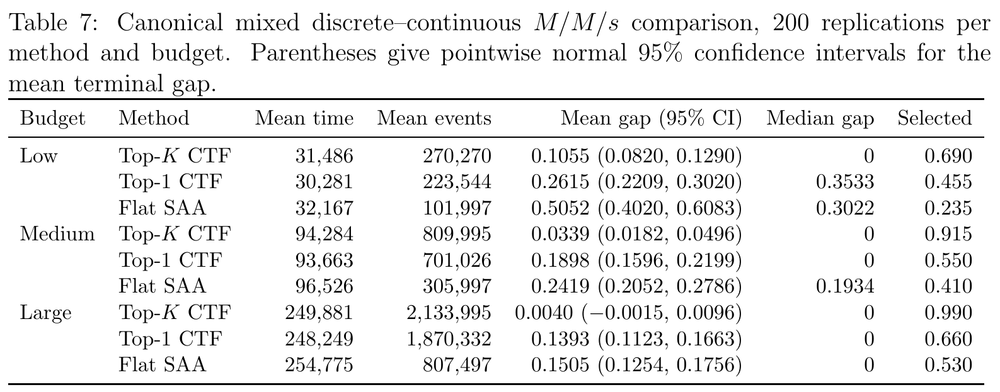
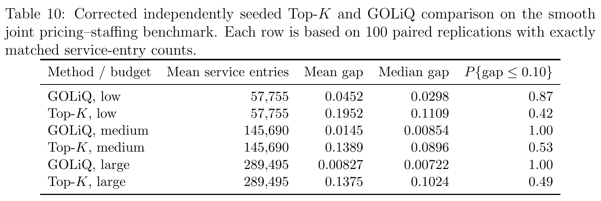

# Direct Sample-Average Learning for Queueing Control: Gradient-Free Top-$K$ Coarse-to-Fine Optimization

[官方论文](https://arxiv.org/abs/2610.26653) · [本地 PDF](./assets/source/paper.pdf) · [HTML 快照](./assets/source/paper.html)

首次提交：2026-10-19；本次精读：2026-11-05；核验版本：v1。会议正式发表日期未核验。本文是旧队列补精读，不是今日新发表。

阅读范围：核心方法、关键公式、主实验/理论条件及与迁移直接相关的附录。未逐行复证全部证明，也不称逐页翻译；具体覆盖见 [[研究前沿/动态等待与匹配决策/01-论文原文与精读/TopKQueue/阅读覆盖|阅读覆盖]]。HTML 为原始快照，外部样式/图片可能需要联网；PDF 是完整离线原文。

代码状态：原文未提供可核验的公开官方仓库入口；未把文中本地脚本名、提交哈希或同名项目当成已取得代码。本次未运行作者代码。

## 1. 要解决的问题

队列不能为每次试验重置，换动作后会继承上一个动作造成的拥堵。目标是用真实运行得到的成本和时间，找出较好的离散/混合控制参数。本文提出总成本/总时间的直接SAA估计，并用Top-K粗到细搜索保留多条路径；重点是最终推荐质量，而非最小累计学习损失。

## 2. 观测、估计器与暂态（§2、4.1–4.2）

每周期固定执行 $D$ 个指定事件，动作整周期不变。事件可能是到达、入服或完成，必须预先定义；周期时长随机，物理状态可能还包括残余服务与旧班组。对动作 $a$：

$$
\widehat f_n(a)=\frac{\sum_{t\le n}\mathbf1(a_t=a)G_t}{\sum_{t\le n}\mathbf1(a_t=a)T_t}.\qquad\text{(6)}
$$

不能把每周期成本率简单等权平均。条件暂态项 $\beta_t=\mathbb E[G_t-f(a_t)T_t\mid\mathcal H_{t-1}]$，其余为鞅差 $M_t$。式12分解为

$$
\widehat f_n(a)-f(a)=\frac{\sum_t I_t(a)\beta_t}{S_n(a)}+\frac{\sum_t I_t(a)M_t}{S_n(a)}.\qquad\text{(12)}
$$

**直观理解：** 噪声平均掉还不够，换动作遗留的系统状态也会系统性偏移估计。连续动作块让偏差函数在块内抵消，降低边界项数量；它不是自动消除暂态。

## 3. Top-K层级搜索与guardian（§3、4.3）

指定嵌套网格、父子映射、各层累计采样目标和保留数。每个活跃动作连续运行到目标，累计统计跨层保留；按成本率保留K个父节点，展开下一层子节点，去重后继续；最后选最低估计成本。

guardian是“后代包含最终网格最优点”的父节点，它未必是当前层最佳点。理论要求最优点从初始网格可达，并在所有可能保留guardian的活跃集合上有正的guardian margin。只审计无噪声的一条路径不够；增加采样也救不回结构上被必然剪掉的最优区域。Top-K不能保证相同总预算下一定胜过Top-1。

事件预算、周期预算和墙钟时长不同；固定墙钟截止还增加未完成概率项。有限网格一致性不能直接当连续全局最优，另有离散化误差。

## 4. 实验与负面证据（§5、Table 5–12）

混合整数 $M/M/s$，每方法每预算200次独立模拟，在近似相同实际时长下，大预算Top-K平均终局gap0.0040，Top-1 0.1393，flat SAA0.1505；最优网格点命中率0.990/0.660/0.530。事件数并不匹配，且报告的gap相对该表采用的网格参考目标。

图表为原始PDF裁图，页码见图片说明及附件溯源记录；数字与标记以原图为准。

$M/M/1$与修正LiQUAR比较：大预算终局median gap为0.018 vs0.111，但累计实际regret为1.425百万 vs0.689百万。不能只取前者宣布全面更好。Top-K使用精确工作量观测，延迟观测对照的可比性受限。

光滑、可用可靠梯度的GOLiQ场景，匹配服务进入事件数：大预算平均gap Top-K0.1375 vs GOLiQ0.00827，GOLiQ明显更好；两者动作切换语义和实际时长还有差异。

图表为原始PDF裁图，页码见图片说明及附件溯源记录；数字与标记以原图为准。

重尾服务需更长运行才能稳定；论文只在指定M/M/1工作量模型完成统一稳定性验证，不能覆盖所有仿真实现。Table12明确区分完整/部分/历史记录；有清单与脚本名不等于本次取得了公开可运行包。

## 5. 研究价值

适合不易求梯度、含整数控制的等待阈值/班组/资源配置研究。迁移时应同时测终局策略质量、累计探索成本、暂态与切换成本，并为全部方法统一物理状态和预算口径。不能将该算法直接接生产做自动试错；本库仅存假设。

## 方法卡与后续实验

- [[研究前沿/动态等待与匹配决策/02-可复用方法卡/TopKQueue-persistent-saa|持续运行队列的总成本率与分块采样]]
- [[研究前沿/动态等待与匹配决策/02-可复用方法卡/TopKQueue-guardian-search|保留多条最优后代路径的Top-K细化]]
