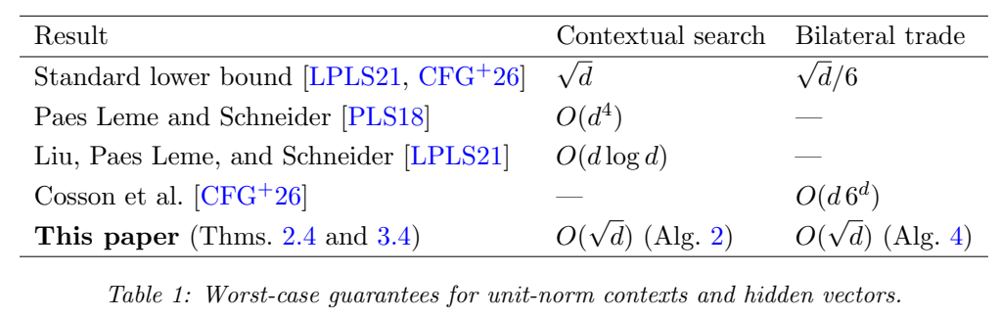

# Contextual Search and Bilateral Trade with a Trace-Square-Root Potential

作者 Romain Cosson、Federico Fusco、Anupam Gupta、Stefano Leonardi、Renato Paes Leme、Matteo Russo。首次发布 2026-11-06，此次核验的版本为 v1（2026-11-06），阅读于 2026-11-10。11 月 9 日 cs.GT 公告。精读 §1 的势函数比较、§2 的单侧基准、§3 的贝叶斯与最坏情形双侧交易、附录 D/E 的构造依据及下界；未在本地重跑形式证明。

[作者原文](https://arxiv.org/abs/2611.09615v1) · [离线 PDF](./assets/source/paper.pdf)

## 衡量的是失去的交易剩余

买卖双方有固定但未知的线性参数 $s,b$，第 $t$ 轮看到的上下文 $x_t$ 给出估值 $S=x_t^\top s,B=x_t^\top b$。平台出同一个价格 $p$，只看到 $Y=\mathbf 1\{S\le p\le B\}$。损失 $\ell=(B-S)_+(1-Y)$ 表示本可产生但错过的交易剩余。隐藏向量跨轮不变；上下文可依据已观察历史选择，但不能泄露额外隐藏信息。

## 从对手为何拒绝未知，到累计损失可求界

- §2 先处理单侧上下文搜索，其一位反馈有方向，表示价格太高还是太低。算法 1 计算投影后验均值、标准差，等概率报 $\mu_x\pm\sigma_x/2$。定理 2.1 将任意时域的绝对误差和界在 $24\operatorname{tr}\sqrt\Sigma$。双侧拒绝不能指明是哪方，不能直接执行两次该规则。
- §3.1 为双侧使用联合后验，允许 $s,b$ 相关，且有有限二阶矩。衡量不确定度时取两个**边缘**协方差的平方根迹之和
$$
\Psi(\pi)=\operatorname{tr}\sqrt{\operatorname{Cov}_\pi(s)}
+\operatorname{tr}\sqrt{\operatorname{Cov}_\pi(b)}.
$$
  对给定报价分别计算观察买卖成交位后，两个投影标准差的期望降幅 $D_S(p),D_B(p)$。Lemma 3.1 保证存在 $p$ 令期望损失至多为 $2^{11}[D_S(p)+D_B(p)]$。算法 3 在当前联合后验上选满足条件的价，再用成交位更新。由方向标准差与全局势函数之间的不等式，逐轮相加可抵消中间势函数（定理 3.2）。
- §3.2 无先验时用代理中心和正定矩阵。每轮选择有限随机计划，一份计划同时指定报价和两种反馈对应的后继状态，用 $\gamma_t=1/[t(t+1)]$ 容许近似。算法 4 的计划优化没有作者声称的高效实现；定理给出任意时域 $2^{12}\sqrt d+1$ 的最坏期望损失界。表 1 与已知 $\sqrt d/6$ 下界比较，匹配的是维数阶。

## 证据与适用问题

若具备已知联合先验，表 2 给出的双侧界为 $2^{11}\Psi(\pi_1)$（常数见定理 3.2）。势函数下降为整套选择与条件更新提供数学证据，无真实市场效果或模块消融。与两篇利润最大化论文相比，本篇每轮是一个共用价，优化福利，比较对象是当轮了解双方估值的可交易结果。新一对独立用户每次都重新抽取估值、需要两个独立价格以赚取价差，均改变模型本身。

对等待或重复报价的启发是用候选决策的即时机会损失与预期信息增量共同定价。若估值向量不存在长期稳定共享结构，或者成交失败有系统性噪声、用户放弃或资源占用，需重建联合后验和有效上下文。形式化代码验证数学推导的范围与计算一个可部署策略的开销，分别见代码栏和 §3.2。

## 原文证据

表 1，单位范数假设下上下文搜索和双侧交易的最坏遗憾阶；算法 4 的维数阶与下界一致，PDF 第 3 页。

## 代码与关联

作者提供 Lean 4 形式化，TraceSqrt.lean、Audit.lean、TradeLottery.lean 对应入口及主要定理。仓库记录的是数学证明；未核到在线交易实现或实测数据，未在本地编译。[作者仓库](https://github.com/renatoppl/trace-square-root)

- [[研究前沿/动态等待与匹配决策/02-可复用方法卡/TraceSqrtTrade-trace-potential|用双侧后验标准差降幅权衡成交与信息]]
- [[研究前沿/动态等待与匹配决策/03-实验假设与结果/TraceSqrtTrade-one-bit-welfare|同为一次成交反馈，利用后验下降能否减少错过的交易剩余]]
