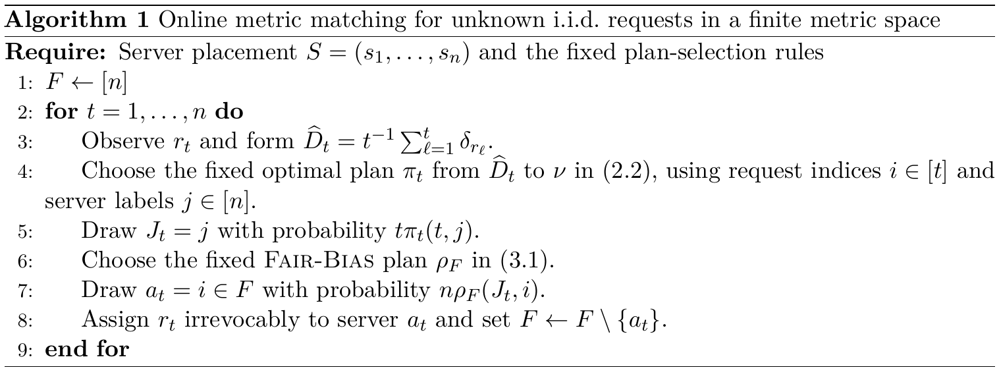

# Online Metric Matching with Unknown i.i.d. Arrivals

[官方论文](https://arxiv.org/abs/2611.04275) · [本地PDF](./assets/source/paper.pdf) · [HTML快照](./assets/source/paper.html)

版本记录：[Submitted on 3 Nov 2026]；本次核验与精读：2026-11-06。本篇为滚动窗口内首次入库；检索日不等于首次发表日。

阅读范围：§1.1–1.2、§3.1、§5.1算法及§6竞争分析；独立性证明未逐行复核。未逐行复证全部数学证明，未声称逐页翻译。[[研究前沿/动态等待与匹配决策/01-论文原文与精读/UnknownIIDMatching/阅读覆盖|原文章节与公式索引]]；HTML为原始快照，外部样式和图片可能需要联网，PDF可离线阅读。

代码：本次核验的论文原文与元数据未提供可确认的作者实现入口；代码状态未知，不能据此断言不存在。未运行代码。 [[研究前沿/动态等待与匹配决策/01-论文原文与精读/UnknownIIDMatching/代码核验|核验记录]]

## 问题和机制

n个已知有标签资源固定在度量空间，请求从未知固定分布独立到达；每到一个立即、不可撤销配一个资源。不允许等批次，也不预给分布样本。

令全部资源均匀分布为ν。每步把含当前请求的经验分布 $\widehat D_t$ 最优运输到ν，π的行质量1/t、列质量1/n；以 $P(J_t=j)=t\pi_t(t,j)$ 抽虚拟资源标签。再用Fair-Bias把ν运输到剩余资源均匀分布，从虚拟标签对应行抽最终资源，分配真实请求。

计划tie-break必须只依赖请求位置多重集，抽样随机数独立；Fair-Bias只能看虚拟流，不能额外偷看真实历史。虚拟标签可以指向已用资源，因为它只是中间表示。

## 证据（§5–6）

Lemma5.1说明在规定对称计划选择下虚拟标签为独立均匀；Theorem6.2有限度量界 $(1+6\alpha(n))E[OPT]$，α为Fair-Bias已知分布竞争比。得到一般度量 $O((\log\log\log n)^2)$，树度量有限支持25、一般支持51。是理论归约，不等于未知/已知分布最优竞争比已经完全相同。

本次核对算法1、运输约束和§6竞争证明主要不等式；没有实际收益实验。每到达求运输计划的计算开销、分布漂移/相关到达、资源再生和延迟匹配均不在保证内。

## 可迁移判断

有价值的是把随时间学习的真实需求转换为下游已知参考分布，保留下游算法接口。实际业务若用滑窗/近似运输，会破坏本文iid和精确计划前提，需作为新假设检验。

## 原文关键图表

原文 Algorithm 1，PDF 第 9 页；原始裁图，机制和证据解释见上文。裁图坐标与源文件校验值见 assets/source/figure-provenance.json。

## 方法卡

- [[研究前沿/动态等待与匹配决策/02-可复用方法卡/UnknownIIDMatching-empirical-transport|在线经验运输生成参考分布虚拟请求]]
