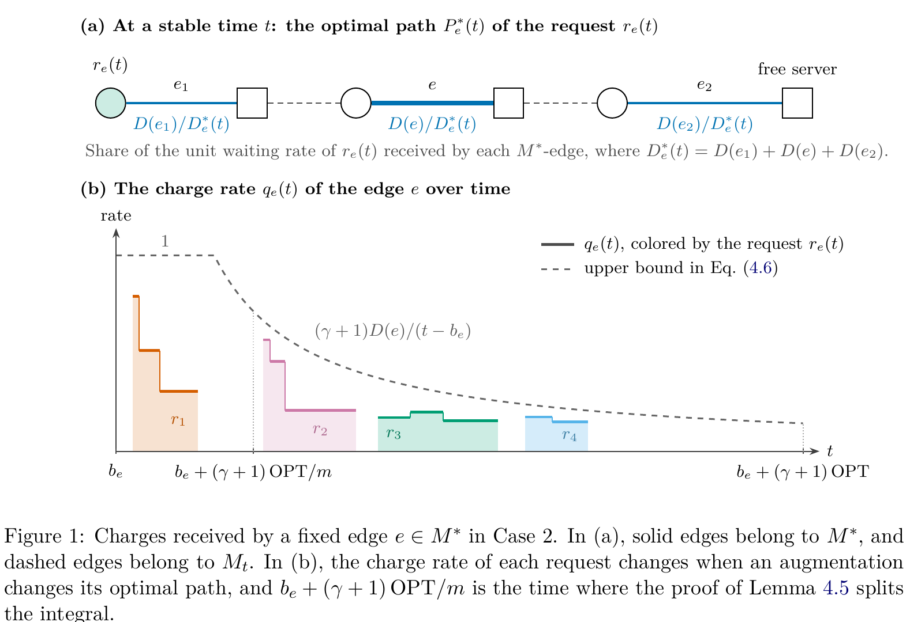

# A Deterministic O(log m)-Competitive Algorithm for Online Minimum Cost Bipartite Matching with Delays

[官方论文](https://arxiv.org/abs/2611.01553) · [本地PDF](./assets/source/paper.pdf) · [HTML快照](./assets/source/paper.html)

版本记录：[Submitted on 1 Nov 2026]；本次核验与精读：2026-11-06。本篇为滚动窗口内首次入库；检索日不等于首次发表日。

阅读范围：§1.1、§2.3、§3全部算法、§5.1非二部扩展和§6；证明主计费思路已读。未逐行复证全部数学证明，未声称逐页翻译。[[研究前沿/动态等待与匹配决策/01-论文原文与精读/VRM/阅读覆盖|原文章节与公式索引]]；HTML为原始快照，外部样式和图片可能需要联网，PDF可离线阅读。

代码：本次核验的论文原文与元数据未提供可确认的作者实现入口；代码状态未知，不能据此断言不存在。未运行代码。 [[研究前沿/动态等待与匹配决策/01-论文原文与精读/VRM/代码核验|核验记录]]

## 等待让何时匹配成为可分析的阈值

二部请求/资源均随时间到达，匹配不可撤销，目标是距离+两端线性等待。本文主要贡献是对已有VRM的更强分析，并推广非二部版本，不应把整个VRM宣称为首次提出。

## 算法（§2–3）

时间增广距离 $D(u,v)=d(x_u,x_v)+|a_u-a_v|$。保留可改的辅助匹配 $M^{OFF}$ 和不可改的真实输出，两者覆盖同一批节点。未配边权γD、辅助已配边反向权−D。请求r求到空闲资源的最小净成本增广路P：
$$\varphi(P)=\gamma D(P\setminus M^{OFF})-D(P\cap M^{OFF}),\quad \gamma(t-a_r)\ge\min_P\varphi(P).$$

条件成立时真实输出连接r与P终点，辅助匹配沿P翻转；资源到达和增广事件后重算受影响最短路/到期时间。辅助边变化不是实际订单改派。非二部用最小权完美匹配求增广路，不能沿用二部有向最短路实现。

## 证据与采用边界

Theorem1.1：任意度量、固定γ>1，确定性O(log m)竞争；γ=2时界24+18ln m，非二部为28+24ln m。无需预知度量全貌/总请求数。新分析沿时间把等待成本计到固定最优匹配边，替代逐次增广的几何分解。

这是最坏情形上界，不是实测相对固定batch提升；常数较大，求路延迟、有限截止、拒单/取消、异质等待权均未实证。可迁移的候选是“等待累计值对照可改善匹配的净成本”触发。若加入拒单和截断等待，原理论不直接继承。

## 原文关键图表

原文 Figure 1，PDF 第 13 页；原始裁图，机制和证据解释见上文。裁图坐标与源文件校验值见 assets/source/figure-provenance.json。

## 方法卡

- [[研究前沿/动态等待与匹配决策/02-可复用方法卡/VRM-ready-netcost|最小增广净成本对应的匹配就绪阈值]]

## 待验证想法

[[研究前沿/动态等待与匹配决策/03-实验假设与结果/2026-11-06-等待累计价值触发对照|等待累计价值触发对照（未运行）]]
