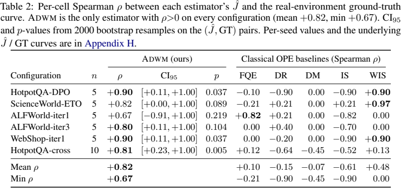

# 用目标策略引导下一状态的扩散式离线评估

Autoregressive Diffusion World Models for Off-Policy Evaluation of LLM Agents · Liu, Kaixuan, Xiong, Guojun, Zhang, Weinan, Tang, Shengpu。arXiv 首投 2026-06-04，本次阅读版本 v4（2026-11-06）。6 月首投。本次核对 v3/v4 的表格，主表 2 数据一致，按已有研究的新入库精读处理。 [版本记录](https://arxiv.org/abs/2606.05558v4) · [本地 PDF](./assets/source/paper.pdf) · [本地 HTML](./assets/source/paper.html)

## 研究问题

多轮策略用模型生成的观测决定下一步动作。若预先整段生成状态和动作，就可能评到了生成器自己选择的动作。

## 方法及关键计算

§4 在历史轨迹上编码潜在状态，训练逐转移的扩散模型，另有逆动力学与行为克隆辅助项。评估时由目标策略先抽样动作，再对下一潜在状态做反向扩散。式 (9) 综合历史先验分数、从新状态反推动作的引导，以及近似的未来动作与目标策略相容性引导；奖励头和终止头产生回报及结束信号。式 (10) 对多条模拟轨迹的累计奖励取均值。

## 关键公式

$$
q_{\alpha}(\tau\mid\pi_{e})\;\propto\;p_{\theta}(\tau)\,\exp\!\Big(\alpha\sum_{t=1}^{T}\log\pi_{e}(a_{t}\mid h_{t})\Big),\qquad\alpha>0
$$

pθ 为学习的轨迹生成分布，πe 为待评估策略，α 调整引导强度。提升目标策略更可能采取的动作序列的权重。作者用逐步扩散引导近似该轨迹目标，还须分别校验动作覆盖和多步预测误差。 [公式原文](https://arxiv.org/html/2606.05558v4#S4.E2)

## 证据、对照与边界

§5 表 2 对六种行为/目标策略组合比较模拟估值与真实环境曲线的 Spearman 排名相关。ADWM 六组均为正，均值 0.82、最小 0.67；FQE 平均 0.10，但一个 ALFWorld 组的 FQE 为 0.82，高于 ADWM 的 0.67。每组仅 5 或 10 个曲线点，多组区间很宽。

表 2　六种配置下的策略价值排序相关，原文 PDF 第 9 页。

表 2 检验排序而非回报的绝对校准；部分基线使用折扣奖励。图 4 有组件消融，但影响随任务变化，不能把总体 0.82 归给单个引导项。动作分布偏移大时仍须做真实锚点评估。

## 阅读覆盖与复用

已核对上述设定、关键计算、主对照及限制，附录证明未逐行复证。已核验官方仓库目录中的 adwm/models/world_model.py、adwm/ope/rollout.py 与 adwm/ope/guidance_policy.py，未运行。[固定提交](https://github.com/kaixuanliu-ai/ADWM/tree/ffca662dcdac38e9afc9e7d1e05ca01463ec03f0)

[[研究前沿/面向决策的履约建模/02-可复用方法卡/ADWM-OPE-用目标策略引导下一状态的扩散式离线评估|用目标策略引导下一状态的扩散式离线评估]] · [[研究前沿/面向决策的履约建模/03-实验假设与结果/ADWM-OPE-动作条件滚动能否恢复已知策略的价值排序|动作条件滚动能否恢复已知策略的价值排序]]

[[研究前沿/面向决策的履约建模/01-论文原文与精读/ADWM-OPE/原文导航|原文章节和图表索引]]
