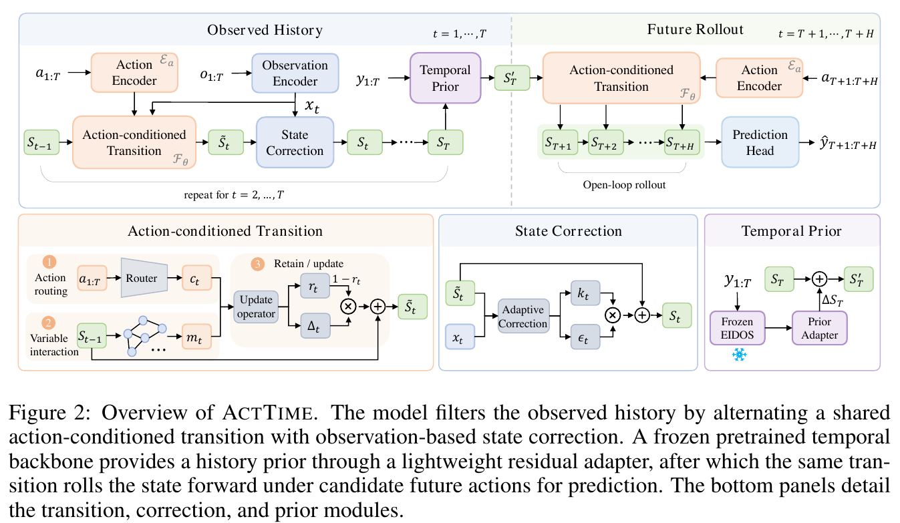
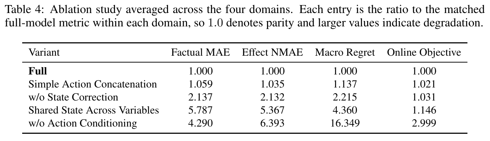

# ActTime: Action-Conditioned World Modeling for Time Series

[官方论文](https://arxiv.org/abs/2610.25764) · [本地 PDF](./assets/source/paper.pdf) · [HTML 快照](./assets/source/paper.html)

首次提交：2026-10-19；本次精读：2026-11-05；核验版本：v1。会议正式发表日期未核验。本文是旧队列补精读，不是今日新发表。

阅读范围：核心方法、关键公式、主实验/理论条件及与迁移直接相关的附录。未逐行复证全部证明，也不称逐页翻译；具体覆盖见 [[研究前沿/面向决策的履约建模/01-论文原文与精读/ActTime/阅读覆盖|阅读覆盖]]。HTML 为原始快照，外部样式/图片可能需要联网；PDF 是完整离线原文。

代码状态：原文未提供可核验的公开官方仓库入口；未把文中本地脚本名、提交哈希或同名项目当成已取得代码。本次未运行作者代码。

## 1. 核心问题与旧范式

事实轨迹预测好，不代表能预测换动作后的轨迹，更不代表能给候选动作排对顺序。ActTime把动作放进状态转移，历史期用观测校正状态，未来期从相同状态分别滚动候选动作。训练只有事实轨迹，反事实与闭环评价来自模拟器；它没有证明观察数据上的因果可识别性。

## 2. 架构与时序（§3.1–3.2）

输入为历史观察/动作及候选未来动作；每个观察变量维持独立144维状态，变量embedding标识身份。观察编码使用当前值和一阶差，动作路由使用全动作向量及差分，为每个变量生成控制向量。

转移内先跨变量自注意力，再把归一化状态、交互消息、动作控制拼接，经有界保留门与SwiGLU更新：

$$
\mathcal T(S_{t-1},c_t)=\operatorname{LN}(S_{t-1}+(1-r_t)\odot\Delta_t).\qquad\text{(6)}
$$

历史期还将实际观察编码送入校正器：

$$
\widetilde S_t=F_\theta(S_{t-1},c_t),\qquad S_t=\widetilde S_t+k_t\odot\epsilon_t.\qquad\text{(7，紧凑写法)}
$$

未来没有观测，不能用这个校正；同一个 $F_\theta$ 按候选动作滚动。所有候选共享同一历史末状态，输出每目标变量的0.1/0.5/0.9分位数。以末次观察锚定中位数，softplus向上下扩展确保分位顺序；该约束不保证概率校准。

图表为原始PDF裁图，页码见图片说明及附件溯源记录；数字与标记以原图为准。

## 3. 预训练先验与分阶段训练

Stage A关闭先验，用事实未来分位pinball损失训练核心10epochs。Stage B冻结已学核心和EIDOS，用目标历史得到冻结先验，只训练60,321参数的边界残差adapter3epochs。零初始化门令起点等于Stage A，先验只改历史末状态，不改动作转移。

$$
S'_T=S_T+\gamma\tanh(\operatorname{MLP}[\operatorname{RMSNorm}(p_T),V]),\qquad\gamma_{\mathrm{init}}=0.\qquad\text{(8、13)}
$$

两个阶段都只用事实目标，checkpoint只按事实验证MAE选取。推理的MPC/CEM规划是在模拟器内闭环，不是线上实地AB；规划主要用中位轨迹，没有完整利用不确定性。

## 4. 评价层次、主结果与消融（§4、附录A/B）

四模拟器：CityLearn能源、SUMO交通、GreenLight温室、库存。七基线均接历史与未来动作，统一候选集合，分别测事实MAE、干预效果NMAE、离线regret、闭环目标。Table2作者报告16组中12组第一、平均rank1.50。Table3候选排序Spearman平均0.8661，TFT0.8154；但库存离线regret仍不及Ridge，CityLearn闭环不及RSSM。

模型对的排序在“事实→效果”平均17.8%反转，在“效果→决策”28.4%反转。这是本实验配置下的比例，不是所有任务的常数。主指标表主要为点估计，不能把很小差异自动当显著收益。

Table4按域内完整模型归一再宏平均：简单拼接动作的离线regret比1.137；去状态校正2.215；共享单状态4.360；去动作条件16.349。支持结构的作用，但都是完整系统内消融。

图表为原始PDF裁图，页码见图片说明及附件溯源记录；数字与标记以原图为准。

附录Table15对同一个Stage-A核心成对比较先验：SUMO加先验后效果NMAE 0.4355→0.4825，离线regret0.0207→0.0221，闭环目标0.3097→0.3036。四域闭环点值均改善，但干预/离线不一致；因此先验是一项需做分指标检查的候选创新，不是无条件推荐。

## 5. 迁移价值与限制

可借鉴动作条件的履约状态转移、历史校正与同历史候选比较，也可直接借用多层评价协议。业务动作常与未观测供需共同变化，事实条件模型不能自动作因果反事实。需验证动作覆盖、混杂、闭环滚动误差与分布外风险；本文没有证明现实系统迁移，也没有风险敏感规划实验。

## 方法卡与后续实验

- [[研究前沿/面向决策的履约建模/02-可复用方法卡/ActTime-controlled-state|按变量维护、动作驱动并由观测校正的状态]]
- [[研究前沿/面向决策的履约建模/02-可复用方法卡/ActTime-boundary-prior|冻结动态核心后的零门控历史先验适配]]
- [[研究前沿/面向决策的履约建模/02-可复用方法卡/ActTime-evaluation-ladder|事实误差、干预误差与动作排序分层评价]]
- [[研究前沿/面向决策的履约建模/03-实验假设与结果/2026-11-05-动作状态与先验|状态校正与历史先验能否支持可靠动作选择（未运行）]]
