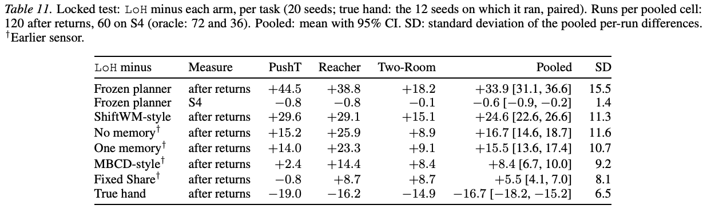

# 执行接口变化后，从观测找回指令的实际含义

<!-- 全库方法复筛开始 -->
> **方法储备 · 模型自进化**。保留“冻结基础控制器与适配器的职责隔离”这一研究问题或机制；是否用于当前业务另行验证。
> 原有阅读范围与证据等级不变；储备不等于效果已验证。
> 已恢复此前因业务距离被移出的原笔记；旧取舍原因仅作历史记录。
> [[研究前沿/论文库复筛与阅读路线|全库阅读路线]] · [[研究前沿/模型自进化/存量论文分层索引|本方向完整分层]]
<!-- 全库方法复筛结束 -->

Library of Hands: Fix the Hands, Not the World Model  
Hasaan Ahmad、Qizhen Ying、Yuxuan Sun、Tianjin Huang、Guangming Wang。arXiv v1。首次提交 2026-11-09；会议或期刊正式发表日未核实。 [作者或出版社记录](https://arxiv.org/abs/2611.12678v1)

三项机器人仿真中，冻结规划器的成功率由 28.6% 升至 62.3%。接口始终不变时，则比原规划器低 0.6 个百分点。

## 作者要解决什么问题

控制器坐标旋转、增益或延迟改变时，正确的命令不再对应训练时同一个动作。若底层环境仍可预测，在线重训练整套动力学未必必要。

## 方法怎样从输入得到决策或预测

每 5 个控制步，记录命令及前后潜状态 → 从冻结预测器反求最能解释状态变化的动作 → 由局部雅可比评估读数精度，剔除极不相符的块 → 用带延迟的映射解释读数，在历史库和新映射之间选择 → 规划器经选中的映射模拟下一段命令。

读数由 $u^*=\arg\min_u \lVert z_{t+1}-f(z_t,u)\rVert^2$ 得到。识别比较命令经映射后的块级动作与读数，利用各方向不同的测量噪声。已校准的正常接口数据给尺度与误差阈值；切换后的首个动作块没有新观测。

## 实验观察和证据范围

表 3 汇总三个 LeWM 仿真任务，完整方法 / 冻结规划器的总体成功率为 62.3% / 28.6%。附表 11 中接口返回后的前两回合，配对差 +33.9 个百分点 [31.1, 36.6]；始终不变时 −0.6 [−0.9, −0.2]。表 13 在相同传感器下移除记忆，PushT、Reacher、Two-Room 分别损失 19.3、22.9、7.6 个百分点。

附表 11，重新出现的接口与稳定接口的配对比较。[原文 PDF](./assets/source/paper.pdf#page=18)

先前在真机数据预训练的模型仍在 RoboCasa 仿真评测。受限于观测能否识别动作、有限映射族及动力学稳定性。新接口的首个块盲行、与接口无关的环境动力学改变，以及弱读数，都会削弱效果。

## 可采用的部分

最小可测试单元是动作反演和正常接口上的读数质量评估。复用记忆带来的收益依赖接口反复出现、映射族可辨、读数尺度正确，规划器必须通过映射查询模型。

若系统更换动作编码或执行延迟，可先用带已知真实执行动作的日志检验反演。个体接受意愿、路况或政策混杂不能统一解释为接口错位。

[[研究前沿/面向决策的履约建模/02-可复用方法卡/ActionMapLibrary-read-store|方法卡：从动作效应读数识别并记忆执行映射]] · [[研究前沿/面向决策的履约建模/03-实验假设与结果/2026-11-13-能否从履约状态变化识别执行接口错位|未运行假设：已知接口变化能否只校正动作映射而保住原状态模型]]

## 阅读与核验范围

27 页原文，核读 §2–4、§6、算法 1、表 3/5 及附表 11/13。 核查 arXiv 原文、作者列出的链接和题名检索，未核到作者实现仓库。算法 1、表 6、附录 A 给出流程及常数。 本地未运行原作者实验。 [本地 PDF](./assets/source/paper.pdf) · [本地 HTML 原文](./assets/source/paper.html)
