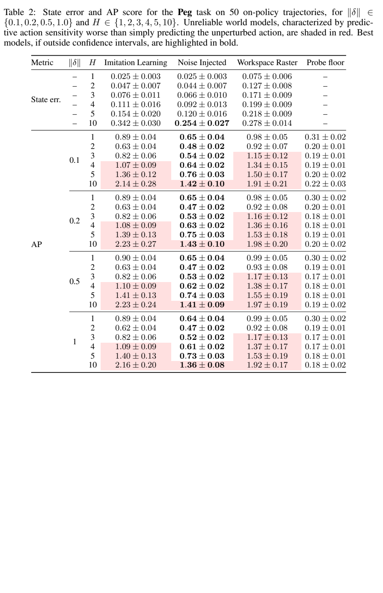

# 同一起点改变一点动作，模型能预测多大变化

<!-- 全库方法复筛开始 -->
> **方法储备 · 面向决策的履约建模**。保留“Does Your World Model Know Actions Have Consequences?”这一研究问题或机制；是否用于当前业务另行验证。
> 原有阅读范围与证据等级不变；储备不等于效果已验证。
> [[研究前沿/论文库复筛与阅读路线|全库阅读路线]] · [[研究前沿/面向决策的履约建模/存量论文分层索引|本方向完整分层]]
<!-- 全库方法复筛结束 -->

Does Your World Model Know Actions Have Consequences?  
Ayush Gaggar; Jared Berry; Todd D. Murphey。2026-11-11 首次提交 arXiv，本次核对 v1。[arXiv v1](https://arxiv.org/abs/2611.15048v1)

状态预测误差低的模型，会不会对动作的小变化给出方向或幅度错误的响应？

## 怎样从输入得到输出

对同一个模拟起点回放原始动作与加扰动作，取得两条未来真实轨迹。在同一个冻结模型上同样滚动，以线性读出把潜在态译成可比状态。比较两个变化量，并单独评估没有扰动时的状态误差及读出器的误差下界。

附录 A.2 的指标等价于 $AP=\sum_i\|\widehat\Delta_i-\Delta_i\|/\sum_i\|\Delta_i\|$。0 对应完全恢复，1 对应忽略所有动作差的基准。报告扰动强度和跨度；相同编码器用两条真实未来经探针解码，另算 probe floor。

## 哪个对照支持这个判断

附表 2 的 50 条 Peg 同策略轨迹，扰动范数 0.1、预测 4 步，模仿学习、注噪、工作空间扫描的数据训练头 AP 为 1.07、0.64、1.34，探针下界 0.19；跨度加到 10 步，注噪头也恶化到 1.42。相同机制的利益随跨度变化。

附表 2，Peg 动作扰动的大小和预测跨度。[本地原文](./assets/source/paper.pdf#page=10)

## 使用条件与可检验的迁移

需要可重复的模拟状态或真正可随机比较的环境。单条观察日志没有未执行动作的真值。论文是在 Push 与 Peg 仿真测试离线动力学头，结果不能直接视为在线履约或硬件控制提升。

在可复位仿真或按群随机的策略试验上，同时评“预测绝对状态”和“预测动作差”，可检出在绝对状态上占优、但忽略政策变化的模型。

[[研究前沿/面向决策的履约建模/02-可复用方法卡/ActionPerturbationAudit-method|方法卡 · 同一起点改变一点动作，模型能预测多大变化]] · [[研究前沿/面向决策的履约建模/03-实验假设与结果/ActionPerturbationAudit-动作扰动响应误差是否随预测跨度扩大|待验证 · 动作扰动响应误差是否随预测跨度扩大]]

## 阅读范围与复现入口

10 页，核对 §2–4、附录 A 衡量方式与表 1–2；会议为作者声明的 CoRL 工作坊。核实正文附录的算法与 TD-MPC2 数据方案，作者本研究的可运行仓库入口未知。 本地验证状态为未运行。
